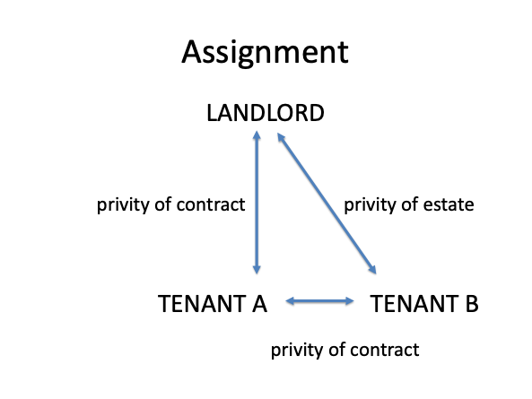
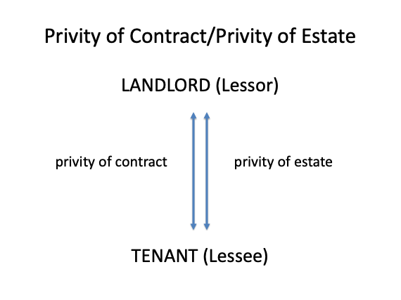

# Unit 10: Leases and Licences

<!-- 
**Commentary**
 -->

<!--  -->

<!-- {:target=" \_blank"} -->

!!! danger "Kim Comment"

    For Unit 10, **two (2) discussion posts** are due by end of day **Monday, November 23, 2025**. 

    Looking ahead, please note that just **one (1) post** is required **for each of Units 11 and 12**, which will both be due by **Wednesday, December 2, 2026**.

    For Unit 10, we are looking at leases and licenses, which are an interesting intersection of contract and property law.

    For this week, please familiarize yourselves with each of the following topics:

    - The Nature of a Lease
        - Can you recognize, define, and distinguish leases and licences?
        - What are the essential elements of a lease?
    - The Nature of the Landlord’s and Tenant’s Interests
        - What is the test for determining what forms part of a lease and thus runs with the land?
        - What are the “usual covenants” in a lease?
    - Obligations of Landlords and Tenants
        - What is the nature of the landlord’s covenant to provide “quiet enjoyment?
    - The Proprietary Status of Licences
        - What is the doctrine of proprietary estoppel?
    - Residential Tenancy Reform
        - What are the principal elements of statutory reform in residential tenancies?

**Leasehold** interests are among the oldest land-based interests in the common law, pre-dating the freehold interests such as the fee simple. Although ancient in origin, many of us experience our first formal interaction with land law through the signing of a residential tenancy agreement. 

The first three sections, on the nature of a lease and the interests and obligations of landlords and tenants, deal primarily with commercial leases. The fourth engages with the possibility that licences, which do not create property interests, might, in some circumstances, give rise to a proprietary status.

Statutory reforms have substantially modified the common law, at least so far as it applies to residential tenancies, and we turn to some of these reforms in the final section. 

## 10.1 The Nature of a Lease

Leasehold interests arise at the intersection or crossroads of contract law and property law. 

Through a contract, a lease agreement, the parties establish a set of rights and obligations that have the capacity, as a form of property, to be enforceable against the world. In a lease agreement, **one party (the lessor) grants the right of exclusive possession** for a defined period of time to a parcel of land; the other party (the lessee) agrees to pay rent. 

The right of exclusive possession held by the **lessee** is understood as **a property interest**: a leasehold interest. Leasehold interests are carved out of a larger interest, usually a freehold interest, but it is **also possible to create a leasehold interest from a longer leasehold interest.** 

The Theological Colleges at UBC had carved 99-year leases from the 999-year lease that they held from the University. When the lease ends, the holder of the freehold interest or the underlying leasehold interest resumes the right of possession.

**A. Privity of Estate**

How is it that the parties to a contract can create a property interest that has the potential to be enforceable against the world? 

One of the **cardinal principles** of contract law is **privity of contract:** that only the parties to a contract are bound by its terms. However, if the contract creates a lease, then the parties are also connected by **privity of estate.** 

It is the **privity of estate** that enables the extension of the rights created under contract to **extend beyond the parties to the contract.**

The distinction between assignments and subleases helps to illustrate how privity of estate works. 

At common law, **lessors (landlords)** and **lessees (tenants)** could **assign** their interests. 

- In the case of a lessor, it could assign the **income stream** and the **remainder interest** (the right to resume possession when the lease expires) to another party. 
- Similarly, the lessee could assign the **right of exclusive possession**. 

In either situation, there would be no privity of contract between the original party to the lease and the party taking the assignment of the lessor’s interest or the lessee’s interest. However, there would be privity of estate, meaning that the terms of the lease would remain binding.

**In the case of an assignment**, the party assigning its interest removes itself from the picture. However, in the example above, Tenant A might still be liable to the Landlord for breach of contract, such as the breach of a provision that prohibited the assignment of the lease. Given that a lease agreement involves a relationship between parties, **most assignments of a lease would involve the consent of the landlord, but that consent is not required at common law.**

**In the case of a sublease**, the original tenant remains, but transfers its right to exclusive possession to a third party. This creates a situation where there is privity of contract and privity of estate between the lessor and the lessee, and privity of contract and privity of estate between the lessee and the sub-lessee, but no relationship between the lessor and sublessee. The lessor’s remedies and the sub-lessee’s remedies for breach of a lease lie with the lessee, the original tenant.

**B. Leases and Licences**

A leasehold estate is a possessory interest in land with a fixed duration. Most commonly, the **duration** is fixed with **a specific term** (e.g., 12 months, 99 years), or with **a specific notice period** for termination (e.g., 1 month, 1 year). 

At its core, **a lease is a grant**, from a lessor (landlord) to a lessee (tenant), of a right to exclusive possession. Lease agreements include:

- a **grant** of exclusive possession; and
- **identification** of the:
    - parties;
    - the property;
    - the term;
    - the start date; and
    - rent (if any).

It is the grant of **exclusive possession** that differentiates a lease from a licence. While a lease confers exclusive possession, a licence conveys permission to do that which would otherwise amount to trespass. 

**A licence is a contractual right to enter the property of another** for a specified purpose. You acquire a licence when you purchase a ticket for a movie, the theatre, a soccer game, the ski-lift, *etc*. You also acquire an implied licence when you enter a retail store as a customer. The vendors at kiosks in the promenades of a shopping mall probably occupy these spaces under a licence rather than a lease. Why? Because the right to sell from a kiosk in the shopping mall is not a right to exclusive possession. Licences provide their holders with a defence against an action in trespass, but do not include a right to exclusive possession.

**A leasehold interest is also a property interest that will run with the land.** For example, if the lessor transfers its freehold interest, then the lease travels with and remains a burden on that freehold interest. By contrast, a licence is binding only on those who are parties to the agreement.

Another consequence of the distinction between a lease as a property interest and a licence as a contract is that a **lessee** who is wrongfully evicted from the lease may bring an action to **recover the estate** (the right to exclusive possession for the period of the lease) while a **licensee** will generally be limited to **recovering damages** for a licensor’s breach of contract.

Much of the time it may not matter whether an agreement creates a lease or a licence, but it comes to matter when there are statutory rights or obligations that arise in the context of leases but not licences. It may also become important on the sale of an interest in land if the purchaser contests the right of the occupant to remain. **The answer may depend on whether the occupant is occupying the space under a lease or licence.** These scenarios arise in the material that follows.

!!! note "Activity"

    Read the introductory material, the decision of the New Zealand Court of Appeal in ***Fatac Ltd. (in liquidation) v Commissioner of Inland Revenue***, and the comments that follow it, in the *Reader*, **634-43**. 

In ***Factac***, the court grapples with the issue of whether the grant included a right to exclusive possession. One of the **legal issues** revolves around the **role of intention**: 

> does it matter whether the parties to the contract intended to create a lease? 

There are two different lines of English authority on the importance of intention, one of which is captured in this passage from the English case of ***Street v Mountford***:

> *The manufacture of a five-pronged instrument for manual digging results in a fork even if the manufacturer, unfamiliar with the English language, insists that he intended to make and has made a spade.* (637)

Intention seems to be taking a back seat to the form, but the New Zealand Court of Appeal appears to send conflicting messages about the role of intention in this passage:

> Whether the occupier has the right to exclusive possession turns on the effect of the contract or grant. **The effect of the contract or grant is a matter of interpretation.** Interpretation is the search for the intention of the parties. The quarry is intention as to exclusive possession.

> It adds nothing to the exclusive possession test to say that the Court must search for the intention of the parties on that subject. (639)

What other factors, beyond a grant of exclusive possession, does the NZCA indicate in ***Fatac Ltd. (in liquidation) v Commissioner of Inland Revenue*** are important considerations in determining whether an instrument creates a lease? Can you list six?

As an aside, note the structure of this judgment: analysis of law, application to facts, conclusion.

!!! note "Activity"

    Once you’ve read ***Fatac***, then turn your attention to the agreement that was at issue in ***Metro-Matic Services Ltd. v. Hulmann***, [1973 CanLII 791 (ON CA)](https://canlii.ca/t/g13sg){:target=" \_blank"}, reproduced in the *Reader*, **641-43**. 

Does this agreement create a lease or a licence? Do the analysis yourself and then go to the decision of the Ontario Court of Appeal for its ruling.

The BC Court of Appeal in ***Pacific Wash-A-Matic v RO Booth Holdings***, mentioned in **comment page (643)**, suggest that the **form of the agreement**, if not determinative, is at least **still relevant**.

## 10.2 The Nature of the Landlord’s and Tenant’s Interests

A lease is a property interest created by contract that includes the grant of exclusive possession. Lease agreements commonly include other terms besides the grant of exclusive possession. Which of these other terms form part of the lease that runs with the land and thus have the potential to bind those who were not a party to the original contract?

The rule from ***Spencer’s Case*** (1538), 5 Co Rep 16, is that **all “real covenants” will run with the land.**

What are real covenants? They are **promises that “touch and concern” the leased property**. The material below includes an analysis from the Manitoba Court of Appeal on the meaning of **“ touch and concern” land**.

At common law, a tenant has a right to assign his or her leasehold interest. However, a common term in lease agreements is that the tenant must secure the landlord’s consent before assigning the lease, **consent that the landlord may not unreasonably withhold.** 

The material below includes excerpts from a decision of the Alberta Court of Appeal that considers the **factors that might allow a landlord to validly withhold its consent.**

!!! note "Activity"

    Read the introductory material and then ***Merger Restaurants v DME Foods Ltd*** in the *Reader*, **643-48**. 

The question for the Manitoba Court of Appeal is **whether the contractual obligation to provide parking stalls in proximity to the leased premises is a real covenant that forms part of the lease and thus binds the subsequent purchaser of the freehold interest.** 

Put another way, is the new landlord who acquired the freehold subject to the lease?

... the court’s conclusion about the importance of parking:

Applying the centuries-old rule [***Spencer’s Case***] to the circumstances of this appeal, I conclude that Merger’s common area rights touch or concern the demised premises. Parking facilities are so essential to the operation of Merger’s restaurant, and to the well-being of both Merger and Lakeview, that such rights cannot be considered merely collateral to the demise. **It is more than speculation to say that the common area rights immediately affect the nature, quality and value of the demised premises**; and that without parking facilities Merger’s restaurant and Lakeview’s shopping plaza on lot 2 would be doomed to failure...

A dispute over access to parking also drove the litigation in ***Sundance Investment Corp v Richfield Properties Ltd.*** The case involved a dispute over **whether the landlord had unreasonably withheld its consent to the tenant’s assignment of a lease.** The lease agreement provided as follows:

> *The Lessee shall not be entitled to assign this lease or sublet any portion of the demised premises without the prior written consent of the Lessor which consent shall not be arbitrarily or unreasonably withheld,* **however** *it is understood and agreed that the withholding of consent by the Lessor shall not be construed or pleaded as being unreasonable* **if the other major tenant** *occupying the building* **objects to the nature of the business** *to be conducted by any sub-tenant or assignee...*

!!! note "Activity"

    Read the excerpts from the reasons for decision of the majority and the dissent ***Sundance Investment Corp v Richfield Properties Ltd*** in the *Reader*, **648-55**. 

The majority ruled that it was not unreasonable for the landlord to withhold consent if providing consent would lead to a direct loss of income. The dissent replied that the landlord had assumed some portion of the risk when it agreed that Beaver Lumber’s rental payments would fluctuate with its net sales. Do you find the reasoning of the majority or the dissent more convincing?

## 10.3 Obligations of Landlords and Tenants

There is a large degree of contractual autonomy in establishing the terms of **lease**. However, there are some common terms, known as **“the usual covenants”**. These are:

- a landlord’s covenant to provide the tenant with **quiet possession**; and
- a **tenant’s covenant** to pay the rent, to maintain repair, to pay taxes, and to allow the landlord to enter to view the state of repair.

Implied terms will yield to express terms. Terms can also be incorporated under statute, either as **required** or as **implied terms.** 

- The latter will apply unless the parties explicitly **contract out** of them. 
- Parties **cannot contract out** of required terms.

**A. Quiet Enjoyment**

What is quiet enjoyment and what amounts to its breach? This was the question before the English House of Lords in ***Southwark LBC v Mills***. This case, and the one joined with it (***Baxter v Camden London Borough Council***), arose because of a lack of sound insulation between residential units. The street view image below from Google Earth shows the block of flats at issue in Baxter.

!!! note "Activity"

    Read the decision and the comments that follow in the *Reader*, **656-65**.

According to the House of Lords, **the covenant to provide “quiet enjoyment” does not literally mean “quiet,” but rather “without interference, without interruption of possession.”** 

Review the discussion of the Canadian approach in the comments, including the case of ***Pellatt v Monarch Investments*** that involved a law student, Anna Pellatt, who successfully established that **indirect interference (including noise) may create the conditions for a breach** of the covenant for quiet enjoyment.

Note Lord Hoffman’s comment about the institutional limits of the common law. Perhaps in a somewhat delayed response to these comments, but more directly as a response to the Grenfell Tower fire in London in 2017, which killed more than 70 people, the Parliament of the United Kingdom is considering a bill, [*Homes (Fitness for Human Habitation and Liability for Housing Standards) Bill 10 2017-19*](https://www.legislation.gov.uk/ukpga/2018/34/enacted){:target=" \_blank"}, to amend the *Landlord and Tenant Act 1985* by introducing an implied covenant in residential leases that a leased dwelling “is fit for human habitation at the time the lease is granted or otherwise created”.

*British Columbia’s Residential Tenancy Act*, [SBC 2002, c 78](https://www.bclaws.gov.bc.ca/civix/document/id/complete/statreg/02078_01){:target=" \_blank"}, provides as follows:

> **32(1)** A landlord must provide and maintain residential property in a state of decoration and repair that 
> (a) complies with the health, safety and housing standards required by law, and 
> (b) having regard to the age, character and location of the rental unit, makes it suitable for occupation by a tenant.

Do you think this provides sufficient protection for a residential tenant?

**B. Non-Derogation of the Grant**

The case of ***Petra Investments Ltd v Jeffrey Rogers plc*** involved a tenant’s claim that the landlord, in failing to maintain the shopping mall as a location for high-end women’s fashion, was in breach of an implied obligation not to derogate from its grant. In short, **the grant included the landlord’s covenant to maintain the particular character of the shopping mall.** 

!!! note "Activity"

    Read comments 6 and 7 in the *Reader*, **663-65**, including the short excerpt from the decision in ***Petra Investments*** and another from the decision of the SCC in ***Clark’s Gamble of Canada Ltd v Grant Park Plaza Ltd.*** 

Note the reluctance of the both courts to read in provisions into the lease that might have been, but were not included.

## 10.4 The Proprietary Status of Licences

Having opened this unit on the important distinction between leases as property interests that run with the land and licences as agreements with remedies in contract for breach, but not property, it may now seem odd to turn to a discussion of the proprietary status of licences. 

However, through the working of a doctrine known as **proprietary estoppel**, the grant of a licence may give rise to certain proprietary entitlements that will bind subsequent purchasers of the land who were not parties to the agreement creating the licence.

!!! note "Activity"

    Read the excerpts from the British Columbia Supreme Court decision in ***Stiles v Tod Mountain Development Ltd***, and the comments that follow it in the *Reader*, **681-89**. 

Tod Mountain, known as Skwelkwekwelt among the Secwepemc (Shuswap) Nation, is now part of Sun Peaks Resort. The photograph below is from the early days of the ski resort, when it was still known as Tod Mountain and when Highland Development granted a permit to Stiles to select, occupy, and build on a lot in a proposed subdivision.

The principal **issue** in the case was **whether Tod Mountain Development, as the successor in title to Highland Development, was bound by Highland’s grant of a permit to Stiles.** 

This is how the court explains the **doctrine of proprietary estoppel:**

Thus, where a party expends money on the land of another under an expectation created or encouraged by the owner, or even where the landowner merely stands silent, the authorities establish that **proprietary estoppel may found a cause of action**, 

- a revocable licence may be rendered irrevocable, or 
- the party’s interest may be found in a licence coupled with an equity, 
- the circumstances may establish a contract between the parties, or 
- equity may require that the fee simple be transferred.

In what circumstances will the interest bind a successor in title? In other words, why is it that the court is prepared to find that Tod Mountain Development is bound by the agreement between Highland Development and Stiles?

!!! danger ""

    **Tod Mountain Development had notice.**

    > It is abundantly clear that Development **took title with notice of Mr Stiles’ equity**. When it took title, Mr Stiles’ improvements were in place and he was occupying them. That must have put Development on notice that he had reached some agreement with a predecessor in title with respect to his occupation of Lot 7. (685)

    > The personal rights created as between Stiles and Highland are **enforceable** against Development b**ecause it took title with notice** of them... (686)

## 10.5 Residential Tenancy Reform

The common law has not been a friend to residential tenants. Indeed, the earlier cases involving quiet enjoyment reveal the reluctance of common law courts to shape the law in a manner that protects the interests of residential tenants. 

It was not until the late 1960s and 1970s that the legislatures of Canadian provinces began to pass **legislation** to create **protections for residential tenants** that common law judges had refused provide. 

In British Columbia, those protections are found in the *Residential Tenancy Act*, [SBC 2002, c 78](https://www.bclaws.gov.bc.ca/civix/document/id/complete/statreg/02078_01){:target=" \_blank"}, or the regulations made under this *Act*.

Two issues of particular concern for tenants are **rent increases** and **a lack of security of tenure**. Jurisdictions have responded in various ways to these concerns, including through the effort to control rent and constrain a landlord’s ability to evict a tenant.

- **Rent control**
    - In British Columbia, there are statutory controls on rent that limit increases in rent for tenants in their existing premises under a continuing lease. 
    - Before 2019, rent increases were limited to the rate of **inflation plus 2%** once every 12 months. Beginning in 2019, rent increases were limited to the **rate of inflation**. However, in 2023, with the rate of inflation significantly higher than it had been in many years, the province limited the annual rent increase to **a maximum of 2%.** 
    - See the *Residential Tenancy Act*, [SBC 2002, c 78](https://www.bclaws.gov.bc.ca/civix/document/id/complete/statreg/02078_01){:target=" \_blank"}, ss 40-43, and the *Residential Tenancy Regulation*, [BC Reg 477/2003, s 22](https://www.bclaws.gov.bc.ca/civix/document/id/complete/statreg/477_2003){:target=" \_blank"}.

- **Security of Tenure**
    - One way of providing tenants with additional security of tenure is to place **restrictions on the capacity of a landlord to evict a tenant**. 
    - In British Columbia, this protection takes the form or a rule that prevents landlords from evicting tenants except 
        - for non-payment of rent, 
        - for “cause”, if the tenant’s employment with the landlord ends, or 
        - if the landlord intends to occupy the premises. 
    
    (See the *Residential Tenancy Act*, [SBC 2002, c 78](https://www.bclaws.gov.bc.ca/civix/document/id/complete/statreg/02078_01){:target=" \_blank"}, ss. 46-49.)

!!! note "Activity"

    Review the provisions cited above in the *Residential Tenancy Act*, [SBC 2002, c 78](https://www.bclaws.gov.bc.ca/civix/document/id/complete/statreg/02078_01){:target=" \_blank"} and *Residential Tenancy Regulation*, [BC Reg 477/2003, s 22](https://www.bclaws.gov.bc.ca/civix/document/id/complete/statreg/477_2003){:target=" \_blank"}. 

Can you connect the protections for residential tenants to one or more of the justifications for property? Do they help to explain why we provide additional protections for residential tenants that we do not also extend to commercial tenants? Are they adequate?

Some landlords circumvented the restrictions on rent increases by requiring tenants to agree to fixed term tenancies that included a clause that tenants must vacate the premises at a certain date, even when the landlords had no intention of requiring the tenants to vacate the property. Instead, the landlords would require that the tenants enter into a new lease agreement at a new rent that, because it was set within a new agreement, could involve a rent increase above the maximum allowed under the *Act* and *Regulations*. 

In 2017, the provincial government **closed this loophole**. Identify the provisions that closed this loophole.

!!! danger ""

    *Residential Tenancy Act*, [SBC 2002, c 78](https://www.bclaws.gov.bc.ca/civix/document/id/complete/statreg/02078_01){:target=" \_blank"}, **s 97(2)(a.1)** and *Residential Tenancy Regulation*, [BC Reg 477/2003, s 22](https://www.bclaws.gov.bc.ca/civix/document/id/complete/statreg/477_2003){:target=" \_blank"}, **s 13.1(2)**

If you are interested, there is more information on evictions and the grounds for evictions on BC Tenant Resource & Advisory Centre (Tract). See “[Evictions](https://tenants.bc.ca/your-tenancy/evictions/){:target=" \_blank"}”.

Many of the statutory protections for tenants are incorporated in the [standard form Residential Tenancy Agreement](https://www2.gov.bc.ca/assets/gov/housing-and-tenancy/residential-tenancies/forms/rtb1.pdf){:target=" \_blank"}. for British Columbia. Look over the standard for agreement. Note that it begins with the essential elements of a lease: the parties, the property, the duration, and the rent.

The standard form agreement is based on the [Schedule](https://www.bclaws.gov.bc.ca/civix/document/id/complete/statreg/477_2003#Schedule){:target=" \_blank"} in the *Residential Tenancy Regulation*, [BC Reg 477/2003, s 22](https://www.bclaws.gov.bc.ca/civix/document/id/complete/statreg/477_2003){:target=" \_blank"} that, under section **13(1.1)**, sets out the prescribed standard terms. 

Next, turn to British Columbia’s *Residential Tenancy Act*, [SBC 2002, c 78](https://www.bclaws.gov.bc.ca/civix/document/id/complete/statreg/02078_01){:target=" \_blank"}, **s 12**, which provides “the standard terms are terms of every tenancy agreement.” Have a look in the definitions section for the definition of “standard terms”. Where does it direct you?

!!! danger ""

    To the *Residential Tenancy Regulation*, [BC Reg 477/2003, s 22](https://www.bclaws.gov.bc.ca/civix/document/id/complete/statreg/477_2003){:target=" \_blank"}.

Turn back to the *Residential Tenancy Act*, [SBC 2002, c 78](https://www.bclaws.gov.bc.ca/civix/document/id/complete/statreg/02078_01){:target=" \_blank"}, sections 2 and 4, for an indication about the coverage of the Act. Why do you think university residences are excluded?

Residential tenancy reform has not proceeded everywhere. One jurisdiction in the US, Arkansas, provides landlords with access to criminal sanctions if tenants do not pay rent.

- What about providing tenants with access to criminal sanctions for landlords who breach the residential tenancy contract?
- Under the law of master & servant in the 19th century, employers had access to criminal sanctions for an employee’s breach of the employment contract. Is there a role for criminal law as a sanction for breach of contract?

## 10.6 Review Quiz

!!! danger "Quiz"

    1. Rent is a required element of a lease. 
        - [ ] True
        - [x] False

    2. There is privity of estate between the original landlord and a subtenant.
        - [ ] True
        - [x] False

    3. A licence is an interest in land. 
        - [ ] True
        - [x] False

    4. In order for a provision in a lease to be a real covenant, the provision must touch and concern land.
        - [x] True
        - [ ] False

    5. A landlord’s obligation to provide a tenant with “quiet enjoyment” of the leased premises requires the landlord to ensure that the premises are quiet.
        - [ ] True
        - [x] False

    6. At common law, a tenant must secure the consent of the landlord to assign a lease and the landlord must not unreasonably refuse their consent.
        - [ ] True
        - [x] False

    7. Landlords have a remedy against sub-tenants if the rent is not paid.
        - [ ] True
        - [x] False

    8. In a lease agreement it is only the real covenants, *i.e.*, those provisions that touch and concern land, that will bind the assignee of a lease.
        - [x] True
        - [ ] False

    9. The covenant of quiet enjoyment in a lease is the commitment by the tenant not to disturb other tenants.
        - [ ] True
        - [x] False

    10. In British Columbia, rent control only applies to tenants in a continuing lease.
        - [x] True
        - [ ] False

## Textbook Summary

**Chapter 8. Leases, Licences, and Bailments**

**8:1. Introduction**

In the case of **leasehold estates**, the **duration is determined**, commonly by a term of years, and this differentiates them from **freehold estates**, which are defined (by a measuring life, in the case of a **life estate**, or so long as there are heirs, in the case of a **fee simple**), but not determined.

Leasehold estates exist at the intersection between contract law and property law. Leases are created through a lease agreement, a contract, that produces a property interest. As such, the terms of the lease agreement may be enforceable against those who are not party to the contract. 

The doctrines of **privity of contract** and **privity of estate** lie at the core of determining what obligations exist between landlords and tenants, and what will bind subsequent owners of the freehold or leasehold interest. It is the capacity of **a lease contract to generate privity of estate** that produces obligations which are said to **“run with the land”** at common law.

**8:2. The Nature of a Lease**

There are four kinds of leases recognised at common law: 

- a **fixed term** lease (e.g., for ten years), 
- a **periodic** lease (such as from month-to-month and which continues until terminated with notice, usually set at the length of the period), 
- a **tenancy at will** (a tenancy with no set term that continues by mutual agreement and which may be terminated at any time by either the landlord or tenant), and 
- a **tenancy at sufferance** (which arises when a tenant overholds after the expiration of a term). The tenancy at sufferance, where this is no agreement but where a landlord does not exercise its right to repossess the property, is somewhat fictional. 
- A **perpetual** lease, being by definition without a certain term, can be created by statute; it is a creature **unknown to the common law**.

When the tenancy is for a fixed term, its starting date must be ascertainable, and its **maximum duration must be certain or ascertainable** at the commencement of the term: see ***Black v. Blair Athol Farms Ltd.***, [1996 CanLII 17978 (MB CA)](https://canlii.ca/t/gc2jd){:target=" \_blank"}, where the leading authorities are cited.

A lease must also contain a grant (a demise) of exclusive possession. It is the **grant of exclusive possession** that distinguishes a **lease** from a **licence**, a distinction that lay at the heart of the decision from the New Zealand Court of Appeal in ***Fatac Ltd. (in liquidation) v Commissioner of Inland Revenue***, below.

!!! info "***Fatac Ltd. (in liquidation) v Commissioner of Inland Revenue***, [2002] NZCA 269"

    This case is mainly about the distinction between **tenancies** and **licences**. The distinguishing feature of a tenancy always used to be the right to exclusive possession. ...The conclusion reached in this judgment is that **it is time to return to exclusive possession as the fundamental test.**

    **Distinction between tenancy and licence**

    In its conventional sense a **tenancy** is an interest in land conferring the right to possess it for a limited period. A **licence** is a mere permission to be on the land, with or without additional permission to perform specified acts there. **The former creates an estate in the land; the latter does not.**

    The distinction has usually assumed significance for occupiers who would enjoy **statutory protection against eviction** only if they were tenants rather than licensees.

    Analysis of the case law reveals a series of ancillary principles for the purpose of distinguishing tenancies from licences. None of these, however, undermines **exclusive possession as the fundamental test.** 

    **Rent** would seem relevant to the presence or absence of an intention to be legally bound but **not a precondition** for a tenancy *per se*.

    **Limitations** upon the purposes to which the occupier can put the land **do not negate a tenancy**: ***Glenwood Lumber Co Ltd v. Phillips***, *supra*, at 408–409 (P.C.). Exclusive possession is not synonymous with an unqualified range of permitted uses. 
    
    **Equally consistent** with the critical role of exclusive possession is the **refusal to recognise a tenancy**, 
    
    - where the owner is **prevented by statute from granting** a tenancy (***Street v. Mountford*** at 821), 
    - where the landlord's right of entry to provide services is **inconsistent with exclusive possession** (*ibid*., at 818, 824–825), or 
    - where the right to exclusive possession **can be terminated** pursuant to some legal relationship **extraneous** to that of landlord and tenant.

    We would see the **last point** as the rationale for withholding recognition as a tenancy, 
    
    - where an employee occupies an employer's premises in order to perform the employee's duties (***Street v. Mountford*** at 818), 
    - where there is a purchaser in occupation pursuant to an agreement for sale and purchase (*ibid*., at 826–827), 
    - where occupation is incidental to the holding of an office, and where there is a mortgagee in possession (*ibid*., at 818). 

    In all of these cases the owner has the legal right to terminate occupation for reasons extraneous to any conventional relationship as landlord and tenant.

    An **express right to enter and inspect** can imply a general foundation of exclusive possession to which exceptions must be expressly stated (*ibid*., at 568). 
    
    **Conversely**, a requirement that the occupier not impede the owner's “right of possession and control” (***Shell-Mex & BP Limited v. Manchester Garages Limited***, *supra*, at 616), or that the occupier **move** from one part of the premises to another **at the owner's direction** (***Dresden Estates Limited v. Collinson*** [1987] 1 E.G.L.R. 45 (C.A.) at 47), **tends to negate exclusive possession.**

    ...in all cases of that type where the occupier is found to have **a mere licence**, it will be because the initial appearance of a right to **exclusive possession** is found to be critically **undermined** by the potential for termination **for reasons extraneous** to the occupation of the exclusively occupied area. A tenant is safe if he pays the rent and other specified outgoings and observes all covenants relating to use of the property. Not so an employee, purchaser, mortgagee, office holder or business partner. **In the latter cases possession is defeasible for reasons unconnected with tenancies.**

    **Conclusions**

    Our conclusion is that in this country, as elsewhere, the fundamental distinction between a tenant and a licensee is that the former alone has the right to **exclusive possession**. For exclusive possession to be meaningful **there must be a minimum finite term**, whether fixed or periodic. **Rent** is an important indicator of an intention to be legally bound but its absence **does not *per se* negate a tenancy.**

    **Restrictions** upon the use to which the occupier may put the land are not inconsistent with exclusive possession. **On the other hand** there will be no tenancy where there is **no intention** to enter into a legally binding relationship or where a **tenancy is precluded** by statute.

    There will similarly be **no tenancy** where the occupier's right to possession may be **terminated for reasons extraneous** to the occupation of the land.

According to the New Zealand Court of Appeal, the grant of exclusive possession lies at the heart of a lease. In determining whether the parties to a contract have created a lease, therefore, **the issue is not what the parties said they were doing, but what they did.**

In ***Pacific Wash-A-Matic Ltd. v. R.O. Booth Holdings Ltd.***, [1979 CanLII 632 (BC CA)](https://canlii.ca/t/24cdc){:target=" \_blank"}, the British Columbia Court of Appeal ruled that **an agreement to permit the installation of washing machines in a residential apartment building**, an arrangement nearly identical to that in ***Metro-Matic Services Ltd. v. Hulmann***, [1973 CanLII 791 (ON CA)](https://canlii.ca/t/g13sg){:target=" \_blank"}, **was a licence, not a lease.** ...the BCCA wrote:

> **It does not grant to the respondent any portion** by way of a demise of the apartment building in question. It does no more, in my view, than grant a licence to the respondent to place its machines in the building and to come on to service them and inspect them and collect the proceeds in the form of coins deposited by the tenants in using the machines.

In ***Birch Hills Hotel Ltd. v. Top Hat Amusements Ltd.***, [1980 CanLII 2359 (SK QB)](https://canlii.ca/t/g8q8j){:target=" \_blank"}, the Saskatchewan Court of Queen’s Bench also considered and distinguished the decision in ***Metro-Matic Services Ltd. v. Hulmann***, [1973 CanLII 791 (ON CA)](https://canlii.ca/t/g13sg){:target=" \_blank"} in ruling that a “Shuffleboard Agreement”, **which granted permission to install shuffleboard equipment in a hotel bar, was licence, not a lease.** The Court explained its ruling as follows:

> ... the other is in the nature of a licence for a concession or a location contract to install equipment. 
> The “Shuffleboard Agreement”, on the other hand, “grants to the Licensee an exclusive right, License and franchise, and leases to the Licensee sufficient space therefore (sic), **to install and operate ... equipment for use by the Licensor’s patrons”**, no specified or defined or established room or space, but only “sufficient space”. ... There is no exclusive possession given by the “Shuffleboard Agreement”.

... the ONSC in ***Orangeville Railway v City of Mississauga***, [2015 ONSC 5655](https://canlii.ca/t/gllx1){:target=" \_blank"} also reiterates the importance of determining whether there has been a grant of exclusive possession:

The character of the relationship does not depend on what the document is called, or whether the word lease is found in the language used by the parties to the agreement. 

The relationship between a lessor and lessee, as distinct from that of a licensor and a licensee, where **there is a transfer of an estate** in the subject land from the lessor to the lessee, and the **granting of exclusive possession** and control of that land to the lessee.

**8:5. The Nature of the Landlord's and Tenant's Interests**

Under a tenancy, the lessee obtains a leasehold interest in the land. This confers upon the lessee a right of exclusive possession, a right that is good against even the lessor. **At common law, the right of the lessor to enter the premises** (say, to inspect the state of repair) **must be negotiated with the lessee.**

The interest in the property held by lessor under a lease， the right to resume possession at the end of the lease， is referred to as a **reversion**, and both that right and the leasehold interest may be transferred. 

A transfer of the leasehold can occur in two distinct ways: 

- the tenant may transfer the remainder of the term (called an assignment), or 
- some smaller portion (a sub-lease). 

When an assignment is made, the **assignee** will be placed in a direct tenurial relationship with the **original landlord**. There is **no privity of contract** between these two parties as there was with the original parties, but there is what is called **“privity of estate”**. 

In the case of a sub-lease, the original tenant retains an interest in the lease. That tenant now wears two hats: as tenant under the original (or head) lease, and as sub-landlord to the sub-tenant. 

All else being equal, an assignee's liability as against the landlord is controlled by the privity of estate that exists between them. The common law rule, established in ***Spencer's Case*** (1583), 5 Co Rep 16, 77 ER 72 (United Kingdom), is that all of the **“real covenants” in the lease run with an assignment.** 

**A real covenant is one that is said to touch and concern the leased property.**

There is no privity of contract or estate between the landlord and a sub-tenant. Therefore, a default by a sub-tenant gives the landlord no direct recourse against that person. In sum, when a breach of the sub-lease leads to a breach of the head lease, the landlord can pursue a remedy against the head tenant, who can, in turn, seek a remedy from the sub-tenant.

The decision of the Manitoba Court of Appeal in M***erger Restaurants v DME Foods Ltd.*** involved a dispute over whether the parking provisions in the lease agreement for a building in which to operate a restaurant were real covenants.

!!! info "***Merger Restaurants v. D.M.E. Foods Ltd.***, [1990 CanLII 7997 (MB CA)](https://canlii.ca/t/g9zhg){:target=" \_blank"}"

    ... the issues that arise on the appeal may be stated:

    - Do the provisions in **Merger**'s lease restrict the use of the parking areas in lot 2 to Merger and other tenants of lot 2, and their employees and invitees?
    - Is **Lakeview** entitled, from time to time, to alter the common areas, including parking spaces, on lot 2, and to designate parking spaces on lot 2 for the exclusive use of Bonanza Restaurant and its patrons?

    A third issue, is the question as to whether the **provision** in the **Merger** lease granting common area rights to **Merger** is **a covenant running with the land**, and consequently binding upon **Lakeview** as the successor in title to the lessor?

    Although similar in some respects to the case on appeal, ***Kontogonis Hldg. Ltd. v. North West Trust Co.***, 38 A.C.W.S. (2d) 273, B.C.S.C., 29th May 1986 can be distinguished. **Firstly**, it would appear that the restaurant in ***Kontogonis*** occupied premises in a commercial building, not in a shopping plaza. **Secondly**, the lease in ***Kontogonis*** obligated the landlord to provide a suitable area for parking; it did not grant common area rights to the restaurant.

    The traditional test for a **covenant** to run with the land is that it must **“touch or concern”** the subject matter of the lease: ***Spencer's Case*** (1583), 5 Co. Rep. 16a, 77 E.R. 72. His Honour Judge Forbes, in The General Law of Landlord and Tenant, 7th ed. (1947 Hamish Hamilton Law Books), notes that to **run with the land, covenants must either affect the land itself**, that is, the “nature, quality or value” of the thing demised (see ***Dyson v. Forster***, [1909] A.C. 98 (H.L.)); **or the value of the land at the end of the term** (see ***Congleton Corp. v. Pattison*** (1808), 10 East 130, 103 E.R. 725).

    There can be no doubt that the extent and availability of parking spaces in a shopping plaza will directly affect the nature and value of the land.

    The passage of time has not affected the rule of law laid down in ***Spencer's Case*** that covenants which touch or concern the land run with the land and are binding upon successors in title.

In P. & A. Swift Investments v Combined English Stores Group Plc (1989), 1 AC 632 (HL) (United Kingdom) at p 642, the House of Lords (per Lord Oliver of Aylmerton) provided this **definition of the touch and concern** requirement:

... the following provides a satisfactory working test for whether, in any given case, a covenant touches and concerns the land:  

- (1) the covenant benefits only the reversioner for time being, and if separated from the reversion ceases to be of benefit to the covenantee; 
- (2) the covenant affects the nature, quality, mode of user or value of the land of the reversioner; 
- (3) the covenant is not expressed to be personal (that is to say neither being given only to a specific reversioner nor in respect of the obligations only of a specific tenant); 
- (4) the fact that a covenant is to pay a sum of money will not prevent it from touching and concerning the land so long as the three foregoing conditions are satisfied and the covenant is connected with something to be done on, to or in relation to the land.

!!! info ""

    It works both ways. A covenant can "touch and concern" either the landlord’s reversion or the tenant’s leasehold estate, it simply depends on which party is trying to enforce the covenant (or is bound by it) after an assignment.

At common law, a lessee has the right to alienate the remainder of the lease. However, a given lease might limit, even eliminate, the lessee’s rights of transfer. **It is common for the right to transfer to require the consent of the landlord** with the proviso that the landlord’s consent **cannot be unreasonably withheld**.

!!! info "***Sundance Investment Corporation Ltd. v. Richfield Properties Limited***, [1983 ABCA 33 (CanLII)](https://canlii.ca/t/2f0t8){:target=" \_blank"}"

    The **issue** in this appeal is whether the respondent Richfield Properties Limited has **unreasonably withheld its consent to a proposed sublease** by its lessee, the appellant Sundance Investment Corporation Ltd.

    Under the terms of the head lease between Richfield and Sundance, Sundance may **not assign or sublease** any of the lease premises **without the prior written consent of the lessor**. This consent is not to be “arbitrarily or unreasonably withheld” with the further qualification that **a withholding of consent is deemed not to be unreasonable if the other major tenant objects** to the “nature of the business” to be carried on by the proposed sub-tenant.

    The **principles of law** on the issue of **unreasonable withholding of consent** to a sublease are adequately reviewed by Egbert J. in ***Coopers & Lybrand Ltd. v. William Schwartz Const. Co. Ltd.*** (1980), 36 C.B.R. (N.S.) 265, 116 D.L.R. (3d) 450.

    The **first principle** ... The landlord is not bound to give any reason for refusing his consent to an assignment: **the burden of proof is on the tenant** to show that the landlord has **unreasonably** withheld his consent, and is not on the landlord to prove that he was justified in withholding it.

    The second principle ... the landlord may rely on **any reason, if genuine, for refusal**, whether or not earlier told to the tenant.

    **Harradence JA (dissenting):**

    However, the term **“nature of the business” cannot be extended so far** as to include something inherent in every business.

    Moreover, when the provision in question is examined, the manner in which it has been drawn bears a strong implication that the **essential element in it is prevention of destructive competition.**

    ... it is of the greatest importance that a provision restricting subletting is a restraint on alienation. **A preferable construction is one which imposes fewer restraints rather than more.**

    In the view which I take of this case, the landlord was, at the time the lease was executed, prepared to assume the risk of expansion of Sundance's business and was bound by that assumption of risk. **Had the parking difficulties emerged as a result of the expansion of the business of Sundance the landlord would be unable to interfere.**

    

