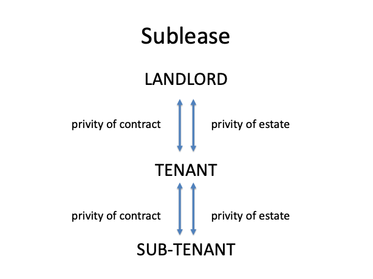

# Unit 10: Leases and Licences

<!-- 
**Commentary**
 -->

<!--  -->

!!! danger "Kim Comment"

    For Unit 10, **two (2) discussion posts** are due by end of day **Monday, November 23, 2025**. 

    Looking ahead, please note that just **one (1) post** is required **for each of Units 11 and 12**, which will both be due by **Wednesday, December 2, 2026**.

    For Unit 10, we are looking at leases and licenses, which are an interesting intersection of contract and property law.

    For this week, please familiarize yourselves with each of the following topics:

    - The Nature of a Lease
        - Can you recognize, define, and distinguish leases and licences?
        - What are the essential elements of a lease?
    - The Nature of the Landlord’s and Tenant’s Interests
        - What is the test for determining what forms part of a lease and thus runs with the land?
        - What are the “usual covenants” in a lease?
    - Obligations of Landlords and Tenants
        - What is the nature of the landlord’s covenant to provide “quiet enjoyment?
    - The Proprietary Status of Licences
        - What is the doctrine of proprietary estoppel?
    - Residential Tenancy Reform
        - What are the principal elements of statutory reform in residential tenancies?

**Leasehold** interests are among the oldest land-based interests in the common law, pre-dating the freehold interests such as the fee simple. Although ancient in origin, many of us experience our first formal interaction with land law through the signing of a residential tenancy agreement. 

The first three sections, on the nature of a lease and the interests and obligations of landlords and tenants, deal primarily with commercial leases. The fourth engages with the possibility that licences, which do not create property interests, might, in some circumstances, give rise to a proprietary status.

Statutory reforms have substantially modified the common law, at least so far as it applies to residential tenancies, and we turn to some of these reforms in the final section. 

## 10.1 The Nature of a Lease

Leasehold interests arise at the intersection or crossroads of contract law and property law. 

Through a contract, a lease agreement, the parties establish a set of rights and obligations that have the capacity, as a form of property, to be enforceable against the world. In a lease agreement, **one party (the lessor) grants the right of exclusive possession** for a defined period of time to a parcel of land; the other party (the lessee) agrees to pay rent. 

The right of exclusive possession held by the **lessee** is understood as **a property interest**: a leasehold interest. Leasehold interests are carved out of a larger interest, usually a freehold interest, but it is **also possible to create a leasehold interest from a longer leasehold interest.** 

The Theological Colleges at UBC had carved 99-year leases from the 999-year lease that they held from the University. When the lease ends, the holder of the freehold interest or the underlying leasehold interest resumes the right of possession.

**A. Privity of Estate**

How is it that the parties to a contract can create a property interest that has the potential to be enforceable against the world? 

One of the **cardinal principles** of contract law is **privity of contract:** that only the parties to a contract are bound by its terms. However, if the contract creates a lease, then the parties are also connected by **privity of estate.** 

It is the **privity of estate** that enables the extension of the rights created under contract to **extend beyond the parties to the contract.**

The distinction between assignments and subleases helps to illustrate how privity of estate works. 

At common law, **lessors (landlords)** and **lessees (tenants)** could **assign** their interests. 

- In the case of a lessor, it could assign the **income stream** and the **remainder interest** (the right to resume possession when the lease expires) to another party. 
- Similarly, the lessee could assign the **right of exclusive possession**. 

In either situation, there would be no privity of contract between the original party to the lease and the party taking the assignment of the lessor’s interest or the lessee’s interest. However, there would be privity of estate, meaning that the terms of the lease would remain binding.

**In the case of an assignment**, the party assigning its interest removes itself from the picture. However, in the example above, Tenant A might still be liable to the Landlord for breach of contract, such as the breach of a provision that prohibited the assignment of the lease. Given that a lease agreement involves a relationship between parties, **most assignments of a lease would involve the consent of the landlord, but that consent is not required at common law.**

**In the case of a sublease**, the original tenant remains, but transfers its right to exclusive possession to a third party. This creates a situation where there is privity of contract and privity of estate between the lessor and the lessee, and privity of contract and privity of estate between the lessee and the sub-lessee, but no relationship between the lessor and sublessee. The lessor’s remedies and the sub-lessee’s remedies for breach of a lease lie with the lessee, the original tenant.

## B. Leases and Licences

A leasehold estate is a possessory interest in land with a fixed duration. Most commonly, the **duration** is fixed with **a specific term** (e.g., 12 months, 99 years), or with **a specific notice period** for termination (e.g., 1 month, 1 year). 

At its core, **a lease is a grant**, from a lessor (landlord) to a lessee (tenant), of a right to exclusive possession. Lease agreements include:

- a **grant** of exclusive possession; and
- **identification** of the:
    - parties;
    - the property;
    - the term;
    - the start date; and
    - rent (if any).

It is the grant of **exclusive possession** that differentiates a lease from a licence. While a lease confers exclusive possession, a licence conveys permission to do that which would otherwise amount to trespass. 

**A licence is a contractual right to enter the property of another** for a specified purpose. You acquire a licence when you purchase a ticket for a movie, the theatre, a soccer game, the ski-lift, *etc*. You also acquire an implied licence when you enter a retail store as a customer. The vendors at kiosks in the promenades of a shopping mall probably occupy these spaces under a licence rather than a lease. Why? Because the right to sell from a kiosk in the shopping mall is not a right to exclusive possession. Licences provide their holders with a defence against an action in trespass, but do not include a right to exclusive possession.

**A leasehold interest is also a property interest that will run with the land.** For example, if the lessor transfers its freehold interest, then the lease travels with and remains a burden on that freehold interest. By contrast, a licence is binding only on those who are parties to the agreement.

Another consequence of the distinction between a lease as a property interest and a licence as a contract is that a **lessee** who is wrongfully evicted from the lease may bring an action to **recover the estate** (the right to exclusive possession for the period of the lease) while a **licensee** will generally be limited to **recovering damages** for a licensor’s breach of contract.

Much of the time it may not matter whether an agreement creates a lease or a licence, but it comes to matter when there are statutory rights or obligations that arise in the context of leases but not licences. It may also become important on the sale of an interest in land if the purchaser contests the right of the occupant to remain. **The answer may depend on whether the occupant is occupying the space under a lease or licence.** These scenarios arise in the material that follows.

!!! note "Activity"

    Read the introductory material, the decision of the New Zealand Court of Appeal in ***Fatac Ltd. (in liquidation) v Commissioner of Inland Revenue***, and the comments that follow it, in the *Reader*, **634-43**. 

In ***Factac***, the court grapples with the issue of whether the grant included a right to exclusive possession. One of the **legal issues** revolves around the **role of intention**: 

> does it matter whether the parties to the contract intended to create a lease? 

There are two different lines of English authority on the importance of intention, one of which is captured in this passage from the English case of ***Street v Mountford***:

> *The manufacture of a five-pronged instrument for manual digging results in a fork even if the manufacturer, unfamiliar with the English language, insists that he intended to make and has made a spade.* (637)

Intention seems to be taking a back seat to the form, but the New Zealand Court of Appeal appears to send conflicting messages about the role of intention in this passage:

> Whether the occupier has the right to exclusive possession turns on the effect of the contract or grant. **The effect of the contract or grant is a matter of interpretation.** Interpretation is the search for the intention of the parties. The quarry is intention as to exclusive possession.

> It adds nothing to the exclusive possession test to say that the Court must search for the intention of the parties on that subject. (639)

What other factors, beyond a grant of exclusive possession, does the NZCA indicate in ***Fatac Ltd. (in liquidation) v Commissioner of Inland Revenue*** are important considerations in determining whether an instrument creates a lease? Can you list six?

As an aside, note the structure of this judgment: analysis of law, application to facts, conclusion.

!!! note "Activity"

    Once you’ve read ***Fatac***, then turn your attention to the agreement that was at issue in ***Metro-Matic Services Ltd. v. Hulmann***, [1973 CanLII 791 (ON CA)](https://canlii.ca/t/g13sg){:target=" \_blank"}, reproduced in the *Reader*, **641-43**. 

Does this agreement create a lease or a licence? Do the analysis yourself and then go to the decision of the Ontario Court of Appeal for its ruling.

The BC Court of Appeal in ***Pacific Wash-A-Matic v RO Booth Holdings***, mentioned in **comment page (643)**, suggest that the **form of the agreement**, if not determinative, is at least **still relevant**.

## 10.2 The Nature of the Landlord’s and Tenant’s Interests

A lease is a property interest created by contract that includes the grant of exclusive possession. Lease agreements commonly include other terms besides the grant of exclusive possession. Which of these other terms form part of the lease that runs with the land and thus have the potential to bind those who were not a party to the original contract?

The rule from ***Spencer’s Case*** (1538), 5 Co Rep 16, is that **all “real covenants” will run with the land.**

What are real covenants? They are **promises that “touch and concern” the leased property**. The material below includes an analysis from the Manitoba Court of Appeal on the meaning of **“ touch and concern” land**.

At common law, a tenant has a right to assign his or her leasehold interest. However, a common term in lease agreements is that the tenant must secure the landlord’s consent before assigning the lease, **consent that the landlord may not unreasonably withhold.** 

The material below includes excerpts from a decision of the Alberta Court of Appeal that considers the **factors that might allow a landlord to validly withhold its consent.**

!!! note "Activity"

    Read the introductory material and then ***Merger Restaurants v DME Foods Ltd*** in the *Reader*, **643-48**. 

The question for the Manitoba Court of Appeal is **whether the contractual obligation to provide parking stalls in proximity to the leased premises is a real covenant that forms part of the lease and thus binds the subsequent purchaser of the freehold interest.** 

Put another way, is the new landlord who acquired the freehold subject to the lease?

