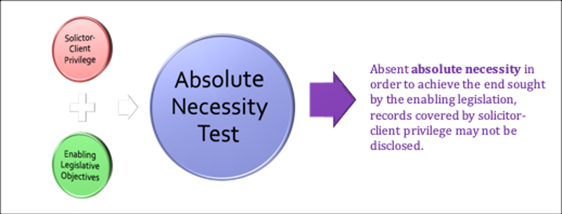
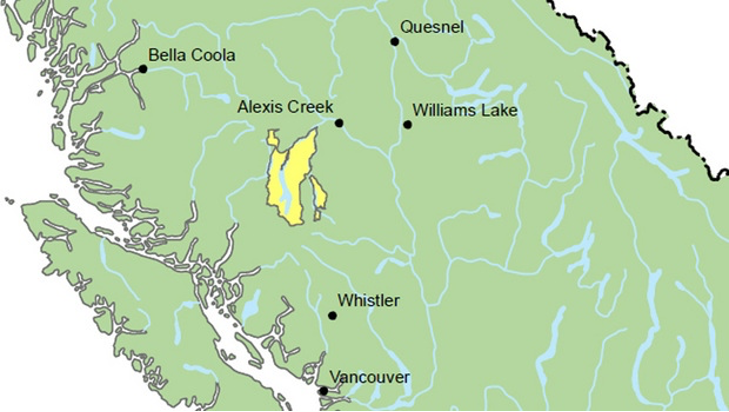

# Unit 8: Aboriginal Title and Reserve Lands

<!-- 
**Commentary**
 -->

<!--  -->

!!! danger "Kim Comment"

    Please note that **two (2) discussion posts** on Unit 8 are due by end of day **Monday, November 9, 2026**.

    For Unit 8, we are delving deeper into the concept of aboriginal title.

    For this week, please familiarize yourselves with each of the following topics:

    - The History of Aboriginal Title and the Indian Land Policy in British Columbia
    - (a)  What were the implications of the SCC decision in *Calder v. BC* [1973]?
    - (b)  What is the significance of the Royal Proclamation of 1763 on Aboriginal title? 
    - (c)  What are the Douglas Treaties and how do these treaties impact Aboriginal title on Vancouver Island? 

    - Aboriginal Title: *Delgamuukw v. British Columbia*
        - (a) What was the significance of the *Delgamuukw* decision? 
        - (b) What are the details of the tests established for Aboriginal title? 
        - (c) What was the outcome of the Truth and Reconciliation Commission? 

    - Aboriginal Title after *Delgamuukw*
        - (a) How did the decisions after *Delgamuukw* impact determination of Aboriginal title? 

    - Aboriginal Title and Title Registration
        - (a) What is the interaction between the BC provincial registration system and Aboriginal title? 
        - (b) What is a caveat and how is this used re Aboriginal title? 
        - (c) What is a certificate of pending litigation (*lis pendens*)? 

    Additionally, please have a look at the summaries below of the recent BC Supreme Court decision in Cowichan Tribes: 

    - [BC Supreme Court's recent Cowichan Decision](https://www.bdplaw.com/insights/bc-supreme-courts-recent-cowichan-decision){:target=" \_blank"}
    - ['Chaotic situation': Cowichan decision appellants warn of possible impacts to port, property, fishing grounds](https://www.cbc.ca/news/canada/british-columbia/cowichan-appeal-stay-arguments-warnings-9.7383876){:target=" \_blank"}
    - [B.C. and Cowichan chiefs start negotiations after court ruling on Aboriginal title](https://www.cbc.ca/news/canada/british-columbia/cowichan-chiefs-joint-statement-bc-land-aboriginal-rights-9.7112012){:target=" \_blank"}

The defining feature of tenurial land law is that **all interests in land arise from the Crown**. 

In Canada, the important **exceptions** are **Aboriginal and treaty rights.** Aboriginal rights, including Aboriginal title, arise not from a Crown grant, but from the prior presence of Indigenous peoples, their laws and traditions, before others arrived. 

**Treaty rights** arise out of the formal agreements between Indigenous peoples and Britain, and later with Canada. This unit reviews the history of Aboriginal title in Canada, with a particular focus on British Columbia. It then turns to the series of foundational cases following the constitutional entrenchment of Aboriginal and treaty rights in 1982 that define the nature and scope of Aboriginal title. In the final section, it considers the relationship between Aboriginal title and title registration.

This unit uses “**Indian**” to describe rights that arise under the *Indian Act*, “**Aboriginal**” when referring to rights protected under the *Constitution Act*, 1982, s 35, and “**Indigenous**”, following the *United Nations Declaration on the Rights of Indigenous Peoples* to describe the societies that proceeded the arrival of Europeans to North America. It also uses “**First Nations**” instead of Indian bands when referring to the governing bodies on Indian reserves. 

The focus of the unit is **Aboriginal title**, but we also consider the creation of reserves and the property interests that occur on them.

## 8.1 The History of Aboriginal Title and the Indian Land Policy in British Columbia

In 1973, the Nisga’a Nation, led by then-chief Frank Calder, went to the Supreme Court of Canada for **a declaration that their Aboriginal title had never been extinguished.** The seven justices that heard the Nisga’a appeal in ***Calder et al. v. Attorney-General of British Columbia***, [1973 CanLII 4 (SCC)](https://canlii.ca/t/1nfn4){:target=" \_blank"}, split three ways. Six justices ruled that Aboriginal title existed, but three would conclude it had been extinguished by colonial land ordinances, three others that it had not. The one remaining judge denied the declaration on a technicality, the Nisga’a had not received the necessary permission from the Crown to sue the Crown. 

The Nisga’a **did not win** their declaration, but the fact that six justices confirmed that Aboriginal title existed, even though three found it had been extinguished, would transform the understanding of Aboriginal title in the common law and the Canadian government’s approach to Indigenous peoples. This would become clear in the specific and comprehensive land claims processes that the Federal government established in the 1970s, and then with the constitutional entrenchment of Aboriginal and treaty rights in the *Constitution Act*, [1982, s 35](https://laws-lois.justice.gc.ca/eng/Const/Const_index.html){:target=" \_blank"}, being Schedule B to the *Canada Act* 1982 (UK), 1982 c 11.

Justice Judson, writing for three justices who found that the Aboriginal title had existed but that it had been extinguished by a series of colonial land ordinances, described its meaning as follows:

> Although I think that it is clear that Indian title in British Columbia cannot owe its origin to the *Proclamation* of 1763, the fact is that when the settlers came, the Indians were there, organized in societies and occupying land as their forefathers had done for centuries. That is what Indian title means and it does not help one in the solution of this problem to call it **a “personal or usufructuary” right**.

A **usufruct** is a legal right that lets someone use and enjoy another person’s property, or earn income from it, **without actually owning it.**

In this unit, we attempt to make sense of this statement from Justice Judson by exploring how and why it is that the issue of Aboriginal title was coming before the courts in British Columbia in the 1970s. This requires not only an investigation of the evolution of Aboriginal title in the common law, but also of the history of the Indian land policy in British Columbia.

!!! note "Activity"

    Read the introduction to Aboriginal property rights in the *Reader*, **391-95**, and then work your way through the 6-part presentation from **Douglas Harris** on the history of Aboriginal title and the Indian land policy in British Columbia. 

Each part is approximately 5-10 minutes long and together they provide important background for the later discussion of the Supreme Court of Canada decisions that will define the **nature** of, and set out the **test** for, **Aboriginal title**.

**Part 1** introduces Frank Calder and provides a fuller description of the Supreme Court of Canada's decision in the litigation that bears his name: ***Calder v British Columbia***.

**Part 2** provides an introduction to the history of trade in the territory that becomes British Columbia between Indigenous peoples and European and North American based trading companies.

**Part 3** picks up the narrative in the mid-nineteenth century when the British interest in western North America shifts from trade to settlement, and to the series of treaties that **fourteen Indigenous communities conclude with James Douglas**, then Chief Factor of the Hudson's Bay Company and then Governor of the Colony of Vancouver Island.

The [text of the Douglas Treaties](https://www.rcaanc-cirnac.gc.ca/eng/1370373165583/1581292088522){:target=" \_blank"} is brief and the important second paragraph is the same in every treaty. Harris provides **three different models of treaty interpretation** based around the text:

- the **text is the treaty**;
- the text is the treaty, but the interpretation of that text may **rely on a variety of external sources**, including other documents and oral histories;
- the text is evidence of how one party to the treaty understood its terms, but **the treaty was an oral agreement** and its terms should be understood based on a range of sources, including the text but also oral histories.

Given the circumstances in which the treaties were negotiated and the text emerged, **which of the three interpretations best fits the text of the Douglas Treaties?**

**Part 4** steps away from the focus on British Columbia to provide some of the larger continental context. This includes a discussion of the [*Royal Proclamation of 1763*](https://primarydocuments.ca/royalproc11763oct7/){:target=" \_blank"}, sometimes described as the Magna Carta for Indigenous peoples in Canada. There is also discussion of the decision of the Judicial Committee of the Privy Council in ***St. Catharine's Milling & Lumber Company v R***, a decision that defines Aboriginal title in Canadian law **until** the decision of the Supreme Court of Canada in ***Calder v British Columbia***.

**Part 5** turns back to British Columbia to consider the development of an Indian land policy, in the absence of treaties, that would produce the foundation line in a colonial settler society between the land that was set aside for Indigenous peoples and the land that was open to the incoming settler society. In British Columbia, the result was approximately 1500 Indian reserves that together amount to 1/3 of one percent of the land area.

**Part 6** traces the legal developments from the reopening of the courts to Indigenous peoples, **courts that had been all but closed between the late 1920s and the early 1950s to Aboriginal rights and title claims**, to the decision in ***Calder*** and its aftermath, including the Federal government's establishment of a **Specific Claims process (for treaty rights claims and claims involving reserve land)** and a **Comprehensive Claims process (for Aboriginal title claims)**.

For those of you with some background in Canadian history, what part of the narrative was least familiar to you? For those of you from outside Canada, or with backgrounds in other jurisdictions with a colonial history, are there important similarities or substantial differences that you found particularly notable?

## 8.2 Aboriginal Title

In 1984, just two years after the constitutional entrenchment of Aboriginal and treaty rights in the [*Constitution Act, 1982*](http://laws-lois.justice.gc.ca/eng/Const/Const_index.html){:target=" \_blank"}, s 35, the chiefs of the Gitxsan and Wit’suit’in Nations initiated court action, claiming 58,000 sq. kilometres in northwestern British Columbia. The claim was not brought by the nations, but was an amalgam of 133 individual claims of the Gitxsan and Wit’suit’in hereditary chiefs to their territories that collectively comprised the territory of the Gitxsan and Wit’suit’in. The chiefs claimed ownership and jurisdiction of their traditional territories, and the case became known as ***Delgamuukw v. British Columbia***, [1997 CanLII 302 (SCC)](https://canlii.ca/t/1fqz8){:target=" \_blank"} after the hereditary name of the most prominent of the Gitxsan chiefs.

It is clear from **Chief Justice Allan McEarchern**’s decision at trial that although he admitted this evidence, he did not know what to do with it and so accorded it little weight. In the end, he would **dismiss the claim of the Gitksan and Wit’suit’in chiefs to ownership and jurisdiction over their traditional territory**, finding instead that 

> the plaintiffs **held rights** to their villages and non-exclusive Aboriginal rights to use adjacent land for subsistence and ceremony, but that these rights had been **extinguished** by pre-Confederation colonial enactments, the same land ordinances that had been much debated in ***Calder***. 

In short, the colony had effected **a “blanket extinguishment” of Aboriginal title with its land legislation**. Aboriginal rights existed at the "pleasure of the crown" and could thus be extinguished "whenever the intention of the Crown to do so is clear and plain."

A change in the provincial government between trial and appeal brought about a change in the province’s position. Instead of arguing “blanket extinguishment,” **the province conceded that the plaintiffs held Aboriginal rights in the claimed territory, or parts of it, but that these rights had been impaired or infringed in some areas.** Nonetheless, the basic issues of ownership and jurisdiction, sometimes referred to in the BCCA decision as Aboriginal title and self-government, remained.

All five justices agreed that the province had been right to concede its claim of “blanket extinguishment”: 

**the colonial legislation had not extinguished Aboriginal rights, and subsequent provincial legislation could not.**

Why not? 

When British Columbia entered Confederation, under the *Terms of Union 1871*, jurisdiction over “Indians and Lands Reserved for Indians” passed from the province to the Federal government ([*Constitution Act, 1867*](http://laws-lois.justice.gc.ca/eng/Const/index.html){:target=" \_blank"} (UK), 30 & 31 Vict, c 3, reprinted in RSC 1985, App II, No 5). However, aside from the question of “blanket extinguishment,” which the province had conceded before the appeal, the **BCCA upheld the trial court decision.**

At trial the plaintiffs claimed “ownership” and “jurisdiction”. The language began to shift in the BCCA to “Aboriginal title” and “self-government,” and on appeal to the SCC the plaintiffs framed their claim in these terms. In addition, at trial the claims were of the individual ‘Houses’ to specific tracts of property, but on appeal the claims were modified into two communal claims. In the end, the SCC would send the claim back to trial because of this **re-configured claim:**

> This defect in the pleadings prevents the Court from considering the merits of this appeal. ... the correct remedy for the defect in pleadings is a new trial. 

Nonetheless, even though the claim failed, the impact of ***Delgamuukw*** has been profound. In its decision, the SCC set out **three distinct features of Aboriginal title:**

- it is **inalienable**;
- its **source** lies in the prior occupation of Canada by Indigenous peoples; and
- it is **a communal right**.

The SCC also described the **content of Aboriginal title** as, 

- **first**, encompassing “the right to exclusive use and occupation of the land help pursuant to that title for a variety of purposes,” and 
- **second**, as subject to an “inherent limit,” such that “aboriginal title cannot be put to such uses as may be irreconcilable with the nature of the occupation of that land and the relationship that the particular group has had with the land which together have given rise to aboriginal title in the first place.”

At this point, the SCC then set out the steps in the **test for proof of Aboriginal title:**

In order to make out a claim for aboriginal title, the aboriginal group asserting title **must satisfy the following criteria:** 

- (i) the land must have been **occupied prior to sovereignty**, 
- (ii) if present occupation is relied on as proof of occupation pre-sovereignty, there must be a **continuity** between present and pre-sovereignty occupation, and 
- (iii) at sovereignty, that occupation must have been **exclusive**. (para 143)

**Finally**, once a First Nation has successfully established an Aboriginal title claim, then the **onus or burden of proof shifts to the Crown** to establish that **any infringement of those rights or title is justified.** 

In explaining this test, Chief Justice Lamer turned to the idea of **reconciliation as the animating principle** behind the constitutional entrenchment of Aboriginal and treaty rights in the [*Constitution Act*, 1982](https://laws-lois.justice.gc.ca/eng/Const/index.html){:target=" \_blank"}, s. 35. These are the final two sentences:

Ultimately, it is through negotiated settlements, with good faith and give and take on all sides, reinforced by the judgments of this Court, that we will achieve what I stated in *Van der Peet*, *supra*, at para. 31, to be the basic purposes of s. 35(1),

*“the reconciliation of the pre-existence of aboriginal societies with the sovereignty of the Crown”.*

Let us face it, we are all here to stay.

The idea of reconciliation has become central to Canada’s efforts to build better relationships between Indigenous peoples, non-Indigenous Canadians, and the Canadian state. The work and recommendations of the [Truth and Reconciliation Commission](https://nctr.ca/){:target=" \_blank"}, which grappled with the impact and effects of the residential school system, is an important part of this process.

***Delgamuukw*** has been the single-most important Aboriginal title case, and among the most important decisions ever by a Canadian court. However, ***Tsilhqot’in Nation v. British Columbia***, [2014 SCC 44](https://canlii.ca/t/g7mt9){:target=" \_blank"}, marks the first time that **a Canadian court has declared a specific territory to be Aboriginal title lands.**

In ***Tsilhqot’in***, the SCC recognized a tract of land in central British Columbia as Aboriginal title lands. The claimed land is shown in the image below, and the portion of it that the SCC declared to be Aboriginal title land is identified in the image that follows.

At trial, **Judge Vickers** dismissed the claim on the basis of a procedural irregularity involving the pleadings. However, he provided what amounted to an extensive judicial opinion describing the area that would be Aboriginal title lands had it not been for the problem with the pleadings.

The British Columbia Court of Appeal determined that there had been no procedural failing and made a declaration of Aboriginal title, but to a much smaller area than Vickers J had identified as Aboriginal title lands. The BCCA ruled that the level of occupation through much of the territory might give rise to Aboriginal rights, but was not sufficient to ground Aboriginal title.

On appeal to the SCC, the province did not contest the BCCA’s decision about the pleadings and the SCC concurred: “minor defects should be overlooked, in the absence of clear prejudice” (para 20). However, **a unanimous SCC** overruled the BCCA’s restrictive approach to Aboriginal title and confirmed Vickers J’s opinion that the **Tsilhqot’in had made out their case for Aboriginal title to an extensive portion of the claimed area.**

!!! note "Activity"

    Read the introduction to Aboriginal title and then the excerpt from ***Tsilhqot’in*** in the *Reader*, **425-47**. 

The remainder of the judgment not reproduced in the casebook deals with the application of provincial laws to Aboriginal title lands. In brief, the **SCC** holds that **general regulatory legislation** that the province enacts **to manage the forests will apply**, **but the allocation of tree farm licences or property interests will not.**

As you read ***Tsilhqot’in***, pay careful attention to the manner in which the **SCC applies the tests** it articulated in ***Delgamuukw***. Note how the SCC not only applies, but also **modifies the tests.** Pay attention to the paragraphs dealing with the **“sufficiency of occupation.”** Here the **SCC rejects the “postage stamp approach” and accepts a “territorial approach” to Aboriginal title.** 

How would you explain this distinction?

!!! quote "Answer"

    The Court rejected the so-called **“postage stamp approach”**, which would limit Aboriginal title to specific places like villages or farms. Instead, it recognized that Aboriginal peoples could have title over a much larger area, even if they didn't physically occupy every part of it.

    The Court went back to the ***Delgamuukw*** test, which requires occupation to be **sufficient**, **continuous** (if relying on present occupation), and **exclusive**. But most of the discussion was really about what “sufficient” means.

    The Court said we need to look at occupation **from both the Aboriginal and common law perspectives**. From the Aboriginal perspective, we should consider how the group actually lived, including its size, lifestyle, resources, technology, and the nature of the land. From the common law perspective, possession doesn't necessarily mean physically living on every piece of land. It can also include surrounding areas that people use and effectively control.

    So, regular hunting, fishing, trapping, or gathering across a territory could be enough to establish an occupation for Aboriginal title, as long as the use shows an intention to possess the land.

    I think this approach makes more sense than limiting Aboriginal title to villages or settlements. What I found interesting is that the common law concept of possession actually helps extend Aboriginal title to a much larger area. At the same time, the Aboriginal perspective helps the Court understand how Indigenous peoples traditionally used and occupied their lands. I guess the two perspectives work well together in this case.

Then look at the SCC’s description of the **characteristics of Aboriginal title.** How does the SCC reframe what it described in ***Delgamuukw*** as the **“inherent limit”**?

Turn to the **justifiable infringement test**. The SCC draws on the test it set out in ***Delgamuukw***, but **adds a step** and also seems to distance itself from the list of possible “compelling and substantial objectives” that it identified in the earlier case. **What is the new step?** And what appears to be the **guiding principle** that informs the justifiable infringement test? See the comment from Douglas Harris, “*Aboriginal Title a Balancing Act*,” in the Vancouver Sun.

In ***Tsilhqot’in*** the SCC has recognized a tract of land in British Columbia as Aboriginal title lands. This is a fundamental step, but, as John Borrows argues, one that still rests on the foundation of European and then Canadian sovereignty on Indigenous lands. 

!!! note "Activity"

    Read his critique in the *Reader* and then comments 1-3, pages **447-51**, which describes the approach of the courts **where title is claimed but not yet proven or recognized in Canadian law.**

Finally, read John Borrows critique of the decision in Tsilhqot’in Nation. What does he mean by “*terra nullius* reproduced”?

!!! quote "Answer"

    One thing I found interesting about ***Tsilhqot'in v British Columbia*** is that the SCC said “[t]he doctrine of *terra nullius* (that no one owned the land prior to European assertion of sovereignty) never applied in Canada”, but then, in the very same paragraph, it said that “at the time of assertion of European sovereignty, the Crown acquired radical or underlying title to all the land in the province.” Borrows thinks this basically brings back the most troubling part of *terra nullius*, even though the Court said it rejected it.
    
    Borrows has three main concerns with the decision.
    
    First, the Crown still has the upper hand. Aboriginal title is recognized, but the government can still infringe on it if it can justify doing so.
    
    Second, Indigenous peoples still have to prove their title in court or negotiate with the Crown. Sounds straightforward in theory, but it is nevertheless a long and difficult these processes.
    
    Third, provincial laws can still apply to Aboriginal title lands. The provinces now have to justify any infringement, but they still have the power to do it. And provincial/federal governments often have their own interests in developing these lands and getting economic benefits from them.
    
    So basically, Borrows is saying that Indigenous peoples may now have more rights to own and use their lands, but the Crown still holds the underlying title and has the final say when it comes to sovereignty.
    
    I think he makes a fair point. The Court says *terra nullius* never applied in Canada, but somehow the Crown still got underlying title to all the land just by claiming sovereignty. To me, it sounds like the Court rejected *terra nullius* on paper, but kept some of its basic ideas in place. I guess that's the contradiction Borrows is trying to point out.
    

## 8.3: Aboriginal Title and Title Registration

Title registration systems are designed to record interests in land and to guarantee that the person or entity registered on title is the holder of that interest. Perhaps not surprisingly, several First Nations have sought to use title registration systems to protect interests in land.

Although Aboriginal title is unequivocally an interest in land, the cases discussed below involve attempts by First Nations not to register property interests but rather as a means to protect them. In each case the Aboriginal title interest was claimed, but not yet established. Nonetheless, title registration was potentially useful for putting other parties on notice of the claim. Even more importantly, **if the First Nations were successful in registering their claims in the title registration system, then the effect would be to prevent future transfers of land until the claim to Aboriginal rights and title was resolved.**

The focus in this topic is on the **relation** between Aboriginal title and title registration, but this analysis also provides an opportunity to review how **title registration systems operate to record non-proprietary interests.** In British Columbia, these include the “**caveat**” and the “**certificate of pending litigation.**”

!!! note "Activity"

    Read the summary from Bankes, Mascher and Watson-Hamilton of the numerous and unsuccessful attempts to register caveats or certificates of pending litigation in relation to Aboriginal title claims in the *Reader*, **974-77**. 
    
    They mention the decision of the BCCA in ***Skeetchestn Indian Band and Secwepemc Aboriginal Nation v. Registrar of Land Titles, Kamloops***, [2000 BCCA 525](https://canlii.ca/t/1fnjx){:target=" \_blank"}.

In British Columbia’s title registration system, a **caveat** is not an interest in land and nor does it create an interest in land. Instead, it is **device that provides notice of a claim to an interest in land.** Section 282 of the [*Land Title Act*](http://www.bclaws.ca/civix/document/id/complete/statreg/96250_00){:target=" \_blank"} indicates that a person who is claiming an interest in land may register a caveat and that the effect of the caveat is to prohibit further dealing with the land that might affect the claimed property interest. See also [*Land Title Act*](http://www.bclaws.ca/civix/document/id/complete/statreg/96250_00){:target=" \_blank"}, section 288, which effectively halts registration of any instruments affecting the land described in the caveat.

**A caveat is a short-term mechanism** for providing notice of claims to land and freezing further transfers until the claim is resolved. It **lapses after two months** ([*Land Title Act*](http://www.bclaws.ca/civix/document/id/complete/statreg/96250_00){:target=" \_blank"}, section 293), **but can be renewed**.

If a dispute over land is on-going and the subject of litigation, then [*Land Title Act*](http://www.bclaws.ca/civix/document/id/complete/statreg/96250_00){:target=" \_blank"}, section 215 enables parties to the proceeding to register **a certificate of pending litigation** (also know as a ***lis pendens***). As with the registration of a caveat, a certificate of pending litigation has the effect of halting future transfers of the land against which the certificate is registered **until the certificate is cancelled** ([*Land Title Act*](http://www.bclaws.ca/civix/document/id/complete/statreg/96250_00){:target=" \_blank"}, section 216).

If the claim on which the caveat or the certificate of pending litigation was based is successful, then the **priority of that claim is established by the date on which the caveat or certificate was registered** ([*Land Title Act*](http://www.bclaws.ca/civix/document/id/complete/statreg/96250_00){:target=" \_blank"}, section 31). This follows the general rule that registration is effective from the time and date of application for registration ([*Land Title Act*](http://www.bclaws.ca/civix/document/id/complete/statreg/96250_00){:target=" \_blank"}, section 31).

To view the land that was at issue in ***Skeetchestn*** search “Tobiano, Kamloops” in Google Earth. Before the dispute, the Six-Mile Ranch was used primarily as rangeland for cattle. After the litigation a portion of it was transformed into a golf course and residential subdivision.

**Madam Justice Southin denied the Skeetchestn claim to register a certificate of pending litigation.** In doing so, she ruled that because Aboriginal title was “unknown” as an interest in land at the time the colony and then province built the title registration system, it had no place within that system:

> There is nothing in the legislative history of this Province, up to and including the enactment in 1978 of the statute now in issue, to warrant the conclusion that the Legislature intended the claims put forth here by the appellants to be registrable, for in the minds of the Legislature there was no such “estate of interest in land” in this Province...

The courts in other provinces and territories in Canada have also pushed back attempts to register Aboriginal title in title registration systems.

In 2001, the year after the BCCA decision, the Skeetchestn Indian Band negotiated the **“6 Mile Settlement Agreement”** with the provincial government. 

In it, the Skeetchesten covenanted **not to sue** with respect to Aboriginal title claims over the lands at issue and **not to pursue the case** to the Supreme Court of Canada. In return, the province agreed to set aside that portion of the former ranch immediately to the west of the golf course development as **a protected area**: the [Six Mile Hill Protected Area](https://bcparks.ca/six-mile-hill-protected-area/){:target=" \_blank"}. It also agreed to work with the Skeetchesn on developing commercial backcountry recreation opportunities, and to provide funding for wildlife studies, to support economic development, and to enhance the capacity of the band to take advantage of the opportunities presented in the agreement. Finally the agreement recognized an advisory role for the Skeetchestn in the creation of management plans for the area. The Skeetchesn and the neighbouring Kamloops Indian Band then negotiated a protocol agreement to implement the settlement agreement.

## 8.4 Property Interests on Reserve Lands

There are **three broad categories of land** that First Nations hold within Canada:

- Aboriginal title lands;
- Treaty lands; and
- Reserve lands.

Aboriginal title has been the focus of the earlier sections in this unit. We have considered treaty lands at various points in the course, including Unit 1 where the focus was on the lands that the Nisga’a hold in **fee simple** under the **Nisga’a Final Agreement**. 

Here we turn to the third category, **Reserve lands**, and to some of the interests that exist on reserves.

!!! note "Activity"

    Reserves and property interests on reserves are created under the *Indian Act*, RSC 1985 c I-5. 
    
    Read the excerpt from Jack Woodward’s *“16 types of Aboriginal Interests in Land that May Be Encountered by Lawyers and Notaries in BC”* (*Reader*, **478-82**) for the list of possible property interests, **some of which, customary allotments and buckshee leases, in particular, are not formally recognized.** 

Property interests that are recognized may be recorded in the **Indian Lands Registry System** (**ILRS**). Created under the *Indian Act*, RSC 1985 c. I-5, the **ILRS is not a title registration system**; it provides information about the nature of property interests on reserves and who has a right to possession, but does **not provide a guarantee of title.**

An increasing number of First Nations have assumed responsibility for creating land registries and for managing the land and resources on their reserves through the **Framework Agreement on First Nations Land Management**. 

In 1996, Canada and 14 signatory First Nations (including the Musqueam on whose traditional territory the Allard Law School is located) signed the **Framework Agreement** to enable First Nations to extract themselves from the *Indian Act* provisions dealing with land management. Parliament then ratified the Framework Agreement with the *First Nations Land Management Act*, SC 1999, c 24 (**FNLMA**). However, the legislation simply implements Canada’s commitments under the Framework Agreement. **It is the Framework Agreement that is the primary document**, and in 2022, Parliament replaced the FNLMA with the Framework Agreement on First Nation Land Management Act, SC 2022, c 19, s 121, making it even clearer that the **Framework Agreement** **is the primary document.** Each First Nation also decides whether it will ratify the Framework Agreement by becoming a signatory.

!!! note "Activity"

    Read the introduction to the First Nations Land Management regime in the excerpt to Malcolm and Moira Lavoie’s article and the Comments that follow it in the *Reader*, **482-85**. 
    
    Note in particular the significant expansion in the number of First Nations that are now managing the land on their reserves.

## 8.5 Review Quiz

!!! danger "Quiz"

    1. What treaty marked the 49th parallel from the height of the Rocky Mountains to the Pacific as the boundary between British interests to the north and those of the United States to the south? 
        - [x] Oregon Boundary Treaty, 1846;
        - [ ] Treaty of Niagara, 1764;
        - [ ] Treaty of Paris, 1763;
        - [ ] Alaska Purchase, 1867.

    2. The Douglas or Vancouver Island Treaties contain which of the following enumerated rights: 
        - [ ] To hunt over unoccupied lands;
        - [ ] To fisheries as formerly;
        - [ ] To village sites and enclosed fields;
        - [x] All of the above.

    3. What year did Britain establish the mainland colony of British Columbia?
        - [ ] 1846;
        - [ ] 1849;
        - [ ] 1858; or
        - [x] 1867

    4. ***St. Catharine’s Milling & Lumber Co. v. The Queen*** (1888), 14 A.C. 46, described Aboriginal title as what sort of right?
        - [ ] Allodial title;
        - [x] A personal and usufructuary right;
        - [ ] Defended by the honour of the Crown; or
        - [ ] Sui generis.

    5. The SCC describes Aboriginal title in ***Tsilhqot’in Nation*** as a burden on the Crown’s radical or underlying title.
        - [x] True
        - [ ] False

    6. In order to **justify an infringement** of Aboriginal title, the SCC has indicated that the **Crown must establish** that: 
        - [ ] It has the consent of the affected First Nation;
        - [ ] The infringement is in the public interest;
        - [x] There are compelling and substantial objectives for the infringement; or
        - [ ] The infringement is consistent with the United Nations Declaration on the Rights of Indigenous Peoples?

    7. Under section 91(24) of the *British North America Act*, 1867 (now the *Constitution Act*, 1867), **Parliament has jurisdiction** over “Indians, and Lands reserved for Indians”. True or False?
        - [x] True
        - [ ] False

    8. When registered against a fee simple interest, a caveat will place an indefinite hold on the transfer of that fee simple. 
        - [ ] True
        - [x] False

    9. **First Nations have successfully registered certificates of pending litigation** against fee simple interest in relation to Aboriginal title claims.
        - [ ] True
        - [x] False
    > While Aboriginal title is an interest in land, Canadian courts (particularly in cases dealing with private fee simple lands, such as ***Gitxaala Nation v. Canada*** or prior interlocutory and title proceedings) have established that a CPL cannot be successfully registered against individual private fee simple titles solely on the basis of an underlying, unproven, or assertion-based Aboriginal title claim against the Crown's underlying title.

    10. Customary allotments on Reserves may be registered in the Indian Lands Registry System. 
        - [ ] True
        - [x] False
    > Under the federal *Indian Act* and the administrative framework governing the **Indian Lands Registry System** (**ILRS**) (and the **First Nations Land Registry**), the **ILRS** is designed to **record formal, statutory interests and transactions authorized under the Act**, such as Ministerial certificates of possession (CPs), lawful allotments approved by the Minister under specific statutory sections, leases, and permits.

## Textbook Summary

**Chapter 5. Common Law Estates and Aboriginal Rights in Land**

**5:22, Aboriginal Rights in Land**

Although Aboriginal law is often presented as a site of reconciliation or legal progress, and the entrenchment of Aboriginal and treaty rights in The *Constitution Act*, 1982 is a singular achievement, **it remains deeply rooted in colonial assumptions** about sovereignty, property, and jurisdiction.

*Colonial Foundations: The Royal Proclamation and the Myth of Terra Nullius*

An analysis of Aboriginal property rights must begin with the *Royal Proclamation of 1763*, which continues to structure Canadian law’s understanding of Indigenous land. While the *Proclamation* is often celebrated for acknowledging Indigenous possession and establishing that Indigenous lands could only be alienated to the Crown and thus off limits to an incoming settler society, **it simultaneously asserted Crown sovereignty and underlying title.** 

**Indigenous land rights were recognized only as a burden on Crown title**, **not as independent sources** of jurisdiction or ownership. In this sense, the *Proclamation* did not displace colonial domination; it regularized it through law.

Canada has formally **rejected the doctrine of** *terra nullius*, the idea that Indigenous lands were legally empty at the time of European assertion of sovereignty. However, critics argue that **Canadian Aboriginal law has functionally reproduced** *terra nullius* by subordinating Indigenous law to Crown assertions of sovereignty and by treating Indigenous land rights as contingent, exceptional, and ultimately defeasible. ...  Canadian jurisprudence has been more cautious, recognizing Indigenous land rights and Aboriginal title, while **leaving the foundations of Crown sovereignty largely unexamined.**

*Aboriginal Title and the Constraints of Sui Generis Recognition*

The modern doctrine of Aboriginal title is anchored in ***Delgamuukw v British Columbia*** (1997), where the Supreme Court of Canada characterized Aboriginal title as a *sui generis* (Latin for **"of its own kind"**) property interest and articulated the legal test of occupation prior to sovereignty, continuity of occupation, and exclusivity.

The Supreme Court’s subsequent decision in ***Tsilhqot’in Nation v British Columbia*** (2014), ... marked the **first judicial declaration of Aboriginal title to a specific tract of land.** Yet even here, recognition was carefully circumscribed. The Court reaffirmed that **Aboriginal title lands remain subject to Crown sovereignty and that governments may infringe title for compelling and substantial objectives, provided they satisfy a justification test.** 

The justification test, originally articulated in ***R. v. Gladstone***, [1996 CanLII 160 (SCC)](https://canlii.ca/t/1fr8w){:target=" \_blank"} involving Aboriginal rights to commercial fisheries, and modified in ***Delgamuukw*** to apply to Aboriginal title, appears considerably more stringent following ***Tsilhqot’in***, but the framework entrenches a hierarchy in which Aboriginal title is **vulnerable to state-defined public interests, particularly resource extraction and economic development.**

*Treaty Rights and the Ongoing Regulation of Indigenous Land Use*

In ***R. v. Badger***, [1996 CanLII 236 (SCC)](https://canlii.ca/t/1frbp){:target=" \_blank"}, the Supreme Court emphasized that **historic treaties must be interpreted liberally**, in favour of Indigenous signatories. Nevertheless, treaty rights, such as the right to hunt on privately owned land, are **routinely constrained by provincial regulation, conservation regimes, and competing property interests.**

*Indian Act Property Regimes and the Persistence of Paternalism*

**Reserve lands** are **held by the Crown for the use and benefit of First Nations**, limiting both individual and collective autonomy over land. While incremental reforms and self-government agreements have altered some aspects of reserve land management, the underlying structure continues to reflect colonial assumptions about Indigenous incapacity and the need for state supervision.

**5:23, Aboriginal title**

**Aboriginal title is a common law concept.** It is the response of common law judges to the conflict over land between a settler society and Indigenous peoples in the territory that becomes Canada. 

In ***St. Catherine's Milling and Lumber Company v. The Queen***, [1888 CanLII 209 (UK JCPC)](https://canlii.ca/t/k8t26){:target=" \_blank"}, the JCPC ruled that **“Indian title was a mere burden” on the Crown’s “present proprietary estate,”** and thus that the land at issue (and the right to grant a timber licence) lay with the province. Most infamously, the JCPC described Aboriginal title as amounting to a right of occupancy or a **“personal and usufructuary right”.**

... the Nisga'a sought a declaration that their Aboriginal title had not been extinguished. In ***Calder v British Columbia***, [[1973] SCR 313](https://canlii.ca/t/1nfn4){:target=" \_blank"}, the Supreme Court of Canada declined to grant that declaration.

Although the Nisga’a did not receive the declaration they sought, the decision in ***Calder*** sidelined the definition of Aboriginal title in ***St. Catherine’s Milling***, and recognized Aboriginal rights, including **Aboriginal title, as more robust than it had previously understood.**

Section 35(1) of the *Constitution Act*, 1982, provides:

> The existing aboriginal and treaty rights of the aboriginal peoples of Canada are hereby recognized and affirmed.

.. after years of litigation in the BCSC and then the British Columbia Court of Appeal, the Supreme Court of Canada in ***Delgamuukw v. British Columbia***, [1997 CanLII 302 (SCC)](https://canlii.ca/t/1fqz8){:target=" \_blank"}, ... in the process of ordering a new trial, the SCC set out the nature and content of **Aboriginal title as a *sui generis* property interest**, the test for proving whether and where it exists, and the standard that the Crown must meet in order to justify an infringement. 

After ***Delgamuukw***, it was unequivocally clear that Aboriginal title was a property interest, “a right in land”. Moreover, it was a unique or *sui generis* interest in land that drew from common law and Indigenous rules and understandings of property.

The decision in ***Delgamuukw*** also set the stage for the claim of the Tsilhqot'in Nation and to the Supreme Court's **eventual recognition of a particular tract of land** in central British Columbia as Aboriginal title lands.

**5:24. *Tsilhqot'in Nation v British Columbia***

!!! info "*Tsilhqot’in Nation v. British Columbia*, [2014 SCC 44](https://canlii.ca/t/g7mt9){:target=" \_blank"}"

    **Introduction**

    What is the **test** for Aboriginal title to land? If title is established, what **rights** does it confer? Does the B*ritish Columbia Forest Act*, R.S.B.C. 1996, c. 157, **apply to land covered by Aboriginal title?** What are the **constitutional constraints** on provincial regulation of land under Aboriginal title? Finally, how are broader **public interests to be reconciled with the rights** conferred by Aboriginal title? These are among the important questions raised by this appeal.

    These reasons conclude:
    
    - **Aboriginal title flows from occupation** in the sense of regular and exclusive use of land. In this case, Aboriginal title is established over the area designated by the trial judge.
    - Aboriginal title confers the **right to use and control** the land and to **reap** the benefits flowing from it.
    - Where title is asserted, but has not yet been established, s. 35 of the *Constitution Act*, 1982 requires the **Crown to consult with the group asserting title** and, if appropriate, accommodate its interests.
    - Once Aboriginal title is established, s. 35 of the *Constitution Act*, 1982 permits incursions on it only with the consent of the Aboriginal group or **if they are justified by a compelling and substantial public purpose** and are not inconsistent with the Crown's fiduciary duty to the Aboriginal group; 
    - **for purposes of determining the validity of provincial** legislative incursions on lands held under Aboriginal title, **this framework displaces the doctrine of interjurisdictional immunity**.
    - In this case, the Province's land use planning and forestry authorizations were inconsistent with its duties owed to the Tsilhqot'in people.

    **The Historic Backdrop**

    Throughout most of Canada, the Crown entered into **treaties** whereby the **indigenous peoples gave up their claim to land in exchange for reservations and other promises**, but, with minor exceptions, **this did not happen in British Columbia**.

    **The Jurisprudential Backdrop**

    In 1973, the Supreme Court of Canada ushered in the modern era of Aboriginal land law by ruling that **Aboriginal land rights survived European settlement and remain valid to the present unless extinguished by treaty or otherwise**: ***Calder v. Attorney-General of British Columbia***, [1973] S.C.R. 313.

    Almost a decade after ***Calder***, the enactment of s. 35 of the *Constitution Act*, 1982 “recognized and affirmed” existing Aboriginal rights, although it took some time for the meaning of this section to be fully fleshed out.

    > 35, (1) **The existing aboriginal and treaty rights** of the aboriginal peoples of Canada are hereby **recognized and affirmed**.

    > (2) In this Act, **“aboriginal peoples of Canada”** includes the Indian, Inuit and Métis peoples of Canada.

    > (3) For greater certainty, in subsection (1) “treaty rights” includes rights that now exist by way of land claims agreements or may be so acquired.

    In 1990, this Court held that s. 35 of the *Constitution Act*, 1982 constitutionally **protected all Aboriginal rights that had not been extinguished prior to April 17, 1982**, and imposed **a fiduciary duty on the Crown** with respect to those rights: ***R. v. Sparrow***, [1990] 1 S.C.R. 1075. The Court held that under s. 35, legislation can infringe rights protected by s. 35 only if it passes a two-step justification analysis: 
    
    - the legislation must further **a “compelling and substantial” purpose** and 
    - **account for the “priority”** of the infringed Aboriginal interest under the fiduciary obligation imposed on the Crown (pp. 1113-19).

    In ***Delgamuukw v. British Columbia***, [1997] 3 S.C.R. 1010, this Court confirmed the *sui generis* nature of the rights and obligations to which the Crown's relationship with Aboriginal peoples gives rise, and stated that what makes Aboriginal title unique is that **it arises from possession before the assertion of British sovereignty**, as distinguished from other estates such as fee simple that arise afterward.

    > *Sui generis* is a Latin phrase that literally translates to **"of its own kind"** or **"in a class by itself"**.

    The Court in ***Delgamuukw*** summarized the content of Aboriginal title by **two propositions**, one positive and one negative. 
    
    - Positively, “[A]boriginal title encompasses the **right to exclusive use and occupation** of the land held pursuant to that title for a variety of purposes, which need not be aspects of those [A]boriginal practices, customs and traditions which are integral to distinctive [A]boriginal cultures” (para. 117). 
    - Negatively, the “protected uses must not be irreconcilable with the nature of the group's attachment to that land” (ibid.), that is, it is **group title and cannot be alienated** in a way that deprives future generations of the control and benefit of the land.

    The Court in ***Delgamuukw*** confirmed that infringements of Aboriginal title can be justified under s. 35 of the *Constitution Act*, 1982 pursuant to the ***Sparrow*** test ... While ***Sparrow*** had spoken of **priority** of Aboriginal rights infringed by regulations over non-aboriginal interests, ***Delgamuukw*** articulated the **“different” (at para. 168) approach of involvement** of Aboriginal peoples in decisions taken with respect to their lands.

    The Court in ***Haida Nation v. British Columbia (Minister of Forests)***, [2004 SCC 73](https://canlii.ca/t/1j4tq){:target=" \_blank"} stated that the Crown had not only a moral duty, but a legal duty to negotiate in good faith to resolve land claims (para. 25).

    The jurisprudence just reviewed establishes a number of **propositions** that touch on the issues that arise in this case, including:

    - Radical or underlying **Crown title is subject to Aboriginal land interests** where they are established.
    - Aboriginal title gives the Aboriginal group the **right to use and control the land and enjoy its benefits**.
    - **Governments can infringe** Aboriginal rights conferred by Aboriginal title but only where they can justify the infringements on the basis of a **compelling and substantial purpose** and establish that they are consistent with the Crown's **fiduciary duty** to the group.
    - Resource development on claimed land to which title has not been established requires the government to **consult with** the claimant Aboriginal group.
    - Governments are under a** legal duty to negotiate** in good faith to resolve claims to ancestral lands.

    **The Test for Aboriginal Title**

    As we have seen, the ***Delgamuukw*** test for Aboriginal title to land is based on “occupation” prior to assertion of European sovereignty. To ground Aboriginal title this occupation must possess **three characteristics**. It must be **sufficient**; it must be **continuous** (where present occupation is relied on); and it must be **exclusive**.

    *1, Sufficiency of Occupation*

    The question of sufficient occupation must be approached from both the **common law perspective** and the **Aboriginal perspective** (***Delgamuukw***, at para. 147).

    - In considering **this (Aboriginal) perspective** for the purpose of Aboriginal title, “one must take into account the group's size, manner of life, material resources, and technological abilities, and the character of the lands claimed”...
    - The **common law perspective** imports the idea of possession and control of the lands. At common law, **possession extends beyond sites that are physically occupied**, like a house, to surrounding lands that are used and over which effective control is exercised.

    To sufficiently occupy the land for purposes of title, the Aboriginal group in question **must show** that it has historically acted in a way that would **communicate to third parties** that it held the land for its own purposes. 

    In summary, what is required is a culturally sensitive approach to sufficiency of occupation based on the **dual perspectives** of the **Aboriginal** group in question, its laws, practices, size, technological ability and the character of the land claimed, and the **common law** notion of possession as a basis for title.

    There is **no suggestion** in the jurisprudence or scholarship that Aboriginal title is **confined to specific village sites or farms**, as the Court of Appeal held. Rather, a culturally sensitive approach suggests that **regular use of territories for hunting, fishing, trapping and foraging is “sufficient”** use to ground Aboriginal title, provided that such use, on the facts of a particular case, evinces an intention on the part of the Aboriginal group to hold or possess the land in a manner comparable to what would be required to establish title at common law.

    *2, Continuity of Occupation*

    The concept of continuity **does not require** Aboriginal groups to provide evidence of an **unbroken chain** of continuity between their current practices, customs and traditions, and those which existed prior to contact (***Van der Peet***, at para. 65). The same applies to Aboriginal title. 
    
    Continuity simply means that for evidence of present occupation to establish an inference of pre-sovereignty occupation, the **present occupation must be rooted in pre-sovereignty times.** This is a question for the trier of fact in each case.

    *3, Exclusivity of Occupation*

    The third requirement is exclusive occupation of the land at the time of sovereignty. The Aboriginal group must have had **“the intention and capacity to retain exclusive control” over the lands** (***Delgamuukw***, at para. 156). Regular use without exclusivity may give rise to **usufructory** Aboriginal rights; for Aboriginal title, the use must have been exclusive.

    Exclusivity should be understood in the sense of **intention** and **capacity** to control the land. The fact that other groups or individuals were on the land does not necessarily negate exclusivity of occupation. Exclusivity can be established by proof that others were excluded from the land, or by proof that others were only allowed access to the land with the permission of the claimant group.

    As with sufficiency of occupation, the exclusivity requirement must **be approached from both the common law and Aboriginal perspectives**, and must take into account the context and characteristics of the Aboriginal society.

    *4, Summary*

    The **claimant group bears the onus** of establishing Aboriginal title. 

    Occupation sufficient to ground Aboriginal title is **not confined to specific sites of settlement** but extends to tracts of land that were regularly used for hunting, fishing or otherwise exploiting resources and over which the group exercised effective control **at the time of assertion of European sovereignty**.

    **What Rights Does Aboriginal Title Confer?**

    *A. The Legal Characterization of Aboriginal Title*

    The doctrine of *terra nullius* (that no one owned the land prior to European assertion of sovereignty) never applied in Canada, as confirmed by the *Royal Proclamation of 1763*. The Aboriginal interest in land that **burdens the Crown's underlying title** is **an independent legal interest**, which gives rise to a fiduciary duty on the part of the Crown.

    ... Aboriginal title is a beneficial interest in the land: ***Guerin***, at p. 382. In simple terms, the title holders have the r**ight to the benefits** associated with the land, to use it, enjoy it and profit from its economic development. As such, the **Crown does not retain a beneficial interest in Aboriginal title land.**

    What remains, then, of the **Crown's radical or underlying title** to lands held under Aboriginal title? The authorities suggest two related elements, **a fiduciary duty** owed by the Crown to Aboriginal people when dealing with Aboriginal lands, and the **right to encroach** on Aboriginal title if the government can justify this in the broader public interest under s. 35 of the *Constitution Act*, 1982.

    As La Forest J. put it in ***Delgamuukw***, at para. 190, Aboriginal title “**is not equated with fee simple ownership**; nor can it be described with reference to traditional property law concepts”.

    *B. The Incidents of Aboriginal Title*

    Aboriginal title confers **ownership rights similar to those associated with fee simple**, including: the right to decide how the land will be used; the right of enjoyment and occupancy of the land; the right to possess the land; the right to the economic benefits of the land; and the right to pro-actively use and manage the land.

    Aboriginal title, however, comes with an important **restriction**, it is **collective title** held not only for the present generation but **for all succeeding generations**. This means it cannot be alienated except to the Crown or encumbered in ways that would prevent future generations of the group from using and enjoying it. Nor can the land be developed or misused in a way that would substantially deprive future generations of the benefit of the land. **Some changes, even permanent changes, to the land may be possible.**

    However, these uses are not confined to the uses and customs of pre-sovereignty times; like other landowners, Aboriginal title holders of modern times can **use their land in modern ways**, if that is their choice.

    The right to control the land conferred by Aboriginal title means that **governments** and others seeking to use the land **must obtain the consent of the Aboriginal title holders.** If the Aboriginal group does not consent to the use, the government's **only recourse** is to establish that the proposed incursion on the land is justified under **s. 35** of the *Constitution Act*, 1982.

    *C. Justification of Infringement*

    To **justify** overriding the Aboriginal title-holding group's wishes on the basis of the broader public good, the government must show: 
    
    - (1) that it discharged its procedural duty to **consult and accommodate**; 
    - (2) that its actions were backed by a **compelling and substantial objective**; and 
    - (3) that the governmental action is consistent with the Crown's **fiduciary obligation** to the group.

    The duty to consult must be **discharged prior to carrying out the action** that could adversely affect the right.

    In general, the level of consultation and accommodation required is **proportionate** to the **strength** of the claim and to the **seriousness** of the adverse impact the contemplated governmental action would have on the claimed right. Where consultation or accommodation is found to be **inadequate**, the **government decision can be suspended or quashed.**

    What **interests are potentially capable of justifying an incursion** on Aboriginal title? In ***Delgamuukw***, this Court, per Lamer C.J., offered this:

    > In my opinion, the development of agriculture, forestry, mining, and hydroelectric power, the general economic development of the interior of British Columbia, protection of the environment or endangered species, the building of infrastructure and the settlement of foreign populations to support those aims, are the kinds of objectives that are consistent with this purpose and, in principle, can justify the infringement of [A]boriginal title.

    If a compelling and substantial public purpose is established, the government must **go on to show** that the proposed incursion on the Aboriginal right is consistent with the Crown's **fiduciary duty** towards Aboriginal people.

    **First**, the Crown's fiduciary duty means that the government must act in a way that respects the fact that Aboriginal title is a group interest that inheres in present and future generations. This means that **incursions** on Aboriginal title **cannot be justified** if they would substantially **deprive future generations** of the benefit of the land.

    **Second**, the Crown's fiduciary duty infuses an obligation of proportionality into the justification process. Implicit in the Crown's fiduciary duty to the Aboriginal group is the requirement that the incursion is necessary to achieve the government's goal (**rational connection**); that the government go no further than necessary to achieve it (**minimal impairment**); and that the benefits that may be expected to flow from that goal are not outweighed by adverse effects on the Aboriginal interest (**proportionality of impact**).

    *D. Remedies and Transition*

    **Prior to establishment of title** by court declaration or agreement, the Crown is required to **consult in good faith with any Aboriginal groups asserting title** to the land about proposed uses of the land and, if appropriate, accommodate the interests of such claimant groups. 
    
    - If the Crown fails to discharge its duty to consult, various remedies are available including **injunctive relief**, **damages**, or **an order** that consultation or accommodation be carried out: ***Rio Tinto Alcan Inc. v. Carrier Sekani Tribal Council***, 2010 SCC 43, [2010] 2 S.C.R. 650, at para. 37.

    **After Aboriginal title to land has been established** by court declaration or agreement, the Crown **must seek the consent** of the title-holding Aboriginal group to developments on the land. **Absent consent**, development of title land cannot proceed **unless** the Crown has discharged its duty to consult and can justify the intrusion on title under s. 35 of the *Constitution Act*, 1982. 
    
    - The usual remedies that lie for breach of interests in land are available, adapted as may be necessary to reflect the special nature of Aboriginal title and the fiduciary obligation owed by the Crown to the holders of Aboriginal title.

    ... if legislation was validly enacted before title was established, such legislation may be rendered **inapplicable** going forward to the extent that it unjustifiably infringes Aboriginal title.

    **Conclusion**:

    I would allow the appeal and **grant a declaration of Aboriginal title** over the area at issue, as requested by the Tsilhqot'in. I further declare that **British Columbia breached its duty to consult** owed to the Tsilhqot'in through its land use planning and forestry authorizations.

**5:26 J. Borrows, *“Aboriginal Title in Tsilhqot'in v British Columbia”***

!!! info "*Terra Nullius* reproduced"

    Supreme Court of Canada purported : “[t]he doctrine of *terra nullius* (that no one owned the land prior to European assertion of sovereignty) never applied in Canada”. Unfortunately the Court reproduced and reaffirmed one of the most troubling aspects of *terra nullius* in the very same paragraph: “At the time of assertion of European sovereignty, the **Crown acquired radical or underlying title to all the land in the province.**” 
    
    Despite the many positive aspects of the case in the ***Tsilhqot'in*** decision, ... *terra nullius*, though modified by this case, is very much alive and well in Canada.

    The **implications** of the Supreme Court's application of *terra nullius* assumptions are at least **three-fold**.

    **First**, the Court is quite clear that Aboriginal title **can be infringed or diminished** as a result of the Crown's superior position. 

    **Second**, unlike Crown title, Aboriginal title must be established by the Court or through agreement with the Crown. This is often **a difficult process**. The fact that Aboriginal title will require some official recognition process signals one of the greatest challenges for Indigenous groups flowing from the Tsilhqot'in decision. 

    Third, the Supreme Court **allowed provincial laws of general application** to govern Tsilhqot'in lands. It said a legal vacuum would exist in Canadian law if provincial law did not apply to Aboriginal lands. The Court has now substituted a justificatory process which provinces (and the federal government) must follow in infringing Aboriginal title; the provinces with all their incentives to derive benefit from Indigenous lands are now fully vested with such authority.

    **Conclusion**

    While Indigenous peoples now have the possibility of owning and using lands in British Columbia for a wide variety of purposes, the **Crown still retains underlying title and paramount sovereign authority** over these lands by virtue of the ***Tsilhqot'in*** decision.

    At the same time the decision has very positive implications for Indigenous peoples in the broader context of the dispossession they have encountered. 

    At the same time the Supreme Court of Canada **assumed away** Indigenous peoples' **underlying title** and overarching **governance powers** in the ***Tsilhqot'in*** decision.

**12:28 Title registration and Aboriginal title**

Indigenous peoples in Canada have used many **different strategies** in an effort to protect their lands. 

Some have sought **recognition of Aboriginal title in Canadian courts**, as did the Gitksan and Wet'suwet'en in ***Delgamuukw v British Columbia***, 1997 CanLII 302 (SCC), and the Tsilhqot'in in ***Tsilhqot'in Nation v British Columbia***, 2014 SCC 44, while others have turned to treaty negotiations, as did the Nisga'a Nation (see Chapter 5). 

Still other have attempted to use the **title registration systems** in different provinces. One strategy has been to launch an Aboriginal title claim over certain lands in the courts and then to attempt to **register a certificate of pending litigation against the existing title** to the lands at issue. 

As the excerpt from the piece by Nigel Bankes, Sharon Mascher, and Jonnette Watson Hamilton reveals, **the courts have largely rebuffed this strategy**, finding that **Aboriginal title is fundamentally incompatible with title registration systems**, which deal with interests in land that derive from the Crown.

!!! info "N. Bankes, S. Mascher & J. Watson Hamilton, *The Recognition of Aboriginal Title and Its Relationship with Settler State Land Titles Systems*"

    The first question is whether it is possible to create space for **Aboriginal title within settler state land titles systems**. One reason for doing so may be to **facilitate economic development** by community members or third parties by providing financial institutions with access to a familiar method for taking and recording security in Aboriginal title land.

    From the perspective of the settler state there has long been an assumption of **profound incompatibility** between its land **titles systems and Aboriginal title**. For example, some courts have held that an Aboriginal title cannot support a caveat in a Torrens land title system because an **Aboriginal title exists outside the ambit of land titles statutes**.

    In the first such case, ***Paulette et al. v. The Queen***, [1976 CanLII 200 (SCC)](https://canlii.ca/t/1z69x){:target=" \_blank"}, the Supreme Court of Canada ultimately ruled that the petitioners could not file a caveat claiming an interest in some 400,000 square miles of land in the Northwest Territories. The Court did so largely on the basis that the provisions of the *Land Title Act*, which did seem to contemplate the filing of a caveat before a certificate of title had been issued, were designed to deal with certain special historical circumstances, not the situation that was before the Court. 
    
    The courts have given a number of reasons for their conclusions. 
    
    - They have at various times said that an Aboriginal interest is **not an interest in land** and therefore cannot support a caveat; 
    - an Aboriginal interest **does not require protection** because, if valid, it will trump settler granted interests; 
    - an Aboriginal interest cannot be registered because it is **not marketable** and only marketable interests can be registered; 
    - an Aboriginal interest cannot be caveated because **land titles systems** were developed to protect interests **derived from a grant from the Crown**; and 
    - an Aboriginal interest cannot be caveated because the provisions that permit caveats to be filed against unpatented Crown land were designed to deal with **interests other than an Aboriginal interest**.

    Aboriginal interests are **not welcome** in the land title systems of the settler state.

**Title registration** has also been deployed in argument in an effort to **protect fee simple interests** from claims to Aboriginal title. In ***Cowichan Tribes v Canada (Attorney General)***, [2025 BCSC 1490](https://canlii.ca/t/kdq92){:target=" \_blank"}, ligation involving a claim of Aboriginal title to 747 hectares within the City of Richmond that had been subdivided and granted in fee simple by the Colony of British Columbia in the 19th century, the BCSC considered arguments that 

the registration of these interests in the title registration system under the *Land Title Act* **either extinguished Aboriginal title** or acted as a **bar to a declaration that the fee simple interests** (at least those held by the City of Richmond) **were invalid.** 

**Chapter 5. Common Law Estates and Aboriginal Rights in Land**

**C. Aboriginal Land Rights on Reserves**

!!! warning "The [*Indian Act*](https://laws-lois.justice.gc.ca/eng/acts/i-5/){:target=" \_blank"}, ss. 18, 30"

    **18(1)** Subject to this *Act*, **reserves are held by Her Majesty for the use and benefit of the respective bands** for which they were set apart, and subject to this *Act* and to the terms of any treaty or surrender, the Governor in Council may determine whether any purpose for which lands in a reserve are used or are to be used is for the use and benefit of the band.

    **30** A person who **trespasses on a reserve is guilty** of an offence and liable on summary conviction to a fine not exceeding fifty dollars or to imprisonment for a term not exceeding one month or to both.

!!! info "J. Woodward, *16 types of Aboriginal Interests in Land that May Be Encountered by Lawyers and Notaries in BC*"

    The *Indian Act* ss. 18(1) and 30 is the starting point for reserves. The *Indian Act* carries forward a policy for reserves that is almost identical to the policy set down by the *Royal Proclamation of 1763*. 
    
    There are over 600 bands in Canada, with over **2000 reserves**, and the *Indian Act* **governs most of them**. Most reserves remain communally held lands controlled by the Chief and Council of the band. It is trespass for a nonmember of the band to be on a reserve.

    **Band-owned Houses under Customary Systems, Known as “Customary Allotments”**

    Band members often have houses on the reserve that are owned by the band. The houses may be held pursuant to long-settled expectations under customary aboriginal law unique to each band. **There is no registration system outside the band for such rights of ownership.** Here is the reason.

    > *Indian Act*: Possession of Lands in Reserves  
    > **20(1)** **No Indian is lawfully in possession of land** in a reserve unless, with the approval of the Minister, possession of the land has been allotted to him by the council of the band.

    **Reserves: “Buckshee” Leases by the Band or by Individuals**

    The *Indian Act* carries forward the policy of the *Royal Proclamation of 1763* by prohibiting private leases for the use of reserves. Such rentals or leases are often called **buckshee**, an odd, informal word that hints at the taint of illegality of these arrangements. **For 253 years they have been illegal and they are still illegal.** Here is why.

    > *Indian Act* **28(1)** Subject to subsection (2), any deed, lease, contract, instrument, document, or agreement of any kind, whether written or oral, by which a band or a member of a band purports **to permit a person other than a member** of that band to occupy or use a reserve or to reside or otherwise exercise any rights on a reserve, **is void.**

    **Reserves: Designated Reserve Land. Leases and Subleases**

    The most common type of transaction where lawyers and Notaries may encounter interests on a reserve is where the land has been **“designated”** under the *Indian Act*. 
    
    **A designation is a conditional surrender.** That means that under the policy established by the *Royal Proclamation*, carried forward by the *Indian Act*, **a public decision by the band membership has been made to release some of the reserve land for non-Indian settlement.** Once there is a designation, section **53(1)(b)** of the *Indian Act* applies.

    > **53(1)** The Minister or a person appointed by the Minister for the purpose may, in accordance with this *Act* and the terms of the **absolute surrender or designation**, as the case may be,  
    > (a) **manage or sell** absolutely **surrendered** lands; or 
    > (b) **manage, lease or carry out any other transaction** affecting **designated** lands.

    Usually the Minister enters into a head lease with a corporation. **That corporation is sometimes owned by the band.** The corporation then becomes the landlord of a number of subleases that can be registered in the **Surrendered and Designated Lands Register** in Ottawa... **Mortgages can be created through assignments of subleases**. This is a specialized field of practice for lawyers and Notaries, but it is becoming increasingly common.

    **Reserves: Certificates of Possession**

    > *Indian Act*: **20(2)** The Minister may issue to an Indian who is lawfully in possession of land in a reserve a certificate, to be called a **Certificate of Possession**, as evidence of his right to possession of the land described therein.

    Some bands have **allocated reserve lands to individual members** of the band. The main limitation is that **a certificate of possession cannot be sold to a nonmember** of the band. Upon death, the interest can pass by Will or by intestacy, but **only to a band member**. 
    
    There is a Registry in Ottawa for such interests, called the **Reserve Land Register**, but that is **a different registry from** the **Surrendered and Designated Lands Register** referenced above. There is **no guarantee that registration first in time creates a priority interest**. The opinion a lawyer can give, based on such a registration, is therefore severely limited.

    **Reserves: Leases under Section 58(3)**

    **Leases can also be created from Certificate of Possession lands** under section **58(3)** of the *Indian Act*. Once such a lease has been created, it functions similarly (but not identically) to a lease created under section **53(1)(b)** referenced above.

    > *Indian Act*: **58(3)** The Minister may lease for the benefit of any Indian, on application of that Indian for that purpose, the land of which the Indian is lawfully **in possession without the land being designated.**

    **Reserves: Permits and Other Rights of Temporary Use**

    Several sections of the *Indian Act* allow for the creation of **temporary use permits.** The most common is **section 28(2)**, **frequently used for power lines, pipelines, and similar rights of way.**

    They are **not usually transferrable** interests and lawyers and Notaries will seldom be involved in dealing with them. 

    > *Indian Act*: **28(2)** The Minister may by permit in writing authorize any person for a period not exceeding one year, or with the consent of the council of the band for any longer period, to **occupy or use a reserve** or to **reside or otherwise exercise rights** on a reserve.

    **Reserves: Absolute Surrender**

    The only way to remove reserve lands from federal jurisdiction and place them within the British Columbia land title system is **by way of absolute surrender.** 
    
    **In modern times that is never done** but there are a few archaic examples that occasionally show up. It is very important to determine if that was an absolute or **conditional surrender**. If the latter, then **it is now known as “designated” land and it is still under the *Indian Act*.**

    **Reserves: The Right of a Non-Indian Spouse to Occupy The Family Home**

    A non-Indian spouse may have a right to occupy the family home under the *Family Homes on Reserves and Matrimonial Interests or Rights Act* (***FHRMIRA***). 
    
    As of December 16, 2014, the “Provisional Federal Rules” came into force for most First Nations. That is one of the rare situations where **a non-Indian has a right to live on a part of a reserve that has not been formally leased.** The right to occupy the family home is an interest that cannot usually be sold, mortgaged, or given to the kids in a Will, but it might be taxed.

    **Land Codes under the *First Nations Land Management Act***

    ... the *First Nations Land Management Act* (***FNLMA***) enables a First Nation to replace the land provisions of the *Indian Act* with the band's own laws. There are no general rules. The prudent lawyer ... will examine each reserve separately to ascertain the exact legal regime in force on those lands, before undertaking a land transaction on that reserve.

!!! info "Malcolm Lavoie & Moira Lavoie, *Land Regime Choice in Close-Knit Communities: The Case of the First Nations Land Management Act*"

    Certificates of possession are permanent interests held by individual band members under the *Indian Act* that give rise to an exclusive right to use and possess land within a reserve. They can only be held by Status Indians. **Lands held under a certificate of possession may be leased to third parties**, using the Minister as an intermediary.

    Before community land on reserve can be leased, **it must be designated for leasing purposes.** 
    
    **A designation is a time-limited surrender** of reserve lands to the Crown. **Ministerial approval alone is required** for the **transfer of a certificate of possession** to another band member or the **transfer of a leasehold interest**. Leases and certificates of possession (but not customary interests) must be registered through the **Indian Land Registry System**.

    The **Framework Agreement** on First Nation Land Management was initially negotiated between Canada and fourteen First Nations. It was finalized in 1996 and ratified in 1999 through the passage of the *First Nations Land Management Act*. The **Framework Agreement** provided for a Lands Advisory Board to deliver support and services to member First Nations in developing and implementing land codes and to advise the Minister on implementation of the regime.

    Together, the ***FNLMA*** and the **Framework Agreement** set out the mandatory content requirements for a land code.

    Both the land code and the associated agreement with the federal government must be ratified by a majority of all eligible voters within the First Nation after independent verification that the code complies with the Framework Agreement and the FNLMA. Both documents must then be approved by the Minister. **Upon the Minister's approval, the control and administration of the First Nation's land and resources are transferred to the First Nation.** 
    
    At this point the **First Nation is permanently exempted from the land management provisions of the *Indian Act*** and takes on the rights, powers, and privileges of a land owner, along with substantial regulatory powers in relation to First Nation lands.

