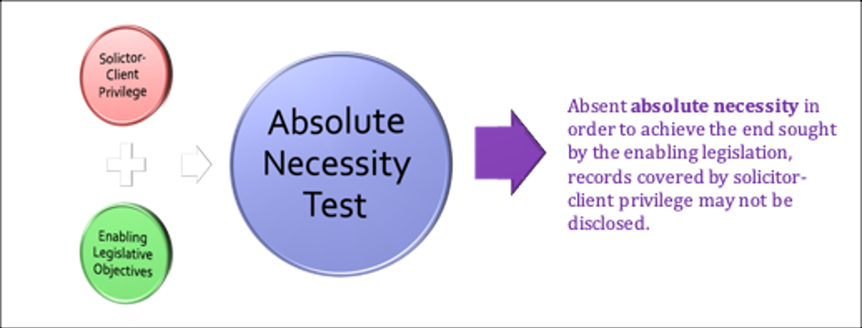

# Unit 9: Qualified Transfers

<!-- 
**Commentary**
 -->

<!--  -->

!!! danger "Kim Comment"

    Two (2) discussion posts on Unit 9 are due by end of day Monday, **November 16, 2026**. For Unit 9, we are exploring qualified transfers, which we have partially considered previously in Units 5 (Estates) and 6 (Equity). For this week, please familiarize yourselves with each of the following topics:

    - Basic Concepts
        - (a) What are the differences between possessory, reversionary and remainder interests?
        - (b) What are the differences between vested and contingent interests?
        - (c) What are the differences between defeasible and determinable interests?

    - State Limitations on Private Power
        - (a) What are the effects of a finding that a condition subsequent, a condition precedent, or a determinable limitation is invalid?
        - (b) What are some of the common sources that provide content for the public policy doctrine?
        - (c) What are the different standards that apply when determining whether a condition is void for uncertainty?
        - (d) What are the different modes by which the alienation of property may be restrained and the degree to which the common law will countenance such restraints?
        - (e) When does a rule against perpetuities issue arise?

This unit focuses on various mechanisms developed in the common law to place **conditions** on and, in effect, to **extend individual control** over, private property. 

The recurring issue in the area of **conditional transfers** is the appropriate **balance between private power and other public policy considerations.**

The unit begins with an introduction to some of the basic concepts and distinctions, including those between **vested and contingent interests**, and between **defeasible and determinable interests**. It then turns to a number of cases where the courts grapple with the appropriate balance between private power and public policy.

## 9.1 Basic Concepts

The material in this topic describes an array of property interests that are created when **transfers** of interests are **accompanied by some qualification, limit, or condition.** 

The list includes reversions and remainders, vested and contingent interests, determinable and defeasible estates, possibilities of reverter, and rights of re-entry.

**A. In Possession, In Remainder, In Reversion**

The case of ***Stuartbrun v Kiansky*** involves a property requirement for eligibility to political office.

 Under Manitoba’s election law, a person must be “an owner of land” to hold elected office. Kiansky held a remainder interest in fee simple in a property for which his mother held a life estate. Did he hold a property interest that would qualify him for elected office?

!!! note "Activity"

    Read the introductory material, the decision of the Manitoba Court of Queen’s Bench in ***Stuartburn v Kiansky***, and the comments that follow it, pages **557-62** in the *Reader*. 

The decision includes a useful reminder, from Anger & Honsberger, of the **doctrine of estates:**

The doctrine of estates is one of the most remarkable and enduring in the history of English land law. 

The term "estate" is probably derived from status, for in a landholding society the relationship one had to one's land no doubt defined one's standing in the community. Later, however, the term "estate" described the quantity of a person's interest in land. The concept of the estate is unique to English law. It is an abstraction, interposed between the tenant and the land so that a person does not own the land itself absolutely or allodially as in the civil law. Indeed, he cannot own the land for the Crown owns it. Instead, he [or she] owns an estate or interest in the land.

Pay particular attention to the Court's description of the various ways in which freehold estates may exist: **in possession**, **in remainder**, and **in reversion**. 

Even though Kiansky did not hold an interest in land that entitled him to possession until his mother died and the life estate ended, his remainder interest was nonetheless a “present right”. That right “co-exists with the life estate even though enjoyment and possession of the real property is postponed until termination of the life interest.” 

**B. Vested and Contingent Interests**

There is another important distinction between property interests that are **vested** and those that are **contingent**. 

Turning to **vested interests** first, there is a further division between those interests that are **vested in interest** and those that are **vested in possession**. 

Take the situation in ***Stuartburn v Kiansky***, the grant of a life estate to one person with the remainder in fee simple to someone else. The person who holds the life estate is vested in interest and in possession, while the holder of the remainder interest in fee simple is vested in interest, but not in possession until the life estate ends. 

**Contingent interests**, on the other hand, **are defined by the existence of a condition precedent:** an event or occurrence, which is **not inevitable** (such as death) that must occur before an interest will vest.

!!! note "Activity"

    Read the case of ***McKeen Estate v McKeen Estate*** and the comments that follow it in the *Reader*, **562-66**. 

The decision turns on whether a gift in the will was vested or contingent. Pay attention to the **four rules of construction** that the court describes for **interpreting a testamentary disposition:**

- the testator’s **intention** is paramount;
- a presumption **against intestacy**;
- a presumption **in favour of vesting**; and
- “a gift is *prima facie* vested if the postponement is to allow for a prior life estate”, the rule in ***Brown v Moody***.

There is a fifth rule that the court alludes to, but does not mention explicitly:

> where “the reason for the postponement of the gift is one personal to the donee, *prima facie* the gift is contingent”, the rule in ***Re Francis***.

Which of the rules of construction factored in the decision in ***McKeen Estate v McKeen Estate***? 

Remember, **rules of construction simply raise rebuttable presumptions.**

When you finish the case, go back to the provision in the will. The over-riding rule of construction in interpreting a will is to give effect to the testator’s intention. Does the result in ***McKeen*** correspond with what appears to be the testator’s intention?

Describe the nature of the interests in the following grants. Are they vested or contingent?

!!! danger ""

    - Land is transferred “to A and B for the life of C, then to B in fee simple”
        - A and B are co-owners a life estate for the life of C that is **vested in interest and possession**. 
        - B holds the remainder in fee simple that is **vested in interest, but not in possession** until the death of C.
    - Land is transferred or devised “to A and B for their lives and then to the survivor of them in fee simple.”
        - A and B are co-owners of a life estate that is **vested in interest and in possession.** 
        - While they are both living they have **a contingent interest in the remainder in fee simple**. 
        - When one dies, the other will become vested **in interest and possession** of the fee simple.
    - Land is transferred or devised “to A for life and then to C in fee simple if C marries D.”
        - A’s interest is vested **in interest and possession**, 
        - but until C marries D, which may or may not occur, **C’s interest is contingent.** If C does marry D, then C’s remainder in fee simple is vested in interest. **It will become vested in possession on A’s death.**
    - Land is transferred or devised “to A for life and then to B in fee simple if, and only if, B attains the age of 19 years.”
        - A’s life estate is vested **in interest and possession.** 
        - B’s interest is **contingent until he reaches 19**. Once B is 19, while A is still alive B is vested **in interest **and, on A’s death, becomes vested **in possession.**

**C. Defeasible and Determinable Interests**

The final distinction in this section is between **defeasible and determinable interests**. 

**Defeasible** interests are also known as interests subject to a condition subsequent because there is **some event that might occur that would cause the interest to come to an end.**  If the condition subsequent does arise, then the **transferor** may exercise **a right of re-entry** to **recover** the interest. 

A **determinable** interest is identified by a determining event that marks the end of the interest. **Should the determining event occur, then the interest will end and the property will pass to the grantor** who holds the **possibility of reverter**.

!!! note "Activity"

    The distinction between defeasible and determinable interests is a fine one, but was of consequence in the decision of ***Caroline (Village) v Roper***. Read the decision and the comments that follow in the *Reader*, **566-71**. 

Note the different phrases that come to be associated with one interest or the other. These phrases serve as a guide to identifying interests as defeasible or determinable. If you spot one of the phrases associated with either defeasible or determinable interests, then you may presume that it creates the interest with which it is associated. 

However, remember that **presumptions are rebuttable**, and that the overriding rule of construction in interpreting a will is to give effect to the testator’s intention.

The importance of intention is apparent in the questionable use of rectification in ***Caroline***. The use is questionable because rectification is usually reserved to correct a mistake, not to fix a poorly drafted provision. See also the note about ***St. Mary’s Indian Band v Cranbrook*** for the importance of intention and the importance of context in determining intention. 

Under the *Property Law Act*, [RSBC 1996, c 377](https://www.bclaws.gov.bc.ca/civix/document/id/complete/statreg/96377_01){:target=" \_blank"}, **s 10(4)** the possibility of reverter and the right of re-entry may be **registered as a charge** against title:

!!! warning ""
    
    **10(4)** **A possibility of reverter** or **a right of entry** for condition broken may be **registered** under the [*Land Title Act*](https://www.bclaws.gov.bc.ca/civix/document/id/complete/statreg/96250_00){:target=" \_blank"} against the title to the land affected in the same manner **as a charge**.

There is an important distinction when it comes to a finding of **invalidity for conditions** subsequent and determinable limitations. 

> If a condition subsequent were found to be **invalid**, then the **condition would be simply removed** and the property **transfers unconditionally.** 

This fits with the idea that the whole of the estate has been transferred, but that a right of re-entry might arise if the terms of the condition subsequent are not met. If the condition were invalid, then the transfer would be unconditional; the right of re-entry is lost. 

> On the other hand, if **a determinable limitation** were found to be **invalid**, then whole the **transfer would be void**. 

This is because the determinable limitation is actually describing the length of the estate. If the limitation that describes the estate were to be void, then no definable estate would have been transferred.

The next section focuses on the factors that might lead to a finding that a condition (including a determinable limitation) is invalid.

## 9.2 State Limitations on Private Power

Where does the state draw the line on the extent of private power over property? In the context of conditional gifts or qualified transfers, what sort of conditions will be allowed and what prohibited?

In general terms, **courts will pronounce a condition as void when it violates public policy.** Some examples of invalid conditions are obvious, such as those that encourage the recipient of a gift to commit a crime. Other conditions are less obviously contrary to public policy. For example, courts have been inclined to strike down general restraints on marriage, but not limited restraints such as stipulating the age at which a person may marry or the religion into which one must marry.

How do courts determine **“public policy”?** One of the dangers with such a broad, undefined term is that judges will impose their views to strike down or uphold a condition, unconstrained by the usual parameters of common law judicial decision-making. It is this hazard that has led some to describe public policy as an “unruly horse,” generating an image of a body of law that cannot be led or quieted, and thus difficult to predict.

In his *Principles of Property Law*, 6th Ed. at 251, Bruce Ziff suggests two categories of public policy in relation to conditional transfers:

- Public policy related **directly to the use** of property and primarily intended to **support the efficient use** of property. This is public policy that is **endogenous** to the institution of property, and would include promoting the certainty of interests and their alienability.
- Public policy related to a broader set of **social policy considerations**. This is public policy that is **exogenous** to the institution of property, such that the limits placed on the conditions or qualifications would be for purposes other than protecting or supporting the institution of property.

The material that follows turns first to the exogenous or broad social policy considerations and then to the endogenous or efficiency considerations that are about the efficient functioning of the institution of property. This distinction is a little artificial in the sense that an efficient property system may well be considered a social policy goal, but it may be thought of as one that is intrinsic to the system itself.

**A. Social Policy Considerations**

As alluded to above, one of the challenges in using a principle such as public or social policy as the test to determine the appropriate limits of private power is its indeterminacy and its capacity to change. What was valid and accepted one generation ago may now be understood as abhorrent and contrary to public policy. Moreover, public policy is inherently contestable and more commonly thought the realm of political rather than legal debate.

!!! note "Activity"

    Read the ***Re Leonard Foundation Trust*** case in the *Reader*, **571-82**. 

As you read the case, pay particular attention to and identify the sources that Justice Robins and Justice Tarnopolsky use to determine whether all or portions of the provisions in the trust violate public policy.

What do you think the decision in ***Re Leonard Foundation Trust*** stands for? And what is the importance of the fact that the foundation is providing access to public institutions? Bruce Ziff suggests

> the attempt to explain the line between permissible and impermissible discrimination by relying on a distinction between private and public conduct to be unhelpful. (*Reader*, 582). 

What do you think? Should gifts that support people from identified religions to attend public post-secondary education be generally prohibited? Should it matter if the public institution administers the scholarship?

The Leonard Foundation still exists and still provides financial assistance to Canadians or landed immigrants who are enrolled in an undergraduate degree program at a college or university in Canada. You will find a whitewashed biography of the man and the remaining eligibility criteria (those not struck down by the courts) as they appear in the original trust.

!!! note "Activity"

    Finally, read the excerpt from the article by Bruce Ziff, “Welcome the Newest Unworthy Heir,” in the *Reader*, **582-88**, for a discussion of the development of the law since ***Re Leonard Trust***. 

The case of ***McCorkill v McCorkill*** involved a gift to an American-based neo-Nazi organization. As you will see in the article, the case does not involve conditions that might be void as against public policy, but instead whether the law will countenance a gift in a will to this particular beneficiary. Ziff also reviews a set of cases involving scholarships to be administered by post-secondary institutions and limited to people of particular faiths. What do the courts say about the validity of these gifts and conditions?

**B. Uncertainty**

Uncertainty may be thought of as an issue that challenges the workability or efficiency of the institution of property. **A condition or limitation may be void for uncertainty**, although determining how much uncertainty is too much uncertainty is not straight-forward.

!!! note "Activity"

    Read the introductory material, the excerpts from ***H.J. Hayes Co v Meade*** and ***Fennell v Fennell***, and the comments that follow in the *Reader*, **604-11**. 

In the first case, note the two different types of uncertainty in the will: 

- the nature or character of the conditions (conditions subsequent or conditions precedent?), and 
- the terms (too vague?) What rules of construction does the court use in answering these questions?

!!! danger ""

    - Testator’s **intention**; 
    - Presumption **in favour of early vesting**; 
    - Presumption **against intestacy**.

There are different standards for the required degree of certainty depending on the nature of the condition. Why is this the case? Remember the discussion earlier in the unit about the different effects of a finding that a condition precedent, a condition subsequent, or a determinable limitation is invalid.

The excerpt from ***Fennell v Fennell*** deals with the issue of **whether a condition subsequent is void for uncertainty**. Note the focus on the testator’s intention and the requirement that the court look at **“the entire circumstances and not just the words in the Will itself to determine the Testatrix’s intention”.** 

However, even with that extrinsic evidence the court determined that the provisions in the will did not have the “practical level of clarity” required. Based on the readings in this Unit, how would you explain this standard for determining whether a condition subsequent is too uncertain?

**C. Restraints on Alienation**

The history of property doctrine in the English common law reveals a recurring tension between the desire of some to limit the alienability of land and of others to have the capacity to alienate it more freely. **To what extent should the law promote the alienability of land?** Or, to what extent should the law allow the holder of an interest in property to limit its alienability? These are recurring questions.

The law will not countenance a condition in a devise that property never be leased, mortgaged or sold, i.e., that it will never be transferred, but the **law does allow limited restraints on alienation.** The limits may be placed on the **mode of alienation** (selling, leasing, and mortgaging), the **class of recipients**, or the **time of alienation**. Furthermore, these restrictions may be combined.

!!! note "Activity"

    Read the excerpt from ***Trinity College School v Lyons*** and the questions that follow it in the *Reader*, **611-16**. 

The case involves two different options to purchase property. In 1963, the Bennetts sold a portion of their land to the school. They also granted the school an option to purchase the rest of the property at a fixed price should they decide to sell. Then in 1965, the school acquired more land from the Bennetts and an option to purchase the land at a fixed price when the Bennetts died. Were these options void as invalid restraints on alienation? Can you figure out why the court thought the first option valid, but the second option void? What does the court appear to be saying in this final passage from the judgment?

> It is reasonable to say that where an estate is bestowed, of which the power of alienation is an incident, that one conveying such an estate to another shall not have the power to alter its character, and to make it something wholly different from what it has been made by the law. To do so is to assume the power to make an estate unknown to the law. It is an attempt not simply to convey away an estate, but to exercise a legislative power, and to create a new form of property in land...

Look back to Unit 1 for a discussion of the doctrine that limits the creation of new forms of property.

**D. The Rule against Perpetuities**

This difficult and perplexing rule operates to place **a limit on the time that a contingent interest may remain contingent.** If the possibility exists that the vesting will occur too far into the future, then the transfer is void. The rule is attributed to the ***Duke of Norfolk’s Case*** (1681), and is described as follows:

> An interest is valid if it must vest, if it is going to vest at all, **within the perpetuity period**. That period is calculated by taking the **lives in being** at the date the instrument takes effect, **plus 21 years**.

Its function is to promote the alienability of property and it does so by targeting contingent interests. The rule against perpetuities only applies to contingent interests and it operates to limit the period of time in which a contingent interest may remain unvested. In brief, **contingent interests may not remain perpetually contingent.** However, establishing whether or not a grant with a condition precedent violates the rule against perpetuities can be a difficult undertaking.

In many jurisdictions, including BC, the rule against perpetuities remains, but considerably modified and simplified by statute such that **many grants that would have violated the common law rule will now be saved.** Scan through the *Perpetuity Act*, [RSBC 1996, c 358](https://www.bclaws.gov.bc.ca/civix/document/id/complete/statreg/96358_01){:target=" \_blank"}, sections 1-13, to get a general sense of the statutory intervention.

You should be aware of the rule against perpetuities, that it **applies to contingent interests**, and that **if it is triggered, then the condition is void and the transfer will fail.** 

==However, you will not be examined on its detail.==

## 9.3 Review Quiz

!!! danger "Quiz"

    1. A property interest that is vested in interest but not vested in possession is a contingent interest. 
        - [ ] True
        - [x] False

    2. The holder of a remainder in fee simple is vested in interest, but not vested in possession. 
        - [x] True
        - [ ] False

    3. A defeasible interest is also known as an interest that is subject to a condition subsequent. 
        - [x] True
        - [ ] False

    4. In a transfer, the phrase “so long as” is generally understood to create a determinable estate.
        - [x] True
        - [ ] False

    5. A condition subsequent gives rise to a right of re-entry if the condition is met. 
        - [x] True
        - [ ] False

    6. If a condition subsequent is found to be invalid, then the condition fails. If a condition precedent is found to be invalid, then the transfer fails.
        - [x] True
        - [ ] False

    7. What doctrine does the Ontario Court of Appeal rely on in *Re Leonard Foundation Trust* to revise an otherwise invalid disposition in order to give effect to the settlor’s intentions? 
        - [ ] Constructive trust;
        - [ ] Cy prés;
        - [ ] Recission; or
        - [x] Restitution?

    8. When it comes to uncertainty, the requirement for clarity is greater when the interest is subject to a condition subsequent than when it is subject to a condition precedent.
        - [x] True
        - [ ] False

    9. Restraints on alienation of property may include limits on: 
        - [ ] The mode of alienation;
        - [ ] The class of recipients;
        - [ ] The time of alienation; or
        - [x] All of the above.

    10. The rule against perpetuities applies only to contingent interests.
        - [x] True
        - [ ] False

