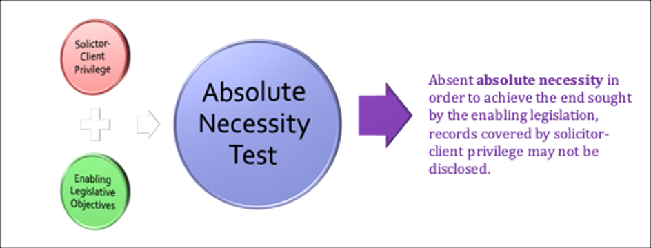
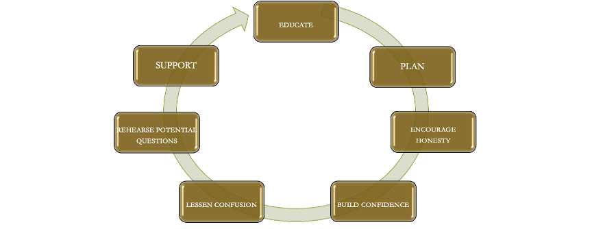

#  Module 5 - Ethics & Civility

<!-- 
**Commentary**
 -->

<!--  -->

## 5.0: Overview

In this Module we move on to an area of legal ethics and professional conduct that spans many areas of working as a lawyer: **civility and ethical conduct in advocacy.**  

We will be examining ethics and civility and how they can **relate to conduct during litigation**. Of course, there are a great many areas where the work of a lawyer is that of a passionate advocate.  We have seen though that passion can lead to hyper-zealous conduct and that may entail problems in civility relating to conduct in those situations.

!!! note "Readings"

    - Woolley Chapter 6: Ethics in Advocacy Pages **313-373** 
    - **Code**:  5.1, 5.2, 5.3, 5.4, 5.5, 5.6, 5.7 [but not 5.1-2.1, 5.1-3, 5.1-7, 5.1-8]
    - **Cases**:
        - ***C.B. v Zellers Inc.*** [1996] M.J. No. 362, also know as ***B. (D.C.) v. Arkin***, [1996 CanLII 12439 (MB QB)](https://canlii.ca/t/g9v33){:target="_blank"}
        - ***Grossman et al. v. Toronto General Hospital et al.***, [1983 CanLII 1975 (ON HCJ)](https://canlii.ca/t/g12gh){:target="_blank"}
        - ***R. v. Lyttle***, [2004 SCC 5](https://canlii.ca/t/1gd50){:target="_blank"}
        - ***R. v. A. J. R.***, [1994 CanLII 3447 (ON CA)](https://canlii.ca/t/6k8c){:target="_blank"}
        - ***Ahuja (Re)***, [2017 LSBC 26](https://canlii.ca/t/h4r68){:target="_blank"}
        - ***General Motors Acceptance Corp. of Canada v. Isaac***, [1992 CanLII 6237 (AB QB)](https://canlii.ca/t/28ntp){:target="_blank"}
        - ***Groia v. Law Society of Upper Canada***, [2018 SCC 27](https://canlii.ca/t/hsb9d){:target="_blank"}
        - ***Schreiber v. Mulroney***, [2007 CanLII 31754 (ON SC)](https://canlii.ca/t/1sgp0){:target="_blank"}
        - ***Laarakker (Re)***, [2011 LSBC 29](https://canlii.ca/t/fn6cd){:target="_blank"}
 
## 5.1: The Advocate – Different Visions

A lawyer’s role can be envisioned in different ways, such as **absolute loyalty to a client** or **pursuit of the public interest**.  And as we have reviewed the usual approach is to to try to **balance these often competing interests**.  

Stressing the specialized role of a lawyer as an advocate, especially in context of civility and ethics, is often particularly hard to keep within this balancing act.  

Acting as an advocate is one area where lawyers are expected to act zealously, but sometimes move into hyper-zealous conduct to try to **advance their their clients interests**.  However, advocacy is an aspect of professionalism and as a lawyer you have a huge responsibility to **protect the integrity of the administration of justice**, which is crucial to proper functioning of the justice system in Canada.

!!! info ""

    - The **“civil” in civility** in civil advocacy refers to being courteous, honest, etc.  
    - The **“civil” in civil litigation** refers to non-criminal litigation or trials such as claims for negligence or breach of contract. 

!!! note "Activities"

    Let's take a look at **rule 5.1-1** in the BC **Code**. 
    
This rule states that lawyers, when acting as an advocate or lawyer, must **represent the client resolutely and honourably within the limits of the law**, while **treating the tribunal with candor, fairness, courtesy and respect**.

This module will focus on the role of an advocate in terms of **ethics and civility in the context of civil litigation**. We will consider some **criminal aspects as well**, particularly ethics at trial and witness preparation. 

The interesting thing about this rule is, if you look at the commentary, it states the lawyer's duty to fearlessly raise every issue, advance every argument and ask every question, however distasteful, that is authorized by law and that that you think as the lawyer will help your clients case. Let's look at the **scope of the rule**.

It applies to your role as a lawyer, as an advocate, not only in informal **court** appearances, but also extends to appearances and proceedings before **boards and administrative tribunals**, other administrative **decision makers**, also in the context of **negotiations** and **mediations** and **arbitrations**, and this is important particularly for the negotiating context, it applies regardless of their function or the informality of their procedures.

It's important to consider this for a moment because the scope of this rule is somewhat **broad**. Part of the advocacy role that encourages zealous practice is a suggestion that you should **refrain from expressing your own personal opinions** on the merits of your clients case to a court or tribunal or other decision maker.

!!! note "Activities"

    Note **rule 5.1-5** because it ties into what we're looking at in this module.

That rule states that a lawyer must be courteous and civil, acting in good faith to the tribunal and all persons with whom the lawyer has dealings. So again, it's quite broad.

**The ethical rule is broader than a narrow legal concept, which is contempt of court.** And if you look at the commentary to this rule, it distinguishes its ethical requirements from the strictly **narrow legal requirements of contempt of court**. It stresses that the two concepts, legal contempt of court and professional obligation, are not identical.

A consistent pattern of rude, provocative, or disruptive conduct if it's engaged in by a lawyer, even though that kind of conduct might not be punished as contempt of court, may nevertheless constitute **professional misconduct** under the ethical code rules.

Lord Denning talks about your duty as a lawyer to a higher cause, a cause that's even higher than your client. It's **a duty to the administration of justice** and he even calls this **a code of honour**. He talks about a fearless duty, but not just in the context of trying to win your clients case.

This is largely the paradigm or framework that we're discussing in this module: how to identify these competing interests when they arise, and how to deal with them ethically when they do arise.

Turning to advocacy and civility, according to Wooley, they have two central meanings. 

- **First**, includes the requirement that lawyers treat each other and all of those part of the legal complex with **a certain degree of professionalism**, but more specifically with **a degree of politeness**.

- There's this requirement to act politely. To a certain degree, however, the **second** part of the meaning of civility in this context is the **inclusion of obligations generally defined or circumscribed in provisions of law, society, Codes of Conduct**. 

In BC it would be the *BC Code of Professional Conduct*. So the sources for this obligation are listed in the Woolley readings, but there are actually **four sources** which are involved the courts inherent jurisdiction to govern proceedings:

- **Codes of conduct** contemplating a high level of lawyers civility, which we've just looked at in some detail with rule 5.1-1 and 5.1-5,

- The other rules as well that we will look at further on in this module and a bit later in the course.

- The third source of the obligation of a civility are **best practice** that have been developed. These may not be formally binding as noted in the readings, but they do provide important guidance for lawyers. They also provide guidance for courts and for Law Societies who may be seeking to sort of regulate this type of behaviour. 

- The obligation for civility involves the **lawyers own personal ethics** and these play a really important role self-regulating civility. It might be the most important actually in a practical sense, **self-control** over a lawyers own behaviour.

You may see a potential conflict here, even though generally most people would agree that acting politely and with courteousness is probably a good thing in most aspects of society. Some lawyers might argue that in many situations it clashes with the lawyer's obligation to advocate zealously on behalf of their client. The counterpoint to this argument is that it's based on a false premise that to act zealously one cannot act politely or civilly with courteousness towards the opposing side. And in fact there are several research studies that have been conducted that say that **juries and even judges can be negatively influenced by impolite or discourteous behaviour**, even if it's intended to be in the service of zealous representation for a client. 

So in other words, **acting civilly might actually benefit lawyers, clients**, interests in many, if not most, cases.    

## 5.2: Civility & Ethics in Pre-Trial Procedures

In context of civil (non-criminal) litigation, many of the ethical issues tend to arise even before the trial stage.  Part of this is because in civil litigation these days a growing number of cases don’t even get to trial for a number of reasons, like negotiated settlements or just dropping the case.  

There are several steps in **pre-trial procedures** before a civil matter can get to trial:  **Initial Client meeting**, **Pleadings** and **Discovery** among them.  

Ethical issues can arise at any one of these steps.  In this topic we will examine the initial client meeting and pleadings.  There are also issues that can arise in the discovery stage, but we will consider those separately in Topic 3.

**PRE-CIVIL TRIAL PROCEDURE**

Many of the difficulties here can arise at the pleadings stage. This is where a lawyer has  to craft the legal argument for their client.  

Imagine that you are representing a client in a civil matter:  

- How are you going to do that in a civil, ethical manner while being “fearless” and “advancing every argument” for your client?  
- What would you do in situations if you suspect that your client is pursuing litigation against another party, perhaps a little vindictively and with a personal grudge, solely to force a settlement in a case?  
- What if the other party in this case is an economically or socially disadvantaged person?  What if these considerations are present and your legal argument is particularly weak?  

You want to be conscious here of **potential abuse of process**.  Some of these ethical considerations relating to pleadings are dealt with in provincial Rules of Court.

The [*B.C. Supreme Court Civil Rules*](https://www.bclaws.gov.bc.ca/civix/document/id/complete/statreg/168_2009_00){:target="_blank"}

The B.C. Supreme Court Civil Rules are the general court rules for civil cases.  They outline procedures and processes, often in a fairly detailed manner.  Subject to some very limited exceptions they govern every proceeding in the Supreme Court of B.C.

[*Rule 9-5 — Striking Pleadings  - Scandalous, frivolous or vexatious matters*](https://www.bclaws.gov.bc.ca/civix/document/id/complete/statreg/168_2009_01#rule9-5){:target="_blank"}

Rule 9-5 governs the procedures for **striking (e.g. removing) pleadings**.   

- This type of provision is generally meant to **stop a type of hyper-zealous advocacy** involved in making pleadings that are frivolous or vexatious and often designed simply to frustrate the court or the other party for no real substantial purpose.  
- This provision is also designed to deter this type of pleading by ordering costs to be paid by the offending party.  

Lawyers should not obviously conduct themselves in a frivolous or vexatioous manner.  This is a real risk risk in pursuing this kind of conduct because a lawyer’s client can open themselves up to liability for abuse of process litigation.   

In B.C. this type of conduct can now also lead to individuals being designated as **“vexatious litigants”** who have procedural limitations and requirements imposed on them prior to filing any civil litigation.   

**BC Code Rules**

The ethics code provisions here apply regardless of whether there is a motion under the Rules of Court to strike down the pleading.  **Rule 5.1-2** omitted.

This rule flows from the other part of the lawyer’s duty as an advocate:  

discharging the duty fairly and honourably, treating the court or tribunal in a way that promotes the all parties’ rights to a fair hearing in which justice can be done.
 

The commentary to the lawyer as advocate rule specifically says that behaviour that encourages dignity, decorum and courtesy in the courtroom is not an “empty formality” because unless order is maintained, rights cannot be protected.

In civil litigation there is a general ethical requirement to **avoid frivolous objections and conduct seen as “vexatious.”**  As a lawyer, this obligation extends to discouraging a client to adopt tactics that just merely delay or harass the other side, solely for the purpose of making the other side “pay a price.”   The commentaries to Rule 5.1-2 point out that those practices can readily bring the administration of justice and the legal profession into disrepute.

Rule 5.1-2(b) addresses more directly the need to **refrain from assisting or permitting dishonest or dishonourable conduct from the client.**  Again, this goes to your duty as a lawyer in civil proceedings not to mislead the court about the position of your client in the litigation.  It goes to the core of the adversarial process and the theory that what keeps the adversarial process working is the portrayal of the honest positions of the parties.  

Ask yourself the question that if all lawyers were to completely disregard this rule, what would likely happen?  

**Case Study**

!!! info "***D.C.B. v Zellers Inc.*** [1996] M.J. No. 362， AKA ***B. (D.C.) v. Arkin***, [1996 CanLII 12439 (MB QB)](https://canlii.ca/t/g9v33){:target="_blank"}"

    The ***Zellers*** case is a good example of questionable lawyer conduct in the context of a dubious claim. 

    The simple facts involve the plaintiff’s son stealing from a Zellers store and getting caught. Zellers hired a lawyer named Arkin to send a letter to the plaintiff claiming that Zellers had a legal right to sue the parent unless the parent paid $225. In response to the demand letter the parent paid that fee.  She subsequently realized that legally she may not have been required to pay, and then sued Zellers to recover her payment. 

    There are contractual law issues here of forbearance and good consideration, specifically whether forbearance to sue (e.g. Zeller’s agreement not to sue if it was paid) is good, valid consideration.  
    
    However, that is not the main issue for our purposes.  Here, we are concerned with **whether the lawyer, Arkin, knew that the forbearer, Zellers, did not have a valid claim against the other party.**   Zellers’ claim is clearly invalid because there is **no general rule that parents are liable for the torts of their children** by virtue of their status as parents.  

    There was no valid claim here.  In other words, **Arkin should have known this and should not have sent this letter even if Zellers’ had instructed him to do so.**  However, that did not stop Zellers from attempting to appeal the decision to the Manitoba Court of Appeal (leave to appeal was refused).

    Jewers J. was unsparing in his criticism of Arkin at paragraph 18 of the decision:

    > Whatever legal opinion or opinions Zellers might have had regarding their claims generally, I cannot believe that they seriously thought that this claim could succeed or that they seriously intended to pursue it to court if it was not paid. 
    
    > Mr. Arkin was not called as a witness at the trial and so we do not have the benefit of what his opinion of the claim was. But I assume that **as a competent and responsible lawyer** [emphasis added], **he knew or ought to have known that the claim had no prospect** whatsoever of succeeding in court and that it would be futile to pursue it.

Is there any financial punishment here for Zellers or Arkin for this type of behavior?  In terms of Costs for the litigation, **the fact that a lawyer starts an action which is unlikely to succeed is not, on its own, generally a basis to award costs personally against that lawyer.**  

However, if that proceeding can be characterized as **vexatious or abusive**, then those are factors that have been considered in awarding costs p**ersonally against that lawyer**.  Woolley references ***Best v Ranking***, a 2016 Ontario Court of Appeal decision, where the lawyer was assessed personal costs of $84,000 for this type of conduct.

## 5.3: Discovery & Negotiation

In common law jurisdictions, **discovery is a pre-trial procedure in civil litigation**.   Each party to the litigation case has the ability to gather evidence from the other party or parties through discovery.  

**Discovery is actually a number of procedures:** 

- **Examination** for Discovery (oral questioning)
- **Interrogatories**, which are written questions to the other party;
- **Requests** for documents and admissions from the other party, and so forth. 

You can **subpoena non-parties to compel them to produce documents for discovery**. 

**Discovery Procedure**

Discovery entails **close examination of evidence**. It is a stage in the litigation process where very sensitive information like personal files and other private documents can be turned over to the other party.  

Because of the sensitive nature of discovery, it is generally heavily regulated.  As Woolley notes, it is typically an area of provincial regulation with provincial rules of court, such as the *B.C. Supreme Court Civil Rules*.  These rules outline the types of documents and information that may be subject to discovery and also the procedure that must be followed.  The rules also outline remedies for mistakes or improper conduct of discovery during the process.

In B.C., Discovery is dealt with in the Supreme Court Civil Rules under [Part 7 “Procedures for Ascertaining Facts”](https://www.bclaws.gov.bc.ca/civix/document/id/complete/statreg/168_2009_01#part7){:target="_blank"}. 

Rules 7-1 through 7-3 outline the procedures for Discovery and Inspection of Documents as well as Examinations for Discovery and Discovery by Interrogatories.

The actual **discovery process** usually takes place in one of the lawyers’ offices.  It can also take place clients’ offices or boardrooms, usually when going through business files or documents.  

An **exam for discovery (E4D)** takes place in same locations but sometimes it can also occur in a court reporters office.  The judge is not physically present during discovery.  The discovery process is in the control of the lawyers and their clients.  This can create the potential for some ethical problems.

**Case Study**

!!! info "***Grossman et al. v. Toronto General Hospital et al.***, [1983 CanLII 1975 (ON HCJ)](https://canlii.ca/t/g12gh){:target="_blank"}"

    During production of documents the hospital submitted only the deceased’s hospital record and objected to the production of other documents.  **One of the questions raised was:** How could a 12 day search for a missing person at hospital result in only 1 piece of relevant documents being produced?

    The Hospital claimed privilege on virtually all documents and would not describe them.  Another question arose relating to the Hospital’s original affidavit, which did not disclose the existence of other documents.  The **central issue** then revolved around the **inadequacy of the affidavit of documents produced for discovery by the Hospital’s lawyer and whether this constituted a breach of the lawyer’s duty to make,** in words of Reid J in this case, **a “full, fair and prompt discovery.”**

    The hospital’s lawyer claimed the plaintiffs had failed to establish any documents existed that should be produced, other than the deceased’s medical record.  Solicitor-client privilege was further claimed for any other relevant documents as it was claimed that the hospital had at that point retained counsel. However, Reid J. stated that **the answer made in the hospital’s affidavit was “mere boiler-plate calculated to conceal all and any documents from inspection.”** 

    Finally, note Reid J.’s final comments relating to the conduct of hospital’s counsel:  “I am satisfied to treat this case as **an example of excessive zeal** and to adopt Master Sandler's order.”

The ***Grossman*** case reflects long-standing common law precedents relating to the insertion of **"boilerplate" description of documents requested under discovery.**  

“**Boilerplate**” language in the legal context refers to using **standardized, generic language** in legal documents or contract clauses that may **not be specifically tailored to the facts** of a particular document or case.  Claiming privilege using “boilerplate” language in this manner to preempt disclosure of documents is generally not proper practice.  **However, that practice has continued to be used** in the absence of any significant objection to it by lawyers.

EXAMPLE OF BOILERPLATE LANGUAGE USED IN DISCOVERY

THE SECOND PART THEREOF:  showing documents in possession of the said defendants which they do object to produce.  

Reports, statements, plans, memoranda, correspondence, photos, sketches, communications and other documents which have been passed between their solicitors and representatives of these Defendants and between their solicitors and third parties for the purpose of obtaining or furnishing information and material to be used on their behalf in this action, or to enable such material to be obtained and to enable their solicitors to prosecute the action on their behalf, and to advise their solicitors with reference thereto.

***Grossman*** illustrates the principle that the proper functioning of discovery is mostly in the hands of lawyers on both sides of a case. In ***Grossman***, it was apparent that **a full and accurate discovery of documents could only to be obtained through the persistence of the plaintiff's lawyer.**  

The case is also important for the general guidelines it contains as to what constitutes a sufficient description of documents for which privilege is claimed, and as to how that privilege should be asserted.   

The lesson from ***Grossman*** lies in the **lawyer’s duty to make full, fair, and prompt disclosure**, including making diligent inquiries about material documents in the possession of others for the client.  

When asserting privilege, the lawyer should at least describe the documents so that it may be contested and mediated by the court, if necessary. Excessive zeal may increase unfairness, obstruct the search for truth, and waste time and money.  The court rules and ethical code are designed to facilitate production of documents in this situation, not frustrate it.

**Negotiations**

Advocacy isn’t restricted to litigation and the courtroom.  A lawyer’s advocacy on behalf of a client, and related ethical responsibilities, extend into any negotiations conducted on behalf of their client.  

Negotiating is a process which allows for some flexibility in applying ethical standards.  This is due to the general goal of the negotiating process, which is to fairly settle a matter before proceeding to litigation and court.  However, like discovery, it is **a process that is mainly in the hands of lawyers**, although **mediators**, **arbitrators** and **small claims court Judges** can participate in certain processes as well.

Many judicial statements in case law often encourage or refer to efforts to settle matters before trial.  The 2006 Ontario Court of Appeal case of ***Ristimaki v. Cooper***, [2006 CanLII 12415 (ON CA)](https://canlii.ca/t/1n2kz){:target="_blank"}, referenced in Woolley readings, mentions discussions about **settlements as “something which pervades, and should pervade, every lawsuit.”**   

The hurdles over accessing the justice system including the exorbitant costs of litigation, especially in provincial superior courts, requires parties, whenever practical, to seriously consider negotiating settlements prior to engaging in litigation.  

Even expenses in small claims court can quickly mount.  That is why as part of the Small Claims process there is **a mandatory Settlement Conference** that must be attended by the parties, which is designed to encourage litigants to settle out of court.  

In addition, newer mechanisms like the **BC Civil Resolution Tribunal**, which deals with certain motor vehicle injury, small claims cases and strata property disputes, have decreased costs by facilitating negotiated settlements and having litigants primarily represent themselves.

In relation to the regular superior courts, [Part 9](https://www.bclaws.gov.bc.ca/civix/document/id/complete/statreg/168_2009_01#part9){:target="_blank"} of the *BC Supreme Court Civil Rules* put in place procedures to settle before trial.   In terms of the BC **Code**, the following is found under **“Encouraging compromise or settlement”**

3.2-4  A lawyer must advise and **encourage** a client to compromise or settle a dispute whenever it is possible to do so on a reasonable basis and must **discourage** the client from commencing or continuing useless legal proceedings.

The commentary to this rule suggest that a lawyer should “consider the use of alternative dispute resolution (ADR) when appropriate, inform the client of ADR options and, if so instructed, take steps to pursue those options.”  

Alternative Dispute Resolution (ADR) is a very large area comprising negotiation, mediation and arbitration.  It is an out-court dispute resolution mechanism.  Unfortunately, there is not any other information in the BC **Code** suggesting when or how ADR or settlement negotiations are to be conducted. 

There is also not much information in the BC **Code** on the manner in which negotiations should be conducted.  

It is assumed that many of the obligations of general ethical lawyer conduct extend into negotiations.  The [*Law Society of Alberta Code of Conduct*](https://www.lawsociety.ab.ca/regulation/act-code-and-rules){:target="_blank"} includes some more specific language prohibiting a “lie” or to “mislead” another lawyer, even during negotiations.  It even defines “misleading” as including misconceptions through oral or written statements, actions or conduct, failure to act or silence. The Alberta code goes even further in requiring a lawyer who has learned that they have inadvertently misled or made a material misrepresentation to an opposing party, to immediately correct the opposing party’s resulting misapprehension.  **This requirement is not part of the current BC Code.**

## 5.4: Ethics at Trial

One of the first issues often encountered in preparing for a trial lies in the **preparation of witness**.  

Witnesses can be a critical part of the trial process and lawyers are expected to prepare witnesses.  The ethics rules generally include a blanket instruction to not deceive the court but there is also a discussion of other preparation and instructions which are **ethically acceptable**:

- Review of both parties’ **theories** of the case
- Review of the basic **issues and materials** in the case
- Review of the **issues that a witness may be asked** or speak to
- Specific **areas of questioning**
- **Areas of particular interest** to the other side
- What an **examination** in court and **cross-examination** will look like
- What **statements or questions a judge may pose**

These instructions are all part of witness preparation.

**Conducting Witness Preparation**

When conducted properly and in good faith, witness preparation is not only ethically acceptable, it’s part of your duty to your client as a lawyer.  What is **not acceptable** is to move beyond this into **actually coaching or coercing a witness to say or do something**.

> "The lawyer’s duty is to extract facts from the witness, not to pour them into him; to learn what the witness does know, not to teach him what he ought to know.”  
> ~ from the New York decision ***In the Matter of Eldridge*** 82 N.Y. 161, 171 (1880)

What is not ethically proper but is sometimes easy to fall into is **witness coaching**.  As opposed to witness preparation, which is part of your duty to your client to prepare them for an examination or hearing, witness coaching goes beyond familiarizing a witness with the process and their knowledge of the case and into **evidence tampering**, directly instructing a witness to say certain things which are not true, and often tampering with or obstructing justice.  

A lawyer must **not assist or encourage the client (or any witness) in giving false or misleading evidence.**  A lawyer who attempts to obstruct justice by willfully counselling misleading or willfully evasive evidence not only breaches their ethical duty to the court but likely also commits a criminal offence.   

The ***R v Lyttle***, ***R v. R (A.J.)***, ***GM Acceptance Corp v Isaac Estate*** and ***Ahuja*** cases illustrate ethical issues related to trial conduct.

!!! info "***R. v. Lyttle***, [2004 SCC 5](https://canlii.ca/t/1gd50){:target="_blank"}" 
    
    The main **issue** before the Supreme Court was to determine **if a good faith basis is sufficient for cross examination or is legal counsel bound to provide some basis in evidence for cross examination?** 

    The Supreme Court of Canada wrote of the great importance of cross examination in Canadian legal system as, among other things, being vital to testing credibility. As stated in the opening paragraph of the decision: 

    > Cross-examination may often be futile and sometimes prove fatal, but it remains nonetheless a faithful friend in the pursuit of justice and an indispensable ally in the search for truth.  At times, there will be no other way to expose falsehood, to rectify error, to correct distortion or to elicit vital information that would otherwise remain forever concealed.

    A judge must balance the rights of an accused to receive a fair trial with the need to prevent unethical cross-examination. The court must ensure **“counsel is not merely taking a random shot at a reputation imprudently exposed or asking a groundless question to waft an unwarranted innuendo into the jury box.”**

Questions about evidentiary foundation can be posed as long as there is a good faith basis for the question. 
    
“**Good faith”** is a function of the information available to the cross-examiner, their belief in its likely accuracy and purpose for which it is used.   **If a lawyer has a good faith basis to ask a probing or suggestive question, and the question doesn't violate any other rules of evidence (like hearsay or relevance), the judge has to allow it.** 

**The right to cross-examine in criminal trials is now recognized as a constitutional right**, protected by ss. 7 and 11(d) of the *Canadian Charter of Rights and Freedoms*.

In terms of the **ethical responsibilities in cross-examination**, they are well stated by Lord Reid in the UK House of Lords case of ***Rondel v. Worsley***:

> Counsel must not mislead the court, he must not lend himself to casting aspersions on the other party or witnesses for which there is no sufficient basis in the information in his possession, he must not withhold authorities or documents which may tell against his clients but which the law or standards of his profession require him to produce.

!!! info "***R. v. A. J. R.***, [1994 CanLII 3447 (ON CA)](https://canlii.ca/t/6k8c){:target="_blank"}"

    The case dealt with an allegation of improper cross-examination. The accused was charged with multiple counts of incest and sexual assault in relation to his daughter and granddaughter.  He was convicted at trial and appealed, arguing that the Crown Counsel’s cross examination of the accused resulted in miscarriage of justice because it was so improper and prejudicial as to render the trial unfair.  
    
    The appeal was allowed as the Court of Appeal held that **the cross examination by Crown Counsel was abusive and unfair.** It was noted that Crown Counsel adopted a sarcastic tone from the outset, repeatedly editorializing (e.g. responding by saying “incredible”, asking if “you want the jury to believe that one too”). Throughout the cross-examination it was held that the approach was to demean and humiliate the appellant and this prejudiced him.

What you should glean from this case:  

- Cross-examination must not cross over the line **from aggressive to abusive**. The cross-examination, considered in its totality and in the context of the entire trial, should not prejudice an accused nor should lawyers act in an abusive manner during cross-examination.  Such conduct could give rise to prejudice and undermine the appearance of fairness at trial. 
- Counsel must **not express personal opinions** during cross-examination, nor should they turn it into an argument.
- If improper cross-examination **prejudices** the accused's defence, or is so **unfair** that it brings the administration of justice into disrepute, an **appellate court must intervene**.

!!! info "***General Motors Acceptance Corp. of Canada v. Isaac***, [1992 CanLII 6237 (AB QB)](https://canlii.ca/t/28ntp){:target="_blank"}"

    The family decided to give up the car and approached the dealer, asking them to take the loan off their hands.  The dealer agreed, but the GM loan corporation refused.  The parties went before the Master seeking summary judgment. 
    
    Counsel for GM knew of a case that weighed heavily against GM but did not disclose it.  During final submissions, the Master realized that there was an authority that is directly on point and that neither side had raised.  The Master raised the case.  Counsel for Isaac stated they did not know about it while GM’s counsel says they were aware of it but did not raise it. 

    ***Isaac Estate*** stands for proposition that **an advocate has a responsibility and duty** as an officer of the court to **bring relevant case law to the attention of the court**.  
    
    Why?  Master Funduk answers that question in the decision by quoting from the BC Court of Appeal:

    > “The reason is simple. Counsel must assist the court in doing justice according to law. When a point is deserving of consideration, the judge must have regard to all the relevant authorities.”  
    > ~ para 90 quoted from ***Lougheed Enterprises Ltd. v. Armbruster***.

    Counsel’s silence about a relevant decision, especially a binding one is not acceptable.  Reported cases in the knowledge of a counsel must be brought to the courts attention. Counsel cannot discharge their duty here by not bothering to determine whether there's a relevant authority.  In other words **ignorance is no excuse.**  **Counsel is not entitled to assume that the case is distinguishable and so not provide it**; they have to bring it forward and then try and distinguish.

What is appropriate **punishment for inappropriate conduct** breaching ethics at trial?

Punishment for conduct breaching the **Code** relating to trials can vary.  Generally, the **seriousness** of the breach is based on the effect of the parties in the trial.  There is also a consideration of **recurring** behaviour breaching the **Code**.

!!! info  "***Ahuja (Re)***, [2017 LSBC 26](https://canlii.ca/t/h4r68){:target="_blank"}"

    Counsel Ahuja attended a Vancouver Canucks hockey game the night before a hearing, consuming some alcohol, and overslept the following morning missing a flight for a hearing in Kelowna that morning.  He subsequently deceived both the court and his client as to the reasons for missing the hearing.  

    In this case there was concern over previous misleading behaviour relating to a previous driving with a suspended license charge.  **Recurring misbehaviour** does indeed “call out for a suspension”. The similarities between this matter and the issue with the suspended driving incident considered by the Credentials Committee were found to be **“too stark to be ignored” by the disciplinary Hearing Panel.**  

    The Hearing Panel found that this case called for a reinforcement of the importance of honesty in all dealings as a lawyer.  **Ahuja was found guilty of professional misconduct.**  He was suspended for one month and ordered to pay costs in the amount of $3,500 plus disbursements.

## Discussion Activity

Consider the issues and questions below and discuss one of the following:

- How should lawyer's balance the various obligations set out in ***Lyttle*** and ***A.J.***? Do the nature of the allegations have any relevance to your thinking? 
-Could counsel for ***Zellers*** have relied on the concept of a "novel" case argument, as a defence to the ethics of their conduct in writing the demand letter? At what point does an advocate's effort to "raise fearlessly every issue [and] advance every argument" (**Code 5.1-1**) through vigorous advocacy on behalf of a client turn into an exercise of using the litigation process for purposes that would offend rule **5.1-2(b)**? Should costs have been awarded personally against the lawyer in ***Zellers*** or in the ***Grossman*** decision, where the Judge found the lawyer's conduct amounted to "excessive zeal?"
- Review this article on [CBA National Article on Why Civility Matters](https://nationalmagazine.ca/en-ca/articles/the-practice/small-and-solo-0f21ef9547cbca5e7d354fdcca311c87/2025/why-civility-matters){:target="_blank"} and indicate whether or not you agree with it, and why or why not - reference the course material from this Module.

## 5.5: Advocacy & Civility

Recall that **civility** generally means treating those participating in the justice system with **politeness**.   Lawyers however have a special ethical responsibility relating to civility.

For lawyers, Recall **Rule 5.1** and the particular ethical obligations to act **honestly**, **fairly** and with **integrity** in dealing with other lawyers and members of the court.  

Going back to punishment for unethical behaviour, there are some questions relating to when how disciplinary actions should be taken against uncivil behaviour.  The general **disciplinary measures** available for advocacy related misconduct include: 

- Costs against a **client**
- Costs against a **lawyer** personally
- A **negative** order under a given rule of civil procedure
- A law society **disciplinary** order.
- **Criminal** sanctions
- Negative **reputation** in the eyes of fellow members of the bar and current/future clients.

The Woolley readings reference a few helpful **disciplinary decisions** in this area.  In ***Law Society of Upper Canada v. Wagman***, the nature of **rudeness** was found to comprise threats which could have inhibited that individual’s willingness to participate openly and fully in the litigation process.  In ***Law Society of Upper Canada v. Kay*** & ***Law Society of Alberta v. Wills***, both cases noted that the lawyers’ **rudeness** is contrary to the interests of clients.  

However, in disciplining the lawyer not for violations of fundamental values, but for rudeness, the disciplining law society risks obscuring the real ethical issues at play.  The following cases illustrate some of the **difficulties in defining and disciplining lawyers when it comes to civility**.

!!! info "***Groia v. Law Society of Upper Canada***, [2018 SCC 27](https://canlii.ca/t/hsb9d){:target="_blank"}"

    The Supreme Court of Canada commented on the **appropriateness of disciplinary actions** in the ***Groia*** decision.  
    
    The duty to practice law with “civility” can be difficult since it does not just concern being polite. The Law Society can charge lawyers who act uncivilly with professional misconduct.

    Generally, **uncivil behaviour** in a court by a lawyer under an honest, mistaken understanding of the law **may not amount to professional misconduct**. The Supreme Court stressed the **facts and context of a disciplinary case is important in analyzing whether uncivil behaviour crosses the line into professional misconduct.** 
    
    <!-- The facts in this case involved Groia acting as the lawyer for an executive charged with insider trading and other crimes.  The trial atmosphere was tense, marked by sarcastic remarks, personal attacks and allegations of professional impropriety.  For much of the trial, Groia believed that crown prosecutors were acting inappropriately, repeatedly accusing them in harsh language of abuse of process.  Groia was mistaken about the law however the judge did not correct him. -->

    The Law Society of Upper Canada investigated Groia and he was ultimately found guilty of professional misconduct.  He received a one month suspension and ordered to pay court costs. Groia lost several appeals before the case finally reached the Supreme Court of Canada.   The majority of the Supreme Court found that the **Law Society’s decision was unreasonable**.  There were several reasons for this:

    - Groia had **a reasonable basis to accuse** the prosecution of misconduct, even though the allegations stemmed from his mistaken understanding of the law.
    - His actions in raising abuse of process were due, in part, to the **prosecutors’ conduct**, the fact that the judge did not correct him, and the legal uncertainty about how to raise the issue.
    - There was **concern** that the Law Society’s decision would make lawyers think twice about forcefully defending their clients, for fear they could be charged with misconduct.
    
    A minority of justices disagreed with the majority.  The minority wrote that Groia had disrupted the trial and unfairly accused the other side’s lawyers of dishonesty. In their view the law society’s decision in the circumstances was reasonable.

- ***Schreiber v. Mulroney***, [2007 CanLII 31754 (ON SC)](https://canlii.ca/t/1sgp0){:target="_blank"}
- ***Laarakker (Re)***, [2011 LSBC 29](https://canlii.ca/t/fn6cd){:target="_blank"}
