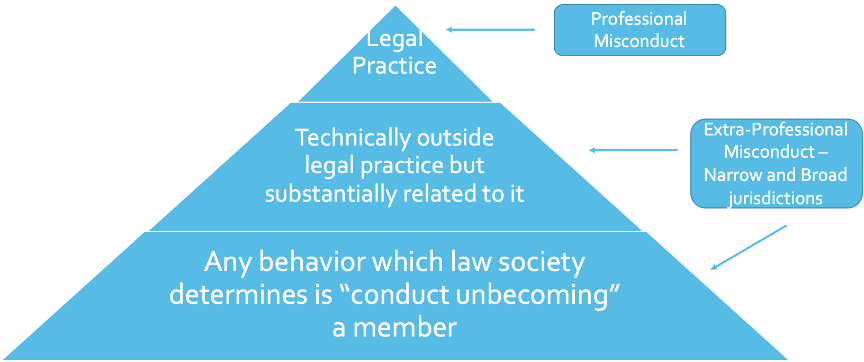
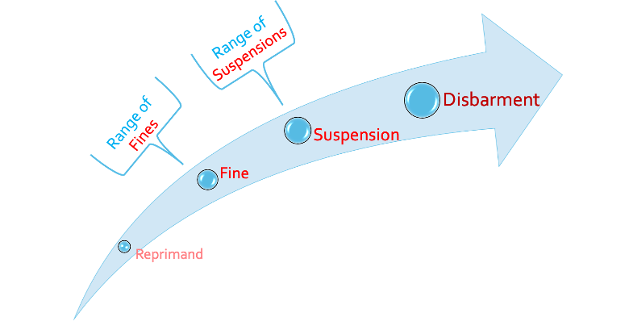

#  Module 6 -  Issues in Self-Regulation & Sanctioning Misconduct

<!-- 
**Commentary**
 -->

<!--  -->

## 6.0: Overview

In this Module we will examine some of the problematic issues in self-regulation, specifically asking the question of **whether the right balance has been struck for regulating Canadian lawyers.**  We are focusing on the use of provincial law societies to regulate lawyers.  Thus, we are not considering the role of courts here, just the **role and appropriateness of provincial law societies in admitting and disciplining lawyers**. 

!!! note "Readings"

    - Articles:
        - Martin, “*The Limits of Professional Regulation in Canada: Law Societies and Non-Practising Lawyers*”
        - Devlin & Hefferman, “*The End(s) of Self-Regulation?*”
        - Dodek, “Taking Self-Regulation for Granted?”
        - Reports referenced:
            - Law Society of British Columbia, “*Report of the Independence and Self-Governance Committee*”
            - Law Society of Upper Canada, “*Working Together for Change: Strategies to Address Issues of Systemic Racism in the Legal Profession*”
    - Cases:
        - ***Preyra, Re***, [2000 CanLII 14383 (ON LST)](https://canlii.ca/t/1gssl){:target="_blank"}
        - ***Law Society of Upper Canada v. Aidan Christine Burgess***, [2006 ONLSHP 66](https://canlii.ca/t/1pswn){:target="_blank"}
        - ***Law Society of Alberta, Resignation Application of Ezra Levant Nova Scotia Barristers’ Society v. Morgan***, 2010 NSBS 1
        - ***Law Society of Alberta v Sychuk*** [1999] L.S.D.D. No. 15
        - ***Adams v. Law Society of Alberta***, [2000 ABCA 240](https://canlii.ca/t/5rq2){:target="_blank"}
        - ***Law Society of Upper Canada v. George Douglas Hunter***, [2007 ONLSHP 27](https://canlii.ca/t/1r0hz){:target="_blank"}
        - ***Law Society of Upper Canada v. Boldt***, [2006 CanLII 9142 (ON SC)](https://canlii.ca/t/1mwsd){:target="_blank"}
        - ***Law Society of Upper Canada v. Carey***, [2017 ONLSTH 25](https://canlii.ca/t/gxfsv){:target="_blank"}
        - ***Law Society of Upper Canada v. Terence John Robinson***, [2013 ONLSAP 18](https://canlii.ca/t/fzfdv){:target="_blank"}

Please note that Module 6 is different from your other modules. It is designed to span two weeks. There are a total of **two discussions** and one quiz for this module. 

==Please check your assignments for the due dates of each: **Both on Oct 26 at 8am.**==

## 6.1: Admission to the Profession

Provincial/territorial law societies in Canada set the **criteria for admission to the legal profession**.  Without the approval of the law society you cannot legally work as a lawyer.  They also set the **general guidelines for the establishment and operation of law schools** in respective provinces, although law schools are independent and free to design their curricula within these general guidelines.  In addition, the law societies set **rules for good character requirements for lawyers**.  Until recently, they set **requirements for mental fitness** for new lawyers. 

!!! note "Activities"

    Please read Adam Dodek’s short online piece [*“Taking Self-Regulation for Granted?”*](https://www.slaw.ca/2016/07/28/taking-self-regulation-for-granted/){:target="_blank"} on self-regulation of lawyers in B.C.  It references the Groia and Laaraker cases that we just reviewed in the last Module, but it also frames our discussion for this Module as well.  Read the ***Preyra*** and ***Burgess*** decisions as they consider the admission of candidates where “good character” was in issue.

**Self-Regulatory Aspect**

As you know the **law societies model is self-regulated**, the membership elects benchers who govern the society.  We touched on some of these self-regulation issues before but we’re going to revisit them here this week because it is a very important issue.  From time-to-time you see calls mostly from non-lawyers that there should be some limits or even an end to self-regulation of the legal profession.

Ask yourself some of these questions over the next two weeks:

- What goals should regulation seek to achieve?
- Does self-regulation enhance or undermine those goals?
- Has the law society achieved the best outcome on some of the regulatory issues we cover here?
- Why might it be better to have someone other than lawyers regulate the profession?

For this module, you should be able to identify the competing values at stake here, weigh pros and cons of each position, take a position and defend it with a rational justification.

When you consider these questions, also consider something that many of you might already suspect: Canada is pretty much alone among common law countries in having **an extremely strong commitment to lawyers' self-regulation**.

The situation in the United States is quite different, although you have state bar associations that do regulate and discipline attorneys the judiciary is much more involved in policing lawyers’ conduct.  Politically, the USA also sees a lot of pressure like campaigns for Tort Reform, which indirectly attacks lawyers as unethically charging high rates and increasing the cost of litigation.  Other countries like the UK, Australia, New Zealand have all moved away in different degrees from the total self-regulatory model.   

**Law societies get their authority over legal education and admission to the bar through their enabling acts.**  Law societies’ authority over education and bar admission varies between Canadian provinces, but in B.C. it’s governed by the *Legal Professions Act*, [[SBC 1998] c. 9](https://www.bclaws.gov.bc.ca/civix/document/id/complete/statreg/98009_01){:target="_blank"}.

!!! warning "*Legal Professions Act*, **Section 3**:"

    **It is the object and duty of the society to uphold and protect the public interest in the administration of justice by**

    - (a) preserving and protecting the rights and freedoms of all persons,

    - (b) ensuring the independence, integrity, honour and competence of lawyers,

    - **(c) establishing standards and programs for the education, professional responsibility and competence of lawyers and of applicants for call and admission**,

    - (d) regulating the practice of law, and

    - (e) supporting and assisting lawyers, articled students and lawyers of other jurisdictions who are permitted to practise law in British Columbia in fulfilling their duties in the practice of law.

**Section 28** is the main section authorizing law society powers over **legal education in BC**.

Across Canada, the provincial law societies work with the Federation of Law Societies to develop what is called “**competencies**” that law schools have to ensure students meet in order for their degrees to be “approved” law degrees for admission to the bar.

Competencies are things you’re all familiar with and it includes both substantive law and practical skills to working as a lawyer in Canada.  **Ethics & Professionalism is one of these competencies that law schools must offer a stand-alone course for.**  Along with this goes the common process established in Canada for admitting foreign trained lawyers.

The **Law Society of BC (LSBC)** report on independence and self governance covers some broad concerns relating to self-regulation, but for the moment  we will focus on credentialing and admissions. 

!!! info "Law Society of British Columbia, [*Report of the Independence and Self-Governance Committee*](https://www.lawsociety.bc.ca/getContentAsset/451e98bf-3407-4740-8f62-da3ec6755971/dfc3d011-8f63-43f6-9ed8-4b444333a1d0/SelfGovernance_2008.pdf?language=en-CA){:target="_blank"}"

    **Part I - Lawyer Independence and Self-Governance**

    **Lawyer independence** is the fundamental right guaranteeing that lawyers may provide legal assistance for or on behalf of a client without fear of interference or sanction by the government, subject only to the lawyer’s professional responsibilities as prescribed by the Law Society, and the lawyer’s general duty as a citizen to obey the law.

    - It identifies the importance of lawyer independence to Canadian society;

    - It makes the separation of lawyers from government clear;

    - Self-governance is incorporated by the phrase “**subject only to the lawyer’s professional responsibilities** as prescribed by the Law Society;”  

    - The concept is explained as **a right to protect the public** when obtaining legal advice (**“that lawyers may provide legal assistance for or on behalf of a client without fear of interference or sanction by the government”**).

    **The Rule of Law** is a fundamental principle underlying Canadian democracy.

    Briefly stated, the rule of law means that everyone is subject to the law or, put another way, that no one is above the law.

    There must be a division amongst those who make the law, those who interpret and apply it, and those who enforce it.

    **An independent legal profession is also fundamental to the maintenance of citizens’ rights and freedoms under the rule of law**, so that they are guaranteed access to independent, skilled, confidential and objective legal advice...[if the highest standards of skill, professionalism and integrity amongst the legal profession are not maintained] confidence in the legal process will be undermined, so will the necessary respect for the rule of law, and the executive and legislative branches will be both tempted and enabled to interfere in the processes which protect their independence.

    **The independence of lawyers is necessarily linked to the preservation of the rule of law.**  Independent lawyers are therefore necessary to preserve a fundamental principle of the Canadian Constitution.

    How can that independence be assured?  The Committee believes that **self-governance is a necessary condition of this independence**, and that this has generally been recognized in Canada by the courts and the legislatures.

    **W. Wesley Pue** noted that to the general public, “(t)he idea of independence [of lawyers] from state regulation strikes many as undemocratic, if not a prescription for lawlessness.”

    **The *Legal Profession Act* requires the Law Society to ensure the independence of lawyers.**  The Law Society must therefore discharge this task assiduously.  This is particularly important given the essential role that lawyer independence has in the maintenance of the rule of law, and, through it, the administration of justice in Canada.  The Supreme Court of Canada has commented on this principle a number of times, perhaps as a reflection of the importance of lawyer independence to the preservation of the rule of law:  
    
    > The independence of the Bar from the state in all its pervasive manifestations is one of the hallmarks of a free society. Consequently, **regulation of these members of the law profession** by the state must, so far as by human ingenuity it can be so designed, **be free from state interference**, in the political sense, with the delivery of services to the individual citizens in the state, particularly in fields of public and criminal law. 
    >
    > ~ ***Canada (Attorney General) v. Law Society of British Columbia*** [1982] 2 S.C.R. 307 at pp 335-336

    In ***LaBelle v. Law Society of Upper Canada***, [2001 CanLII 28255 (ON SC)](https://canlii.ca/t/1w9nn){:target="_blank"}, the Ontario Superior Court discussed the **rationale for self-governance** by referring to an article by G. D. Finlayson, Q.C. (later Finlayson, J.A. of the Ontario Court of Appeal) entitled “*Self-Government of the legal profession – can it continue?*” as follows:
    
    > The protection of rights has been a historic function of the law, and it is the responsibility of lawyers to carry out that function.  In order that they may continue to do so **there can be no compromise in the freedom of the profession from interference, let alone control, by the government.** (emphasis added)”

    If lawyers were not governed and regulated in a manner independent of the state, clients could not be assured that their lawyer would be providing them with independent representation, particularly (for instance) if the client’s case required a direct challenge to the state’s authority.

    With self-regulation and self-governance, however, **comes a responsibility to demonstrate that the Law Society is discharging its mandate in the public interest, rather than in the interest of those it regulates.**  The perception is that the system operates in the public interest.  But such a perception is not likely to continue for long if the system in fact operated for the private interest of the profession.

Along with the required educational and licensing requirements to be a lawyer, Canadian law societies impose the **“Character and Fitness” requirements to be a lawyer**.

For the protection of the public and the profession, the *Legal Profession Act* imposes a statutory obligation on the **Law Society governors, called Benchers**, to be satisfied that each applicant for enrolment is of good character and is fit to become a barrister and solicitor of the Supreme Court. The important point here is that **the burden of proof is on the applicant to satisfy the Benchers in this regard.**  So if the benchers raise any concerns, the onus is automatically on the applicant to satisfy those concerns.  So in practice, what does that mean?

Law Society staff screen all prospective articled students, applicants for call and admission, applicants for reinstatement and applicants for transfer to ensure they are of good character and repute and are fit to become a barrister and a solicitor of the Supreme Court. This could include investigation of any criminal charges, financial difficulties, treatment for some types of serious illnesses or any other factors that may affect an applicant's character or fitness for practice.

If Law Society staff have **concerns** about the character or fitness of a candidate for enrolment, call and admission, transfer or reinstatement, the **application is referred to the Credentials Committee.** The Credentials Committee can review the matter in question and any relevant factors. For example, in the case of questionable prior conduct, it may consider such factors as the applicant's age at the time of the conduct, how recent the conduct was, its seriousness and any evidence of rehabilitation.

Once the review is completed, the committee can:

- **approve** the application;
- **approve** the application **with conditions**;
- **defer** consideration pending further information or the completion of an investigation; or
- order a credentials **hearing**.

A former lawyer who was disbarred or who resigned for disciplinary reasons must be referred to the Credentials Committee and the committee must order a credentials hearing.

Anyone applying for enrolment in the Law Society Admission Program or for admission and call to the Bar is advised to answer all questions fairly and fully and to disclose to the Law Society anything that the applicant considers might adversely affect the application. The applicant should give the fullest details possible and provide supporting documentation.

When considering **past criminal charges or convictions**, the **Credentials Committee assesses the following factors:**

- applicant's age at the time of the conduct in question;
- recentness of the conduct;
- reliability of the information;
- seriousness of the conduct;
- factors underlying the conduct;
- cumulative effect of the conduct or information;
- evidence of rehabilitation;
- applicant's positive social contributions since the conduct;
- applicant's candour in the admissions process; and
- materiality of any omissions or representations.

!!! info "***Preyra, Re***, [2000 CanLII 14383 (ON LST)](https://canlii.ca/t/1gssl){:target="_blank"}"

    The applicant engaged in duplicitous behaviour over a long period. He failed to be entirely honest about it for four years. This was not a single lapse of judgment resulting from a stressful situation.

    The applicant completed law school at Queen's University in 1994 and completed Phase One of the Bar Admission Course in June 1994. He was unable to find an articling job and in August 1994, in his attempt to find an articling job, the applicant intentionally falsified his law school marks and other academic credentials and pursuits to prospective employers.

    Even after his misrepresentations were exposed, the applicant continued to misrepresent what had happened in significant ways.

    **Good character definition:**

    > Character is that combination of qualities or features distinguishing one person from another.  **Good character connotes moral or ethical strength, distinguishable as an amalgam of various attributes or traits which would include, among others, **integrity**, **candour**, **empathy** and **honesty**.**

    <!-- In this case, the applicant intentionally falsified his law school marks and other academic credentials and pursuits to at least five prospective employers. These misrepresentations were uncovered in August 1994. Even though his misrepresentations were exposed, the applicant continued to misrepresent what had happened to the Law Society as well as to other individuals, including the dean of his law school and the mentor assigned to him by the Law Society. -->

    The purpose of the good character requirement is to ensure that the **Law Society** can protect the public and maintain high ethical standards in the lawyers the Law Society admits to practice. Any decision in such applications must serve to **protect the public and maintain high public confidence in the Law Society's self-governance.**

    **The onus is on the applicant** to prove, on a **balance of probabilities**, that he is of good character at the time of the hearing of the application. **The test does not require perfection or certainty.** The applicant need not provide a warranty or assurance that he will never again breach the public trust. **The issue is his character today, not the risk of his re-offending.**

    It is important not to confuse the **good character requirement for admission** with notions about **forgiveness or about giving an applicant a second chance**. 
    
    **The admissions panel is not in the forgiveness business,** the test to be applied is clear, and the admissions panel is to determine **if the applicant is of good character today.** The Law Society Act does not permit an admissions panel to apply any test other than that relating to the applicant's good character at the time of the hearing.

    **Decision**

    Being a lawyer is a great privilege; it is a gift, not a right. It is not automatic, and does not necessarily follow from passing law school and the Bar Admission Course. More than simply meeting the academic standards, the statutory scheme is clear that **an applicant must also be of good character.**

    The applicant engaged in duplicitous behaviour over a long period. He failed to be entirely honest about it for four years. This was not a single lapse of judgment resulting from a stressful situation. Even after being caught, the applicant had several opportunities to admit his misrepresentations to all that he should have. He did not do so. As recently as one year before the hearing, the applicant was still misrepresenting the truth to people close to him, and was still failing to be honest with his articling principal, and even with his own lawyer.

    The **transition** from being a person not of good character to one of good character **is a process, not an event.** It may or may not happen to someone who was not of good character. It may or may not happen to this applicant. The applicant asserts that he has been in the process of change since 1994. **Central to the task of the admissions panel is to determine whether that process is concluded.**

!!! info "***Law Society of Upper Canada v. Aidan Christine Burgess***, [2006 ONLSHP 66](https://canlii.ca/t/1pswn){:target="_blank"}"

    The good character requirement and the passage of time.

    Aidan Christine Burgess was a law student who completed the Bar and her articles. 

    **Issue**(s): Whether or not, on a balance of probabilities, Ms. Burgess has established that she is of good character today. 

    **Holding**: Not enough time has passed to be able to tell whether her character has actually changed.

    **Relevant Legislation and precedent**

    *Law Society Act*: **s.27. (2)** An applicant for admission to the Society shall be of good character. ... (4) An application for admission to the Society may be **refused only by the Hearing Panel after holding a hearing**.

    **Precedent**

    - ***Preyra v. Law Society of Upper Canada***, [2003] L.S.D.D. No. 25
    - ***Miller v. Law Society of Upper Canada***, [2004] L.S.D.D. No. 8
    - ***Levesque v. Law Society of Upper Canada***, [2005] L.S.D.D. No. 38

    **Reasoning** *(But not really, cause it’s a discipline hearing so it’s just talking about what happened and then applying the test as to whether she has good character now)*

    - Plagiarism, lies told to Law Society, and lies told to character references go to the heart of who lawyers are
    - **Integrity is fundamental to the competence of a lawyer**
    - Obviously not of good character from at least 2001 to 2005, but how about now?
    - Purpose of good character requirement: ensure that the Law Society can protect the public and maintain high ethical standards in the lawyers it admits to practice
    - Definition of good character (although not exhaustive)is a bundle of attributes amounting to good character

    > Character is that combination of qualities or features distinguishing one person from another. Good character connotes moral or ethical strength, distinguishable as an amalgam of virtuous attributes or traits which would include, among others, integrity, candour, empathy, and honesty.

    - **Onus on applicant** to prove that she is of good character at hearing of the application
    - Standard: **balance of probabilities**
    - Relevant test: whether applicant has established her good character **at the time of the hearing** on a balance of probabilities, not whether there is future risk of abuse of public trust
    - **Doesn’t need** to provide **warranty**

    **Character today, not risk of re-offending**

    - Don’t confuse good character finding with notions of forgiveness
    - Only test is that of character today at the time of the hearing
    - Oral testimony from applicant, retired prof, bf’s dad, and applicant’s articling principal at Osler
    - Number of powerful references to applicant’s good character in Document Book
    - Found guilty of plagiarism in 4th year at U of T (2001)

    Taken alone, this would not preclude finding of good character 5 years later

    - What is more important is the persistent and ongoing lies told by applicant to Law Society and various persons giving character references
    - Lied about why she was accused of plagiarism. Saying it was too similar to two other papers she’d handed in (truth is she copied it from the Internet without citing it accordingly)

    Panel says they would have found it helpful considering the serious nature of the deception.

    > We do not believe that there has been sufficient passage of time for us to find that the bad character exhibited by Mrs. Burgess up until April 2005 has changed.

    **Ratio**

    Onus on applicant on balance of probabilities to prove that her character today is good.

    Psychiatric/psychological evidence is helpful.

    There is a time issue, need to wait a while before considering if character has changed from the time the applicant exhibited reproachful behaviour. 

## 6.2: Conduct Unbecoming a Member

Once admitted, a lawyer’s conduct can come under scrutiny for actions technically outside their legal practice.  

The diagram below represents the narrow and broad powers the law society has to **discipline extra-professional misconduct** in addition to professional misconduct situations.  

**Professional misconduct** generally relates to disciplinary investigations within a lawyer’s legal practise and generally encompasses everything in that practise.  

However, law societies also assert jurisdiction over **misconduct by lawyers outside of their legal practice.**  Law Societies’ power to discipline for extra-professional misconduct was designed to protect the public, and other lawyers, from technical arguments that a misconduct occurred outside of the lawyer’s legal practice.

Disciplinary investigations related to extra-professional misconduct relates to two different categories.  

- The first includes any action that is technically **outside** the legal practise but is **substantially related** to it.  This tends to have relatively narrow jurisdiction for the law societies.  
- However, extra-professional misconduct can also be investigated for **any behaviour** which a law society determines is “conduct unbecoming a member.”  This latter category can be a fairly broad jurisdiction for investigations.

“Conduct unbecoming a member” is defined in the *Legal Profession Act* under Definitions:

conduct unbecoming the profession" includes a matter, conduct or thing that is considered, in the judgment of the benchers, a panel or a review board,

- to be **contrary to** the best interest of the public or of the legal profession, or
- to **harm the standing** of the legal profession”

**Conduct unbecoming** is mentioned at several points of the *Act*, most significantly relating to **Complaints from the Public (S. 26(a))** and **Discipline (S. 36(b))**.  The inclusion of “conduct unbecoming...” in the *Act*, as opposed to being located in the **BC Code**, has been taken to signify that the legislature intends for **this provision to be applied more broadly** in some situations, in order to protect the public.

In this Module we will examine several decisions that may implicate “conduct unbecoming the profession” in broad manner, spanning a considerable amount of time for more serious conduct, such as in the ***Sychuk*** case that you will review in Topic 4.

Canadian lawyers have been disciplined for “conduct unbecoming” eg. being nude in public and bad cheques.  These usually involve **mild**, if any, **discipline being imposed**.  However there are more serious cases where a lawyer has been disbarred for “conduct unbecoming...”

## 6.3: Sanctioning Lawyers for Misconduct

One of the recurring issues that is becoming apparent as we go through the cases is the **selection of appropriate disciplinary measures for lawyers.**  Because of the self-regulatory aspect of the measures, close scrutiny is often paid to the effects of the disciplinary measure on a range of actors:  the lawyer involved, the broader legal profession, and the public at large are some of the recurring considerations here. 

From the cases that we have already examined, you can discern that disciplinary sanctions can involve anything from **letters of reprimand**, to **fines**, **suspensions** and ultimately **disbarment**.  Within those sanctions, there are large ranges, for example, relatively small fines vs proportionately larger ones, **shorter suspensions vs a longer suspension**, *etc*.  In imposing these disciplinary sanctions, law society panels consider not only the type of disciplinary action needed but the extent to which it is imposed can have an impact on its deterrent effect and how its seen by the public. 

The diagram below illustrates the range of disciplinary actions, and ranges within ranges of things such as fines and suspensions.

Two cases that we are covering in this topic both involve lawyers who were the subject of disciplinary proceedings for having inappropriate sexual relations with their clients.  They are good cases to compare for the types of actions committed and how they were each analyzed by the Law Society of Alberta and Law Society of Upper Canada, and how each dealt with its respective case.

!!! info "***Adams v. Law Society of Alberta***, [2000 ABCA 240](https://canlii.ca/t/5rq2){:target="_blank}"

    > lawyers are perceived by clients to be very special people with very special powers, and this means that the client then is in a very vulnerable position... in his or her relationship with the lawyer, and it is incumbent upon the lawyer to recognize that nature of this very special trust relationship.  Mr. Adams set that aside, the almost sanctity of this relationship, and minimized it and discounted it and took advantage of this young woman...

    The Benchers of Law Society disciplinary proceedings ultimately resulted in Adams’ **disbarment**.  He appealed the disbarment penalty to the Alberta Court of Appeal.

    The focus here is therefore on the penalty imposed.  

    Adams’ appeal ultimately turned on applying administrative law principles in judicial review (as they existed at the time):  **Was the Benchers’ decision reasonable in this case?**  
    
    The answer ultimately was **Yes**: the court explained that this is a professional disciplinary hearing.  It is an administrative tribunal **meting out discipline**, so **it engages public law principles of protecting the public,** and Adams conduct with his client **affected not only the legal profession but the wider public and its perception** as to how the Law Society **metes out** discipline to one of its members.

    There are several parts of the decision that merit particular attention.  
    
    - At paragraphs 8-10, the court talks about the special **significance of honour, integrity and trust** in the legal perception, especially the trust between a lawyer and a client that is necessary for the system to function properly.  
    - The court noted that it is a mistake to compare administrative punishment in this context with criminal sentences, comparing disbarment to a prison sentence, for example, is not an accurate comparison here.  The court stated **it’s a mistake** in the context of a Law Society Disciplinary process to argue that **only the most serious offences** committed by the most serious offenders, **deserves the most serious punishment.**  Essentially what the court is saying here is that disbarment is only one of a range of punishment available and it is not reserved for the very worst conduct committed by the very worst lawyers.

!!! info "***Law Society of Upper Canada v. George Douglas Hunter***, [2007 ONLSHP 27](https://canlii.ca/t/1r0hz){:target="_blank"}"

    ***Hunter*** is a case we will return to under conflicts of interest in an upcoming Module.  Here, we are concerned with the **penalty** that was imposed.  
    
    <!-- The facts of the case are reviewed in paragraphs 4-28 of the decision, but briefly they involved George Hunter very prominent senior lawyer with a high national profile in the legal profession.   Hunter engaged in a romantic relationship with a client which began approximately 2 ½ years after she retained Hunter to represent her in an acrimonious dispute with her ex-husband over access to their daughter.  The personal side of their relationship began when Hunter began asking her for lunches and to a hockey game, then over dinner, Hunter told her his marriage "had been over for a long time but he continued to live with his wife for the sake of their children.”  Later that evening they began a sexual relationship that continued for approximately 2 ½ years, during which time she continued to retain him as her lawyer. -->

    The Law Society of Upper Canada panel began by looking at the relevant *Ontario Code of Professional Conduct* rules, as they existed then, for a breach of the conflict of interest rules.

    On the facts of this case, the court’s analysis was that during the time period of the sexual relationship the female client was emotionally vulnerable. **Hunter failed to appropriately recognize and address the issues surrounding the conflict of interest and the complainant’s vulnerability.**  

    Look at paragraphs 60-62 of the decision, considering the penalty to be imposed.  The tribunal panel did say that a reprimand would “fail to reflect the seriousness of the misconduct here” but refused to impose a lengthy suspension as suggested by the law society.  **The panel suspended Hunter for 60 days and ordered him to pay costs of $2500.** 

## 6.4: Limits of Professional Regulation in Canada

In this topic we explore the powers of law societies to discipline for alleged extra-professional **misconduct** in the areas of **non-practising or former lawyers**.  

The Law Society of B.C. defines non-practising membership as:

Non-practising lawyers retain the same rights as practising members, **except the right to practise law** or to act as notaries public or commissioners for taking affidavits...

Non-practising members are entitled to:

- **run** for election as Benchers;
- **vote** in Bencher elections and general meetings of the Law Society; and
- **receive** Law Society publications.”

Non-practising members cannot provide legal opinions or any other statements that are akin to providing legal advice.  In summary they retain certain rights but not the basic privilege of practising law.  They are members of the Law Society, but they cannot work as a lawyer.

There is considerable room for arguing that the limits of law societies’ powers over non-practising members should be different than for practising members.  

Non-practising members, by definition, do not earn their livelihood as lawyers.  They are often **journalists**, **businesspersons**, **government workers** or **politicians**.  The cases we explore in this topic all touch on aspects of conduct on non-practising or former lawyers seeking reinstatement.

!!! info "[Law Society of Alberta, Resignation Application of Ezra Levant](https://documents.lawsociety.ab.ca/wp-content/uploads/2017/02/16173607/Ezra_Levant_HE20150107_HCR_22August2016.pdf){:target="_blank"}"

    Ezra Levant has been very critical of the Alberta Human Rights Commission (AHRC).  In 2014, Levant wrote a column using strong language to criticize one of the lawyers on the AHRC. He referred to him and another commissioner as “crazy” and “supernova crazy.”  

    Read Martin’s article and it’s analysis of Levant’s case, and then read the Law Society Resignation Application decision.  In particular note the Law Society’s reasoning on the nature of the complaints against Mr. Levant and it’s analysis of potential disciplinary actions that could be taken if he was denied an application to resign from the law society:

    > It has been argued before us that the complaints are politically motivated and attempt to utilize the LSA's disciplinary process to curb Mr. Levant's activities as a journalist. 
    
    > Whether that is so or not, our task is to determine **whether or not the alleged conduct is the kind that could merit disbarment. In our view, the answer is clearly no.** There are significant issues of freedom of speech and *Charter* rights. LSA counsel has advised us that there are substantive defences available to Mr. Levant with respect to those complaints, **particularly when one considers that they relate to Mr. Levant’s conduct as an inactive lawyer and not a person practising law.**

!!! info "***Nova Scotia Barristers’ Society v. Morgan***, [2010 NSBS 1](https://canlii.ca/t/29l3x){:target="_blank"}"

    Similar to Levant, the case of John Morgan involved a lawyer acting mostly in the capacity of being a politician.  
    
    A complaint to the Nova Scotia Barristers' Society was lodged alleging that he

    > failed to discharge his duty, as a lawyer who holds public office, ... and failed to uphold and encourage public respect for justice and the administration of justice.”

    Moran argued that his conduct should not attract professional discipline because he was not acting as a lawyer and that his job as a politician by definition involved the need to “offend people in certain circumstances”. 

    Morgan also argued that the law society should act in the public interest, which in this case would fall on the side of protecting politicians’ ability to speak freely.

    Of course, the difference between Levant and Morgan is that **Morgan was a practising lawyer** at the time of the impugned conduct.  Nevertheless the **panel found that he was not guilty of misconduct.**  ... what is clear is that the panel found that **he was bound by** the *Nova Scotia Barristers’ Society Code of Legal Ethics and Professional Conduct*.

!!! info "***Law Society of Alberta v Sychuk*** [[1999] L.S.D.D. No. 15](https://canvas.ubc.ca/courses/204077/files/47698951/download?wrap=1){:target="_blank"}"

    Maurice Sychuk was a former professor at the University of Alberta law school and practicing lawyer who was convicted of murdering his wife in 1985.  He was subsequently disbarred in 1990 and spent approximately ten years in prison.  He then applied for reinstatement to the bar after being released on good behaviour and generally turning his life around.  The Law Society of Alberta denied his application for reinstatement.  
    
    The case raises interesting questions about **whether a lawyer who has been convicted of the most serious crime can ever be rehabilitated sufficiently to practice law again**.

    Read the Law Society decision which ultimately decided **against reinstatement**. Pay particular attention to the events leading up to disbarment noted at paragraphs 7-10, and the responses to the Law Society’s notice at paragraphs 22-23.  The Law Society, in a somewhat laconic fashion, notes that the application is “controversial.”   Beginning at paragraph 48, the Law Society launches into its explanation for its ultimate decision to refuse reinstatement.  Do you agree with the Law Society in the ***Sychuk*** case?

    > **48** Fundamental to the role of lawyers in society and the administration of justice is the need to uphold the law. In our view, **this principle becomes even more critical when the legal profession is self-governing and independent from the state.** As a self-governing profession, we are all too aware that the public sometimes sees us as self-serving rather than fulfilling our mandate which is to govern in the public interest and to protect the public interest.

    > **54** In our view, an application for reinstatement is much different from an application for admission to the Bar. The Applicant in this case, in addition to committing the most serious of crimes, has broken faith with his oath, his role as an officer of the court, and as a member of our Law Society. 

    > **55** Ultimately, the Benchers must assess the **effect** of the admission to the bar of this Applicant **on public respect** for the legal profession and the law in Alberta.

    > **61** Even if we are wrong, however, and rehabilitation is the controlling factor, we would not have recommended that the Applicant be admitted to the bar. We concede that the evidence of rehabilitation is substantial, and we concede that the Applicant has developed new ways to deal with his anger and his addiction. Nevertheless, he has only been out on full parole since January 1, 1998, and **in our view, insufficient time has passed to provide us with sufficient comfort of complete rehabilitation.**

## Discussion Activity: Appropriate Punishments?

Please choose one of the following topics to discuss:

- 1, Consider ***Samarakoone v The Law Society of British Columbia***, [2025 BCSC 492](https://canlii.ca/t/kb4j8){:target="_blank"}, where the **Law Society of BC was reprimanded in part of its own incompetence** and consider the ramifications of what happens if the body responsible for regulating lawyers itself has issues with competence.

- 2, Consider the ***Levant*** case on the basis of freedom of expression. Refer to this Department of Justice summary of the constitutional guarantees of **Freedom of Expression** in *Charter*:  [Section 2(b) – Freedom of expression](https://www.justice.gc.ca/eng/csj-sjc/rfc-dlc/ccrf-ccdl/check/art2b.html){:target="_blank"}. Do you think that, if Levant had not resigned, he would have been disciplined by the Law Society?  What could he be disciplined for (e.g. **Code** or *Act* provisions?)? Consider that the Law Society is still able to discipline non-practicing lawyers and whether that would have been an appropriate outcome in this instance. 

- 3, In the context of the ***Sychuk*** case, consider the following questions:
    - Where there is no evidence to indicate that the lawyer has acted unethically within the confines of their legal practice, is it nonetheless reasonable to conclude that lawyer’s unethical behaviour outside their practice casts doubt on that lawyer’s future ability to practice law ethically?
    - At what point should do you think a lawyer who committed extra-professional misconduct be viewed as “rehabilitated”? Are there some types of misconduct from which a lawyer just cannot recover?

## 6.5: Regulating the Unauthorized Practice of Law

In this topic we examine **how law societies regulate those individuals** who either act or portray themselves as **lawyers** when, in fact, **they are not.**  

In terms of regulating the authorized practice of law, in Canada it is codified in provincial statutes that create lawyers’ legal monopoly over providing legal services.  

**Section 1** of the *Legal Profession Act* defines the **“practice of law”** in fairly broad terms from appearing as counsel or advocate, to drawing/revising/settling documents, doing certain acts, giving legal advice and making certain representations including offers of any of these things and representations of being a lawyer.  It also excludes certain acts, most significantly any of these listed acts are not prohibited if they are done by a non-lawyer for no expectation of a direct or indirect fee, gain or reward.  **“Practising lawyer”** is further defined as someone in good standing who holds a practicing certificate.  

**Section 15** of the *Act* further specifies limits on the authority to practice law to a practicing lawyer, with exceptions for self-represented individuals, articling students, and other limited permitted exceptions.

!!! info "***Law Society of Upper Canada v. Boldt***, [2006 CanLII 9142 (ON SC)](https://canlii.ca/t/1mwsd){:target="_blank"}"

    Regulating non-lawyers raises some serious public policy issues, specifically issues relating to **protecting the public** on the one hand, while **ensuring access to affordable justice** on the other.  When you are reading the ***Boldt*** decision, consider the statement at **paragraph 70** of the decision:

    > It is a well-known fact that low and middle income persons often find the cost of legal services beyond their means.  There are alternatives to the legal process for the resolution of disputes.  Mediation is one of these alternatives.  However, mediators should not be seen as a low priced alternative to lawyers.  **The mediation process cannot be a shield for those who are illegally providing legal advice** and leading clients to believe that their legal rights and entitlements are fixed...

    The ***Boldt*** case illustrates the example of penalties Law Societies can impose in cases of work that is deemed ”unauthorized practice of law.”  Keep in mind when we are reviewing the ***Boldt*** case: the **penalties** imposed here, the **nature** of the offence, **problems with access to justice** and also how much **time and expense** law societies devote to these sorts of cases.

    Maureen Boldt was a paralegal in Ontario, not a lawyer.  She had been found to have engaged in unauthorized legal practice.  Ultimately the Law Society of Upper Canada sought and was granted an injunction.  Despite the injunction order Boldt continued engaging in activities that constituted the practise of law.  She was found guilty of contempt of the court Order.
    
    Unable to work as a paralegal, she applied for reinstatement in 2011 as a paralegal under the Ontario licensing framework and was refused. Her house arrest resulted in her being dismissed from her position on the North Bay City Council for missing too many meetings. 

    Maureen Boldt died on August 6, 2020.  While the Law Society and many lawyers did not view Boldt’a actions favourably, some paralegals and others in the public in Ontario viewed Boldt as a fighter for paralegal rights in Ontario. A former colleague on city council praised Boldt after her passing:
    
    > Let’s face it, a lot of paralegals in Ontario owe Maureen a lot... She fought the law society’ on numerous occasions, eventually pushing the body to codify the rules paralegals now operate under in the province.

!!! info "***Law Society of Upper Canada v. Carey***, [2017 ONLSTH 25](https://canlii.ca/t/gxfsv){:target="_blank"}"

    The first sentence of this decision reads:

    > There are few cases in which a finding that a licensee has breached a court order and been found in contempt of court will **not lead to a corresponding finding of professional misconduct**. This is one of them.

    Carey was a very unusual case.  Carey acted for clients subject to **a Mareva Order** prohibited any dealing with or transfer of monies and assets.  Several years later the Supreme Court of Canada definitively held that his **solicitor-client duties were no defence to breaching the Mareva Order**.  Essentially, Carey, the lawyer, was found in contempt of a court order through returning trust funds to a client.  **The hearing panel found that Carey’s conduct was a mistake or error in judgment rather than professional misconduct.**

    When you look at the decision, note that the hearing panel found two important facts:

    - the **standard of commercial litigation practice** in 2006, nine years before the final determination of breach and contempt, was to **return a client's money held in trust to the client upon request, even when a freezing injunction was in place**; and
    - Mr. Lenczner, another lawyer with significant experience in freezing injunctions, advised other licensees in the Lawyer's position to do exactly as Carey did.

    The hearing panel noted that **there was no other guidance available to lawyers in Carey’s situation in 2006** as well as the fact he had otherwise made every effort to comply with his professional obligations. The combined weight of these facts, properly found on available evidence, led the panel to find **an error in judgment rather than wilful misconduct.** 

    The hearing panel then considered that **an error in judgment does not rise to the level of professional misconduct unless there is a serious or significant departure from professional standards.** Since the only evidence of professional standards in 2006 was the evidence from Lenczner, it was reasonable for the panel to conclude that Carey’s conduct in 2006 was not a departure from then-current professional standards, and thus, not professional misconduct.

    Think about the hearing panel’s finding.  It found that contrary to the general rule that breach of a court order will constitute professional misconduct, Carey committed an error in judgment in returning trust money to his client in 2006.  Thus he did not engage in conduct that tended to disrespect or prejudice the administration of justice in a manner that brought discredit upon the legal profession.

!!! info "***Law Society of Upper Canada v. Terence John Robinson***, [2013 ONLSAP 18](https://canlii.ca/t/fzfdv){:target="_blank"}"

    The ***Robinson*** case involved a lawyer who in June 2009 pled guilty to an aggravated assault which occurred in June 2007. His discipline hearing before the law society took place three years later. A hearing panel imposed a two-year suspension on him, effective June 4, 2012 (when the hearing took place), together with preconditions to the resumption of practice. Robinson is Aboriginal and his professional life has largely been devoted to representing members of the First Nations  community.

    On appeal, the appellant Robinson challenged the penalty imposed on him. The most important issue he raised was **whether the hearing panel erred in failing to appreciate the relevance of his Aboriginal background and related circumstances to the penalty imposed**.  
    
    The primary issue involved the application the **Gladue principles**, which the **Supreme Court of Canada has stated** that in, the context of indigenous offenders in Canada, oblige **Judges to consider an appropriate sentence considering an offender’s indigenous background and their unique individual circumstances situated in the individual’s community.**

## 6.6: Diversity, Mental Health & the Legal Profession

The legal profession in Canada is not particularly diverse.  

The B.C. Law Society has noted that in its [*“Towards a More Representative Legal Profession”*](https://www.lawsociety.bc.ca/Website/media/Shared/docs/publications/reports/Diversity_2012.pdf){:target="_blank"} report that approximately 14.6 percent of lawyers in British Columbia identified as a visible minority compared with 25.3 percent of the total population in the province.  This is despite the fact that **visible minorities** represent approximately 1/3  of university graduates with an occupation.  The Law Society suggests that their **under-representation in the legal profession** is related to reasons other than an inability to obtain a university education.  

The same phenomenon is seen with lawyers in the United States.  In an American Bar Association profile of [national lawyer demographics](https://www.americanbar.org/content/dam/aba/administrative/market_research/national-lawyer-population-demographics-2010-2020.pdf){:target="_blank"}, Caucasian/White individuals comprise approximately 86% of practising lawyers despite comprising 76% of the national population. 

The Law Society of B.C. notes in its Report that American lawyers who are members of a visible minority comprise 20% of Associate lawyers but only 6% of Managing Partners nationwide.  **Diversity, or a lack of it, is a real problem for the legal profession in North America generally and in Canada specifically.**

The legal profession has also experienced significant challenges in achieving **gender equality**.  Historically, the legal profession in Canada was dominated by white males.   Women have made tremendous progress recently relative to their historical position but their position remains underrepresented in many aspects of the legal profession, **particularly in partnership and leadership positions**.  

The reasons for the disproportionate gender and racial balance are complex and extend well beyond the scope of self-regulating lawyers.  However, law societies across Canada have increasingly taken a more active regulatory role in promoting a more equal **gender balanced** and **racially equal** legal profession.

**Working Together for Change**

In 2016, the Law Society of Upper Canada published its [*“Working Together For Change”*](https://lawsocietyontario-dwd0dscmayfwh7bj.a01.azurefd.net/media/lso/media/legacy/pdf/w/wo/working-together-for-change-strategies-to-address-issues-of-systemic-racism-in-the-legal-professions-final-report.pdf){:target="_blank"} report with several recommendations intended to facilitate **three key objectives**:

- **inclusive workplaces**,
- **Reducing barriers** created by racism, unconscious bias and discrimination, and
- Achieving **better representation** of racial balanced lawyers in the profession.

The report contains 13 recommendations meant to address and resolve issues of systemic racism in the legal professions and encourage diversity. **Read the recommendations starting at page 2.**  

The report also contains a summary of over 20 submissions by various organizations representing the profession and the public.  When you examine the report you will see that there are **five main areas of focus**: 

- accelerating a **culture shift** within the legal profession;
- **mechanisms for measuring progress** in achieving diversity;
- **education** designed to adapt to a changing work environment;
- **tools** for the implementation of support;
- **operations** of the Law Society.

Some of the final report's recommendations include:

- developing **a demographic data** inclusion index of firms and other legal workplaces of at least 25 licensed lawyers;
- **adopting a practise** based on principles of diversity, equality and inclusion;
- continuing **professional development programs** on topics of equality and inclusion in the profession

**Mental Health**

Issues of **psychological distress** and **mental health** have long been a problem in the legal profession.  However, only recently has research in Canada and the United States spurred law societies to openly reveal “problematic levels of substance use, depression, anxiety and various other forms of psychological distress among lawyers.”  These can be serious health issues and they manifest themselves among lawyers at a level much greater than among the general population and even when compared to a majority of other professions.  

The Law Society provided the following rationale for its *Mental Health Task Force* from the executive summary of its [second interim report](https://www.lawsociety.bc.ca/Website/media/Shared/docs/initiatives/MentalHealthTaskForce-SecondInterimReport2020.pdf){:target="_blank"}:

> A number of commentators have regarded the conclusions drawn from the research as a call to action, demanding that all sectors of the profession commit to improving lawyer wellness. In responding to this call, the Law Society has elevated addressing mental health and substance use issues within the profession to an organizational priority. In so doing, the Law Society **recognizes not only the scale of the problem**, but also, the **critical connection to its public interest mandate** and **the important role regulators can play** in building a healthier professional and regulatory culture.”

In response to these concerns, the Law Society of B.C. launched a *Mental Health Task Force* which has provided recommendations for adoption.  The summary below includes recent changes to the **Application for Admission** to the Law Society of B.C. which **eliminates the mental fitness requirement:**

The Benchers have taken steps to **destigmatize** mental health challenges and help current and future lawyers struggling with those challenges by adopting recommendations from the Law Society’s *Mental Health Task Force*, including:

- collaborating with BC law schools to ensure continuity and awareness of resources for students as they transition from law school to practising law;
- hosting a forum on mental health and substance use issues for lawyers and law firms;
- developing a style guide for non-stigmatizing language in Law Society communications;
- conducting a voluntary, confidential survey on mental health and substance use among BC lawyers; and
- revising the Law Society Admission Program application form to **remove questions about applicants’ medical fitness**.

The Benchers noted that “in reaching their decision to revise the application form, the Benchers determined that although the questions were well-intentioned, in 2020 there are better ways to address the question of fitness to practise law.”

!!! warning "Old Schedule A - Medical Fitness"

    **Schedule A MEDICAL FITNESS**

    Must be completed legibly and is to be signed by the applicant only.

    Section 19 of the *Legal Profession Act* requires that each applicant for articles, call or admission, transfer or reinstatement satisfy the Benchers that he or she is a person of good character and repute and is fit to become a barrister and solicitor.

    In asking the questions in this Schedule, the Benchers are seeking information that will help them assess medical fitness to practice competently. Information with respect to practice standards and a competency profile outlining the knowledge, skills and behaviours expected of entry level lawyers is available on the Law Society’s website at lawsociety.bc.ca.

    The practice of law is often rigorous, demanding a high level of functioning. Any medical condition that would render you incapable of practicing law competently puts clients’ interests at risks and harms the profession’s reputation. However, the Benchers recognize that everyone experiences pressures in life and responds to those pressures differently. You may be quite capable of practicing law competently in spite of a medical condition.

    It is the Benchers’ responsibility as the governing body of the profession to determine if an Applicant has an impairment that effectively disables that individual from carrying out the functions normally required of a lawyer.

    Accordingly, the Benchers are not looking for information about past conditions that have been resolved and are not currently affecting your ability to function as a lawyer. You need only report current conditions that could impair your ability to perform the duties of an articled student.

    The fact that you may have sought professional assistance for a problem is not a bar to enrolment. In most cases, evidence of having sought professional assistance is positive evidence as it suggests that you are actively seeking to deal with a problem and taking control of your life.

    On behalf of the Law Society, the Lawyers Assistance Program and LifeWorks Canada provide confidential counselling and referral services to lawyers and articled students and their families who suffer from alcohol or chemical dependencies, stress, depression or other personal problems. Although funded by the Law Society, these programs are entirely independent and their services confidential. The Law Society actively encourages individuals to seek the education and assistance they need. The Lawyers Assistance Program can be contacted at: 1.888.685.2171 and LifeWorks Canada at 1.888.307.0590.

    In order to protect your right to privacy, the information you provide relating to this application will be held in confidence and will only be provided to the Credentials Committee where it is deemed relevant to a concern regarding your fitness to practice law and only after you have been notified of the information to be provided to the Committee.

    If you answer yes to the questions below, you may be asked to provide further information from a source that the Law Society deems appropriate. If you would like to discuss a personal concern confidentially, please contact a Bencher or the Manager of Credentials and Licensing.

!!! warning "Old Schedule A - Checklist"

    1. Given Name(s) Surname

    2. (a) Based on your personal history, your current circumstances or any professional opinion or advice you have received, do you have a substance use disorder?
        - [ ] Yes 
        - [ ] No

        (b) Have you been counseled or received treatment for a substance use disorder? 

        - [ ] Yes 
        - [ ] No

    3. If you answered yes to questions 2 (a) or (b), please provide a general description on a separate sheet.

    4. Based on your personal history, your current circumstances or any professional opinion or advice you have received, do you have any existing condition that is reasonably likely to impair your ability to function as an articled student?
        - [ ] Yes 
        - [ ] No

    5. If the answer to question 4 is “yes”, please provide a general description of the impairment on a separate sheet.

**This information and requirement is no longer part of the application for admission process.**

In addition to the recommendations and changes to the application process, the Law Society stressed further collaboration with law schools to ensure **transitions in services and supports for law students and future lawyers**. Law Schools in Canada are often the first place where future lawyers begin to encounter issues that may negatively affect mental health.  The rationale from the Law Society is that these steps to address mental health issues in the legal profession are meant to encourage both current and future lawyers who are struggling to seek support.

## 6.7: Alternatives to Self-Regulation?

The Law Society of B.C. frames **self-regulation as an essential part of lawyer independence.**  “Lawyer independence” can be an elusive concept to define.  In terms of rights, the Law Society prefers to frame it as **a public right**, rather than a lawyer’s right, meant **to protect the rule of law.** 

**In Defence of Self-Regulation**

The [*“Report of the Independence and Self-Governance Committee”*](https://www.lawsociety.bc.ca/Website/media/Shared/docs/publications/reports/SelfGovernance_2008.pdf){:target="_blank"} defines **lawyer independence** as

the fundamental right guaranteeing that lawyers may provide legal assistance for or on behalf of a client without fear of interference or sanction by the government, subject only to the lawyer’s professional responsibilities as prescribed by the Law Society, and the lawyer’s general duty as a citizen to obey the law.” (page 2)

**The principle of lawyer independence as a fundamental right and an essential part of the rule of law** has been confirmed by the Supreme Court of Canada (***Roncarelli v. Duplessis***, [1959 CanLII 50 (SCC)](https://canlii.ca/t/22wmw){:target="_blank"}).  The most important ideas forming the core of this concept include:

- the **importance** of lawyer independence to Canadian society;
- the clear **separation** of lawyers from government;
- a right to protect the public when obtaining legal advice **without fear of state interference**
- access to an **independent judiciary** (separation of powers) can only be supported by an an independent bar.

The Law Society notes that self-regulation, or self-governance,  is incorporated into this concept by the phrase “subject only to the lawyer’s professional responsibilities as prescribed by the Law Society.” (pg 3)   

**Self-governance separates the legal profession from the government and ensures there are no undue pressures or conflicts of interest.** Self-governance is thus tied not only to lawyer independence, but to the rule of law, a “fundamental principle underlying Canadian democracy.”  

The Report notes that the rule of law means that “no one is above the law... there must be a division amongst those who make the law, those who interpret and apply it, and those who enforce it.” (3)  Building on all of these principles, the Report concludes that 

the independence of lawyers is necessarily linked to the preservation of the rule of law. Independent lawyers are therefore necessary to preserve a fundamental principle of the Canadian Constitution. (pg 4). 

In the Law Society’s view, **self-governance is a “necessary condition” of lawyers’ independence.**  The report notes that it has been recognized by legislatures and courts.  Indeed, lawyer independence is enshrined in [Section 3](https://www.bclaws.ca/civix/document/id/complete/statreg/98009_01#section3){:target="_blank"} of the *Legal Professions Act*.   It has also been recognized by Supreme Court of Canada and legal academics:

> The independence of the Bar from the state in all its pervasive manifestations is one of the hallmarks of a free society. Consequently, regulation of these members of the law profession by the state must ...  be  free  from  state  interference,  in  the political  sense,  with  the  delivery  of  services  to  the  individual  citizens  in  the  state, particularly  in  fields  of  public  and  criminal  law.
> 
> ~ ***Canada (Attorney General) v. Law Society of British Columbi***a [1982] 2 S.C.R. 307 (Estey J) at pp 335-336.

&emsp;

> Lawyers could not  advise  citizens  as  to  their  responsibilities  with  respect  to  particular legislation  or  governmental  action  if  they  cannot  maintain  their  independence  as individuals.  It is almost impossible to do this if the society that governs them is under the day to day control of the government.  
> 
> ~ ***Finney v Barreau du Quebec*** [2004] 2 S.C.R 17 at [1] quoting G Finlayson, *“Self-Government of the legal profession - can it continue?”* (1985) 4 Advocates Soc. J. No. 1 at 11-16

**The report clearly states that self-governance is the preferred way to guarantee lawyer independence and rule of law.**  However, the independence of lawyers and self-governance is not a principle that is well recognized by the general, non-lawyer public.  The report quotes Professor Pue noting that, **to the general public**, “(t)he idea of independence [of lawyers] from state regulation strikes many as undemocratic, if not a prescription for lawlessness.” (5).

The report does note that there are **other models** that have been or are being devised by which to regulate and govern lawyers, and “**not all of these are as clearly self-governing as those in Canada**. While some of these models operate in countries that are best described as liberal democracies...[they] less clearly demonstrate and preserve the independence of lawyers.” (7).  

However, despite the assertions of the benefits of **self-regulation/governance**, there are **critics of this model**.

**Problems with Self-Regulation**

Read the selected page excerpts from the Devlin & Heffernan article, [*"The End(s) of Self Regulation(?)”*](https://www.albertalawreview.com/index.php/ALR/article/view/342){:target="_blank"} and consider what we have looked at so far in the regulation of lawyers by lawyers.  You can discern some patterns from the decisions reviewed.  One of them is the appropriateness of the self-regulatory mechanism.  Would some other approach be better?  Consider some of the issues outlined below in the context of some of the ideas and alternatives put forth by Devlin & Heffernan.

There are at least **three problematic issues** that often prove contentious in the current framework of self-governance of lawyers:

- There are many suggestions that the current self-regulatory model is at least **a contributing cause to the access to justice** crisis in British Columbia, and across Canada. Many Canadians do not have ready access to legal services either because they have difficulties navigating the legal complex or simply cannot afford a lawyer.
    - Total self-regulation allows for little oversight over regulating in **self-interest**.
    - Within the context of self-regulation, **limited examples of non-lawyers** able to assist with in-demand legal services:
        - RCICs for immigration
        - CPAs in tax court
        - In Ontario, licensed paralegals for some family matters.
    - Still too little?

- Self-regulation by definition gives lawyers the power to choose who becomes a lawyer. As we will see in upcoming modules dealing with lawyers in organizations such as corporations and government, complex business and public policy issues are increasingly “legalized” resulting in many lawyers often **making decisions relating to what are important policy issues, not legal ones.** 
    - Complexities of modern governance have resulted in the **legalization of public policy**.
    - Lawyers now have **outsized influence** on how public policy is shaped. As a result, our democracy should care about who is and who is not a lawyer.
    - A voice for the Legislature?
    - Internationally trained lawyers: don’t think it’s fair? No recourse!

- Finally, the pillars of self-regulation rest on arguing that only the rights of an independent bar, free from government influence or interference, can successfully ensure that the principle of the rule of law is adhered to in a democratic society. However, this argument obscures some legitimate criteria that should be evaluated in terms of the actual effects of self-regulation/self-governance.  Evaluative **criteria ideally** applied to any regulatory regime is **whether the objectives associated with it**, in this case protecting an independent legal profession, the rule of law, democracy, zealous advocacy for clients, and so forth, **are promoted or hindered by the regulatory structure.**
    - Defences of self-regulation centre around the **normative value of an independent bar**.
    - Does this old refrain **obscure** more important evaluative criteria?
    - Instead, **focus on** determining whether regulatory model **enhances or inhibits** the rule of law, access to justice, democracy, zealous advocacy, etc.

## Discussion Activity: Mental Health

Review this [article on lawyers and mental health](https://www.slaw.ca/2026/05/26/theres-got-to-be-a-better-way-law-societies-approach-to-the-regulation-of-lawyers-with-mental-health-issues/){:target="_blank"} and comment on how the Law Society is to balance the wellness issue of mental health together with capacity and reputation and advocacy for the client. Feel free to reference the Law Society's decisions on mental health and capacity in your response.

## 6.8: Summary

This Module has spanned a variety of issues ranging from admission to the profession to ethical standards that may actually be health issues better addressed through treatment than sanction.  

Part of the difficulty with self-regulation is the appearance of uneven treatment of issues related to concept like conduct unbecoming a lawyer.  The vague nature of certain conduct often clashes with the need to protect the profession and the public through unauthorized legal practise, even when that conduct might possibly be argued to provide a certain amount of access to legal services that might not otherwise be available.  

The self-regulatory model is not the only framework that could be used to regulate the legal profession in Canada but it looks likely to persist, perhaps with some modifications, for the foreseeable future.

