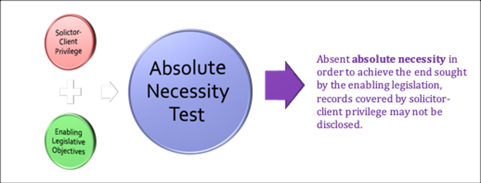
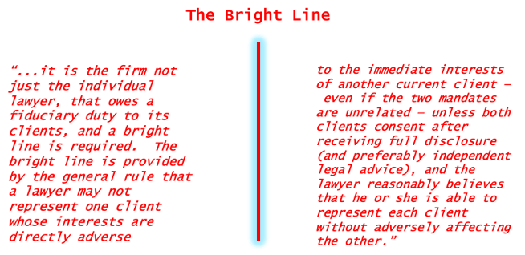
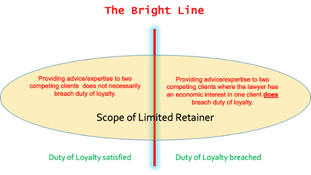
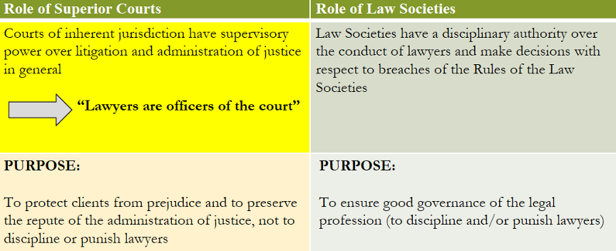
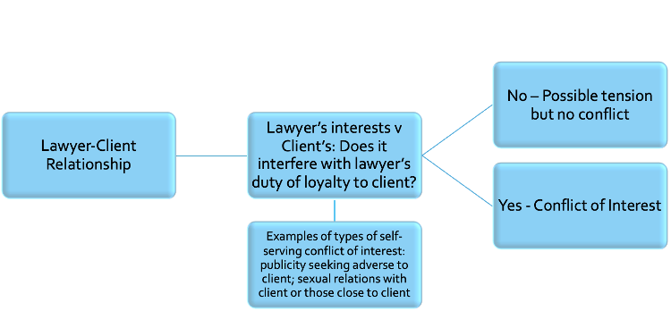

#  Module 7

<!-- 
**Commentary**
 -->

<!--  -->

This is the second and last of our two week modules and we will be discussing Conflicts and Duties in more detail. Please note that there are **three  assignments for this Module**. 

These Scenario Questions are examples of what you may expect to see on the **Final Exam**.

**Module Overview**

This is the second and last of our 2-week Modules.  In this Module we cover some topics that deal with the proper functioning of the lawyer-client relationship.  The framework that we analyze in this Module is designed to **regulate any potential conflicts of interest **between a lawyer and their client.  Some of the obligations that we reviewed in previous Modules carry over into the duty of loyalty and conflicts of interest.  

They both tie into public policy values like trying to make access legal services effective.  The values underlying **duty of loyalty and preventing conflicts** at all costs sometimes come into **conflict with access to justice** issues, potentially making access to legal services more difficult in some situations. 

!!! note "Readings"

    - **Code**: 3.4; 1.1 [definitions of “conflict of interest” and “consent”]
    - Cases:
        - MacDonald Estate v Martin, [1990] S.C.J. No. 41
        - Ontario v Chartis Insurance Co, 2017 ONCA 59
        - Stewart v. Canadian Broadcasting Corp. et al (1997), 150 D.L.R. (4th) 24
        - R v Neil 2002 SCC 70
        - Strother v 3464920 Canada Inc. 2007 SCC 24
        - Canadian National Railway Co. v McKercher LLP, 2013 SCC 39
        - Law Society of Saskatchewan v Balon 2016 SKLSS 8
        - Law Society of Upper Canada v. George Douglas Hunter, 2007 ONLSHP 0027

## 7.1: The BC Code and Conflicts of Interest

It is much more difficult to avoid conflicts in today’s world when many lawyers work for large, multi-national firms and change employers throughout their career.  A sole practitioner may even find it hard if they are working in a large metropolitan area. 

Part of the difficulties in avoiding conflicts relates to lawyers having the same concerns that most other people in modern society have.  Lawyers have their own **personal interests**, sometimes financial interests, that may either align with a client’s interests or stand in opposition to them.  Sometimes there might be **family interests**.  Often times lawyers and some clients can develop a friendly or personal relationship that can go well beyond a professional relationship.  This can lead on some occasions for outside economic or **romantic relationships** to develop, which can cause problems.

So we’ll cover some of these issues this week that can pull lawyers in different directions when confronting the potential for a conflict of interest.  Conflicts, as you’ll see, has developed into quite a large body of rules, and is featured in quite a bit of SCC case law in recent years.

The issue of conflicts is a large area of concern for the profession and for individual lawyers, it’s not an overstatement to paraphrase Alice Woolley that “no area of the law... causes lawyers more difficulty in their practices than the rules governing conflicts of interest.”

Before we get into the case law, I want to illustrate that point by looking at the **BC code** and how it deals with conflicts of interest.

Here are the relevant definitions in the **Code**, first you have “conflict of interest” itself defined:

> **“conflict of interest”** means the existence of **a substantial risk** that a lawyer’s loyalty to or **representation** of a client would be materially and adversely affected by the lawyer’s own interest or the lawyer’s duties to another client, a former client, or a third person.

> **“consent”** means fully informed and voluntary consent after disclosure.

In terms of “substantial risk” the risk must be **more than a mere possibility**; there must be a genuine, serious risk to the duty of loyalty or to client representation arising from the retaining the client.  The commentaries say that a client’s interests may be seriously prejudiced unless the lawyer’s judgment and freedom of action on the client’s behalf are as free as possible from conflicts of interest.

**“Representation”** means **acting for a client** and includes your **advice** to the client as well as the **judgment** on behalf of the client.

S. 3.4 of the **BC Code** deals directly with Conflicts. It’s a big section.

- Conflicts & Dispute carry over generally to all sub-sections
- Duties to current & former clients

There are 24 subsections with more sub-provisions under those sections. There are some areas that overlap with others such as conflicts & dispute.

I wanted to highlight 2 areas that we’ll focus on more, such as the **general duty to avoid conflicts** with **current** clients but also duties to **former** clients, specifically when acting against them.

!!! warning "3.4  Conflicts"

    **Duty to avoid conflicts of interest**

    3.4-1  A lawyer must not act or continue to act for a client where there is a conflict of interest, **except** as permitted under this **Code**.  

**Examples**: Acting for a client in more than one matter, providing legal advice on commercial transactions to a small business while representing an employee of that business on an employment matter, having direct or indirect financial interest (through family for example) in a client’s affairs, close personal or sexual relationship with client.

So **this rule applies throughout the lawyer-client relationship**, you have to examine whether a conflict of interest exists not only from the beginning of the relationship but throughout the duration of a retainer, because new circumstances or information may establish or reveal a conflict of interest.

The value of an independent bar is diminished unless the lawyer is free from conflicts of interest. The rule governing conflicts of interest is founded in the **duty of loyalty** which is grounded in the law governing **fiduciaries**. The lawyer-client relationship is a fiduciary relationship and as such, the lawyer has a duty of loyalty to the client. 

To **maintain public confidence** in the integrity of the legal profession and the administration of justice, in which lawyers play a key role, it is essential that lawyers respect the duty of loyalty. **Arising from the duty of loyalty** are other duties, such as **a duty to commit** to the client’s cause, the **duty of confidentiality**, the **duty of candour** and the **duty not to act in a conflict of interest**. This obligation is premised on an established or ongoing lawyer client relationship in which the client must be assured of the lawyer’s undivided **loyalty, free from any material impairment** of the lawyer and client relationship.

As the commentaries notes, you will see that the rule reflects the principle articulated in the ***R. v. Neil*** and ***Strother*** cases, where the **SCC outlined the principles regarding conflicting interests involving current clients.**  The rules outline the principle that **a lawyer must not represent one client whose legal interests are directly adverse to the immediate legal interests of another client without consent.** 

We’ll look at those cases later,  but the commentaries for **Rule 3.4** do outline some of the factors for you to consider in determining whether a conflict of interest exists:

**Factors** for the lawyer’s consideration in determining whether a conflict of interest exists include:

- the **immediacy** of the legal interests;
- whether the legal interests are **directly adverse**;
- whether the issue is **substantive or procedural**;
- the **temporal relationship** between the matters;
- the **significance** of the issue to the immediate and long-term interests of the clients involved; and
- the clients’ **reasonable expectations** in retaining the lawyer for the particular matter or representation.

There are some **common scenarios** outlined as examples:

- (a) A lawyer acts as an advocate in one matter against a person when the lawyer represents that person on some other matter.

- (b) A lawyer provides legal advice to a small business on a series of commercial transactions and at the same time provides legal advice to an employee of the business on an employment matter, thereby acting for clients whose legal interests are directly adverse.

- (c) A lawyer, an associate, a law partner or a family member has a personal financial interest in a client’s affairs or in a matter in which the lawyer is requested to act for a client, such as a partnership interest in some joint business venture with a client.

- (d) A lawyer has a sexual or close personal relationship with a client.

**Other situations** include: 

- A lawyer or his or her law firm acts for a public or private corporation and the lawyer serves as a director of the corporation, and 
- Sole practitioners who **practise with other lawyers in cost-sharing or other arrangements** represent clients on opposite sides of a dispute.

here is the separate Provision for **CONSENT** under **Rule 3.4**: CONFLICTS:

!!! warning "s. 3.4-2"

    **Consent**

    3.4-2  A lawyer must not represent a client in a matter when there is a conflict of interest **unless** there is **express or implied consent from ALL clients** and the lawyer **reasonably believes** that he or she is able to represent each client without having a material adverse effect upon the representation of or loyalty to the other client.

    (a) **Express consent** must be fully informed and voluntary after disclosure.

    (b) **Consent may be inferred** and need not be in writing where all of the following apply:

    - Client is government, financial institution, entity publicly traded or with in-house counsel;
    - Matters are unrelated;
    - Lawyer has no relevant confidential information from one client that might reasonably affect other; **and**
    - The client has commonly consented to lawyers acting for and against it in unrelated matters

    [1] **Disclosure is an essential** requirement to obtaining a client’s consent. Where it is not possible to provide the client with adequate disclosure because of the confidentiality of the information of another client, the lawyer **must decline to act.**

    [2] The lawyer should inform the client of the **relevant circumstances** and the **reasonably foreseeable ways** that the conflict of interest could adversely affect the client’s interests. This would include the lawyer’s relations to the parties and any interest in or connection with the matter.

    [3] Following the required disclosure, the **client can decide** whether to give consent. 

IN TERMS OF **INFERRED OR IMPLIED CONSENT**, remember that IT APPLIES ONLY IN EXCEPTIONAL CASES, INVOLVING **“SOPHISTICATED CONSUMERS OF LEGAL SERVICES”**, that list on inferred consent is actually fairly exhaustive: **Governments** or **Banks** or **large Corporations with in-house counsel** are all considered sophisticated entities for the purposes of inferred consent. 

**Conflicts: Duties to Former Clients**

!!! warning "3.4-10"

    **Acting against former clients**

    Unless the former client consents, a lawyer must not act against a former client in:

    - (a) the same matter,

    - (b) any related matter, or

    - (c) any other matter, if the lawyer has relevant confidential information arising from the representation of the former client that may reasonably affect the former client.

The general prohibition and permitted activity in the previous rule relating to conflicts apply to former clients as well.  **You are prohibited from acting against a former client in the same or related matter unless they consent.**  You are also prohibited in many instances from acting against them in other matters if you obtained relevant **confidential information** while representing them and it might affect the former client.

Basically this rule prevents you from attacking legal work done during the retainer, or from undermining the client’s position on a matter that was central to the retainer.

**You are permitted however to act against a former client in a case unrelated to any work** you’ve previously done for them.  Any **confidential information** you previously obtained while representing that client would **must be irrelevant** to the new case.

**Rule 3.4-11** discusses **exceptional situations** where another lawyer in a firm acts against a client that another in the firm previously represented.  When the former client doesn’t consent, this is **only allowed** where taken reasonable measures to ensure that there will be **no disclosure of the former client’s confidential information** by the transferring lawyer to the new firm lawyer.  You should also consider the extent the prejudice and the good faith of the parties.

!!! warning "3.4-11" 

    When a lawyer has acted for a former client and obtained confidential information relevant to a new matter, **another lawyer** in the lawyer’s firm may act against the former client in the new matter, if the firm establishes, in accordance with **rule 3.4-20**, that it is reasonable that it act in the new matter, having regard to all relevant circumstances, including:

    - (a) the adequacy and timing of the measures taken to ensure that **no disclosure** of the former client’s confidential information to the partner or associate having carriage of the new matter will occur;

    - (b) the extent of **prejudice** to any party; and

    - (c) the **good faith** of the parties.

The commentaries to **rule 3.4-20** provide **guidelines regarding lawyer transfers between firms.**  For these types of situations when working in firms they provide valuable guidance for the protection of confidential information.  These are described as rare cases in which, having regard to all of the relevant circumstances, it is appropriate for the lawyer’s partner or associate to act against the former client.

You should take a moment to become familiar with them.

These guidelines also apply with modifications to situations in which **non-lawyer staff leave** one law firm to work for another and a determination is made, before hiring the individual, on whether any conflicts of interest will be created and whether the potential new hire actually possesses relevant confidential information.

**Guidelines: How to screen / measures to be taken**  

- The **screened lawyer** should have **no involvement** in the new law firm’s representation of its client in the matter. 
- The screened lawyer should **not discuss** the current matter or any information relating to the representation of the former client (the two may be identical) with anyone else in the new law firm. 
- No member of the new law firm should discuss the current matter or the previous representation with the screened lawyer. 
- The firm should take steps to **preclude the screened lawyer** from having access to any part of the file.
    - The measures taken by the new law firm to screen the transferring lawyer should be stated in **a written policy**
- The new law firm should **document the measures** taken to screen the transferring lawyer, the **time** when these measures were put in place (the sooner the better), and should advise all affected lawyers and support staff of the measures taken. 

## 7.2: Duty of Loyalty: Former Clients

There are three cases here that illustrate the **duty of loyalty** as it pertains to conflicts of interest and former clients.   

In the area of **conflicts of interest**, a **landmark case** in Canada was decided approximately 30 years ago in ***MacDonald Estate v Martin***. It is often referred to as **a classic “transferring lawyer” case** where there is a conflict between the duty of a transferring lawyer to their former client vs the duties of the new lawyer to the transferred client.  The decision is a "classic" case of a divided Supreme Court of Canada seemingly struggling to achieve consensus.  Although there were no dissents, there were two different concurring opinions by 4 and 3 justices, respectively, that differed in how the Court reached its decision.  

The Ontario Court of Appeal decision in ***Chartis*** illustrates the difficulty of applying the the test from ***McDonald Estate*** in certain types of practical working situations that lawyers find themselves engaged in. 

In this case ***Martin*** was the appellant but also a Plaintiff in an estate lawsuit related to the **MacDonald estate**.  In 1983 **Martin** hired **AK Twaddle** as his lawyer. **Twaddle** was assisted by his articling student (and later junior lawyer of the Twaddle Law firm) **Kristin Dangerfield**.  **Dangerfield** was actively engaged in the case and was privy to many confidences disclosed by the appellant to **Twaddle**.  **Dangerfield** was in attendance at numerous meetings between **Twaddle** and **Martin**.  She assisted in the preparation of many documents, prepared and attended examinations for discovery and was present when a settlement was discussed by the parties.

After the **Twaddle law firm** dissolved **Dangerfield** joined a firm in 1987 which eventually became the **Thompson Dorfman Sweatman** firm.  The Thompson firm represented the Defendant in the Estate lawsuit that **Martin** had commenced.  That litigation was continuing when **Dangerfield** joined the **Thompson firm**. 

**She was not assigned to the case and not in any way involved in representing the Defendant.**  Both **Dangerfield** and senior lawyers of the **Thompson firm** swore affidavits that the case had not been discussed with **Dangerfield** since she joined the firm and would not be discussed with her.  The application at lower courts to remove the **Thompson firm** was dismissed and **Martin** appealed to the Supreme Court of Canada.

!!! info "***MacDonald Estate v. Martin***, [1990 CanLII 32 (SCC)](https://canlii.ca/t/1fsph){:target="_blank"}"

    The main issue before the Supreme Court is concisely defined:  **What is the appropriate standard** to be applied in determining whether the Thompson firm is disqualified from continuing to act in this litigation **by reason of conflict of interest?**

    The main considerations here relating to ethics and conflicts of interest involve competing values.  **Soyinka J** identifies several **competing values** in the decision:

    - The value of maintaining high standards of the legal profession and the **integrity** of the Canadian justice system;
    - The countervailing value that a litigant should not be deprived of their **choice of counsel** without good cause; and
    - The value of permitting **reasonable mobility** in the legal profession.

    A disqualifying conflict of interest may be based on either the possibility or probability of **“real mischief”**, mischief being defined as the **mis-use of confidential information by a lawyer against a former client.** The court majority noted that recent trends in conflict laws point towards a strict test in favour of ensuring not only that there is **no actual conflict** but that there must be **no appearance of conflict.**  
    
    The **appropriate test** here required two questions to be answered:

    - Did the lawyer receive confidential information attributable to a solicitor and client relationship **relevant to the matter at hand?** 
        - In this case it was acknowledged that Dangerfield actively worked on the very case in respect of which her new firm is acting against her former client. She was therefore in possession of relevant confidential information.
    - Is there a risk that it will be **used to the prejudice of the client?** For this question the court indicated that there is a **a strong inference** that lawyers who work together share confidences, **unless satisfied** that all reasonable measures have been taken to ensure that no disclosure will occur by the "tainted" lawyer to the member or members of the firm who are engaged against the former client. **Such reasonable measures would include institutional mechanisms such as Chinese Walls and cones of silence.** 
        - In this case, there was nothing beyond the sworn statements of Dangerfield and co-counsel that no discussions of the case occurred and the undertaking that none would occur. In Sopinka’s opinion, this was **not sufficient to demonstrate** that all reasonable measures have been taken to rebut the strong inference of disclosure.  Therefore Martin’s appeal was allowed and a conflict of interest was found.

Read **Cory J**’s concurring opinion, which contains a a strong criticism of how the majority reached it’s decision. They would impose a much stricter test. It seems that the **key point** **Cory J** takes issue with is the majority’s statement that **it is unreasonable to expect lawyers in same firm to not,** in the era of mega mergers and huge law firms, **be on different sides at different times in representing clients.**  Justice Cory disagreed and said this reality still cannot be allowed to affect the public’s confidence in the judicial system.

Following the ***MacDonald Estate*** case, law societies in Canada gradually established sophisticated ways to screen clients and also assess lawyer’s previous work experience in relation to past clients.  The reason that Law Societies did this was to **minimize the risk** that confidential information obtained by a client’s former lawyer would be made known to lawyer representing the client’s opponent.  

But Law Societies **also wanted to enable the former lawyer** to join the new oppositional law firm.  These are the parts of** BC Code** rules that we covered in Rule 3.4 in BC and they cover sub rules **17 to 23** of 3.4

Take a moment to reflect and consider whether you think these rules resolve the issues from that case.  Could the **Code** possibly cover every type of situation encountered in this area of conflicts?

The ***Chartis*** case illustrates how **Codes** and **Rules** cannot anticipate or solve every situation.  In particular there is the question of whether, in some circumstances, the assumption of shared information **cannot be rebuttable no matter what steps** the lawyers or firm take to prevent that sharing.  While you are reviewing the ***Chartis*** case, consider some of these issues:

- Interplay between roles of both courts and law society on conflicts questions
- Do the **Code** rules solve the problem?
- Does the standard established in ***Chartis*** bring Canada closer to Justice Cory’s vision in ***MacDonald Estate***?

!!! info "***Ontario v. Chartis Insurance Company of Canada***, [2017 ONCA 59](https://canlii.ca/t/gx2f7){:target="_blank"}"

    ***Chartis*** concerns the disqualification of counsel because of conflict of interest.  There was no suggestion of actual impropriety but there was an issue of information being transferred between lawyers due to their close relationship and after one of the lawyers transferred to another firm.  Very briefly, the facts involved an entity called **“TG”** acting as counsel for Government of Ontario in insurance coverage matters.  
    
    Read the factual review in the decision and consider the following issue:  **Was there inadvertent disclosure of confidential information** arising from the close working relationship between two lawyers after one transferred law firms to work with the other?

    To answer this question the Court used the **test** formulated in ***MacDonald Estate***:  
    
    - The test must be such that **the public represented by the reasonably informed person would be satisfied that no use of confidential information would occur.**  
    
    It is conceded that the lawyer, **Foulds**, was in possession of confidential information relevant to the client. In assessing risk of prejudice to the client, the court presumed that Foulds would impart confidential information to his new colleagues at **LBM**. However, the court noted that, as outlined in ***MacDonald Estate***, that **inference is rebuttable**.  In this case there were several safeguards put in place before Foulds arrival at TG, which the court noted in its decision.  However **there was still an open question as to whether these safeguards were sufficient or “reasonable” in the circumstances.** 

    Although Foulds clearly had confidential information about Ontario, the case turned on the risk that Foulds' knowledge might be used to the prejudice of the Ontario government. The court said that the **test is objective:**  
    
    - **A reasonable person must be satisfied that no confidential information would be transferred by the tainted lawyer.**  
  
    Because of the inference that lawyers who work together share confidences, all reasonable **measures must therefore be taken to ensure that no disclosure** will ever occur by the tainted lawyer. Whether there was **enough evidence** that all reasonable measures had been taken was the **key** issue in this case.

    It is on this point that the Court discussed applicable guidelines and recommendations under the **Code**, but noted that the **guidelines could not possibly consider every instance.** The **Code** is **not exhaustive** and does not reverse the onus of proof on the lawyer to prove that a conflict does not exist.  More significantly, **it does not rebut the assumption of shared confidences between close-working colleagues.**

    In this case the integrated nature of the working relationship between the lawyers meant that the potential for inadvertent disclosure was too great. As a result, LBM was disqualified from continuing to represent AIG on the Action. While the “ethical screen” had been implemented according to the Law Society of Upper Canada Code guidelines, compliance with the “spirit of the guidelines” was lacking.  
    
    The court ultimately held the **integrity of the legal profession** and the **administration of justice** are **more important concerns** than either **a client's choice of counsel** or **lawyer mobility**.

Key **Takeaways** from ***Chartis***: Court essentially stated that Litigators must **abide by the spirit of the ethical screen**, and not just adhere to the letter of recommended guidelines of their law society.  **Technical compliance with guidelines may not be enough to prevent a conflict.**  In a larger firm, it may be easy to fully abide by the bounds of an ethical screen. However, **in a close working relationship, the tainted lawyer may find it more and more difficult to avoid improper and inadvertent disclosure.**  Litigators must be aware that the administration of justice has sway above all else, including a client's right to choose their own lawyer. **In some conflicts there may be no option, absent consent, but to turn down the retainer or remove oneself from the case.**

The Duty of **Loyalty to former clients** is explored in the ***Stewart*** case that we previously reviewed under lawyer's ethical responsibilities regarding public communications.  Stewart is a case that involves **both conflicts and confidentiality issues.**   

As you recall the facts of this case involved the defendant hiring prominent criminal defence lawyer **Edward Greenspan QC** for an unsuccessful appeal of his conviction in 1981.  Almost 10 years later, in November 1991, CBC televised a reenactment of the crime and the subsequent trial using Greenspan as the host and narrator.  The program was created by CBC and a company known as “Scales of Justice Enterprises” of which Greenspan had been one of the incorporators.  Greenspan was also one of the creative minds behind the “Scales of Justice” program that aired the reenactment on CBC as “***Regina v Stewart***.”  The broadcast of the program brought renewed attention to the case.  

By 1991 **Stewart**, who had been released from prison since 1982, thought he had put his past behind him so after the broadcast he brought litigation against Greenspan, CBC seeking damages from the network for airing the program.

!!! info "***Stewart v. Canadian Broadcasting Corp.***, [1997 CanLII 12318 (ON CTGD)](https://canlii.ca/t/1w5hb){:target="_blank"}"

    For our purposes here, the issues were:

    - Did Mr. Greenspan owe a duty of **loyalty to his former client** Mr. Stewart?
    - If yes, did he **breach** this duty?

    The court held that the duty of loyalty that Mr. Greenspan owed Mr. Stewart was **alive but inoperative** through the years that they were independent of one another. 
    
    Mr. Greenspan, however, **brought himself back within the framework of that duty** when he chose to involve himself in public aspects of Mr. Stewart’s case yet again. **Thus Mr. Greenspan had an operative duty of loyalty and breached it.**  The trial judge made several very important points which emphasized the **positive obligation of a duty of loyalty** rather than the negative prohibition on conflicts of interest:

    - Lawyer-client fiduciary relationship **exists beyond duration** of retainer
    - The fiduciary relationship imposes **a positive obligation & duty of loyalty**
    - Loyalty arises out of **client vulnerability and dependency** on lawyer
    - It is a freestanding obligation **not dependent on confidentiality**
    - While freedom of expression and coverage of judicial process is of fundamental importance and essential to a democratic society and crucial to the rule of law so is the duty of loyalty that a Lawyer owes to their client. **The public needs to have faith in lawyers and legal institutions.**

    Greenspan owed a duty of loyalty to Stewart, and he breached it, favouring his own financial interests and self-promotion over Stewart’s interest.  The manner in which Greenspan publicized his former client’s case undercut the benefits and protections Greenspan had provided as counsel.  
    
The key **takeaway** from this case is that **a lawyer has the discretion to publicize information** in the public domain respecting the case of a former client, barring contractual constraint upon such conduct; however this does **not relieve counsel of their fiduciary duty of loyalty to their former client.**

## Module 7 - Scenario: Dealing with Conflicts & Former Clients

Please answer one of the following scenarios with reference to the appropriate **Code** sections and caselaw:

!!! danger ""

    **Scenario 1**

    You are a real estate lawyer and you are assisting a client with the sale of a house when the financing fell through. You were retained solely for the purpose of this specific transaction. You find this information particularly interesting as there had been a bidding war on the property and you are aware that your niece had also bid on the same property. You are contemplating advising your niece that the property will shortly become available again. What are your ethical obligations?

    **Scenario 2**

    You currently work as counsel representing **Health Canada**. Prior to working for Health Canada you were counsel for **Moderna**, one of the manufacturers and distributors of a COVID-19 vaccination that is being released this Fall. You are aware that Health Canada sought production orders on Moderna and was informed that the records sought do not exist. You know as a result of your previous employment, that they do exist and that those records will have far-reaching consequences. What are your ethical obligations here?

## 7.3: Duty of Loyalty: Current Clients

In Topics 3 & 4, we focus on the duty of loyalty for issues that involve conflicts of interest relating to ongoing clients.  There are **three aspects** to the **Duty of Loyalty** here:

- **avoiding a conflict** of interest;
- duty of **commitment** to the client’s cause, and;
- a duty of **candour**. 

You will see these factors involved to some degree in all of the cases we examine for these topics.  Keep in mind that the **“Bright Line” rule** we examine involves: 

- an existing client of a lawyer with an unrelated matter and whether that lawyer accepting a new client will cross that “bright line” and create a conflict.

***Neil*** is a landmark SCC decision on conflict of interest relating to lawyers and clients. The Supreme Court of Canada held that there is **fiduciary duty that both firms and lawyers owe** towards their client.  A lawyer or law firm cannot represent a client whose interests may be in opposition to the interests of another client without consent and a reasonable belief that the client’s interests will be adversely affected.

!!! info "***R. v. Neil***, [2002 SCC 70](https://canlii.ca/t/50d1){:target="_blank"}"

    An overview of the facts of ***Neil*** are useful to understand the ruling.  Following complaints that the **accused paralegal** (**Neil**) was providing legal advice contrary to the *Alberta Legal Profession Act*, he sought representation from **Venkatraman Law Firm** for two criminal charges that ultimately brought the case to the Supreme Court of Canada.

    First Indictment: “Canada Trust” matter 
    Second Indictment: The “Doblanko” matter

    The accused, **Neil**, argued that the law firm, with which he had a solicitor‐client relationship, was in a conflict of interest. He claimed that his lawyer had failed to represent him and had ‘sold him out’ to the interests of another client of the firm. Thus, asserting that charges should be stayed because of his lawyers actions.

    There were several **issues** here considered by the court:

    - Was there a duty of loyalty owed by the law firm to the appellant?
    - Did the law firm breach their duty of loyalty to the appellant?
    - What are the **proper limits of a lawyer’s “duty of loyalty”** to a current client in a case where the lawyer did not receive any confidential information that was (or is) relevant to the matter in which she/he proposes to act against the current client’s interest?

    At paragraph 19 of the decision the court analyzed the **three components of the duty of loyalty** relevant to this case:  duty to **avoid conflicting** interests, duty of **commitment** to a client’s cause, and duty of **candour**.  The analysis reveals at paragraph 29 that that **it is the firm, not just the individual, that owes a fiduciary duty** to its clients: **a bright line is required.**

    The **breaches** of the Duty of Loyalty in this case included two conflicts:

    - **First** conflict: Attempt to act simultaneously for both the **appellant (Neil)** and eventual **co-accused (Lambert)** in the Canada Trust Charges
    - **Second** conflict: Accepting retainer (**Doblanko**) that required firm to **produce evidence disfavorable** to the current client (**Neil**)

    The **remedies for a breach** of the duty of loyalty included:

    - Submitting a **complaint** to the relevant governing body, The Law Society of Alberta, that may result in disciplinary action;
    - Seeking **compensation** for conflict of interest
    - **Constitutional remedy** for breach of ethical rules could be sought but not always justified

    At paragraph 43, **Binnie J.** ultimately declined to enter a judicial stay of proceedings: “There is nothing in the **Doblanko** verdict to contravene our fundamental notions of justice.”

Key **takeaways** from the ***Neil*** decision include:

- The court’s comments, at paragraph 3, that **a law firm, as fiduciary, cannot serve two masters at the same time**
- **It is the firm not just the individual lawyer, that owes a fiduciary duty** to its clients, and **a bright line is required.** 

The bright line is provided by the **general rule** that, 

- **a lawyer may not represent one client whose interests are directly adverse to the immediate interests of another current client**, 
- **even if** the two mandates are **unrelated**, 
- **unless** both clients **consent after receiving full disclosure** (and preferably independent legal advice), **and** 
- the lawyer **reasonably believes** that he or she is able to represent each client without adversely affecting the other.

**Summary of the Bright line rule:** 

an objective rule that resolves a legal issue in a straightforward, predictable manner.  The bright-line rule is supposed to be easy to administer and produces clear, certain, though, arguably, not always equitable results. 

***Strother*** is another important Supreme Court of Canada case dealing with conflicts. Unfortunately, the facts are fairly complicated but they can be simplified by categorizing the actors and timeline of events:

Main actors:

- **Monarch** Entertainment employed **Darc**
- **Davis and Company** employed senior tax partner **Strother**
- **Sentinel**, a partnership later formed by **Darc** and **Strother**

Timeline of events:

- 1996 & 1997: Monarch has an exclusive retainer with Davis and Company
- Late 1997: Government of Canada enacts new tax laws, minimizing the profitability of Monarch
- Early 1998: Strother agrees to leave Davis to be a partner with Darc in Sentinel if they receive a favourable advance tax ruling
- 1998: Davis and Company, and Strother, continue to advise Monarch under an oral retainer
- October 1998: Darc and Strother receive favourable advanced tax ruling, Strother leaves Davis in March 1999, they go on to earn $60 mn over next 2-3 years
- Proceedings against Strother and Davis and Company were dismissed at trial and then reversed on appeal. Strother and Davis and Company appealed to the Supreme Court of Canada.

!!! info "***Strother v. 3464920 Canada Inc.***, [2007 SCC 24](https://canlii.ca/t/1rn36){:target="_blank"}"

    There were several issues in ***Strother***:

    **Issue #1:** What was the scope of the 1998 oral retainer?

    - Strother suggested the possibility of exploring tax-assisted business opportunities which Monarch agreed to consider in 1998.
    - **Although written retainer had ended**, **the solicitor-client relationship** in relation to tax-assisted film production services **carried on** into 98’ and 99’

    **Issue #2:** Was it a breach of fiduciary duty for Davis and Company to take on Sentinel as a client while concurrently representing Monarch?

    - Davis and Company’s representation of Sentinel was **not directly adverse** to any immediate interests of Monarch
    - **The bright line rule** (leaving out Strother’s interest) **does not apply** here.
    - **A conflict will not necessarily be found** because clients’ have competing commercial interests, this would be impractical.

    **Issue #3:** Was Strother free to take a personal financial interest in Sentinel?

    - No, he breached his duty to avoid conflicts of interests as defined in ***Niel***.
    - Bright line rule applied, **his personal financial interest came into direct conflict with his fiduciary duty to Monarch** which resulted in a material and adverse impact.
    - The retainer was not concluded, he had a duty to advise on all matters relevant to the 1998 retainer, namely alternative tax-assisted business opportunities.

    **Issue #4:** Can **Davis and Company be held vicariously liable for Strother’s “wrongful act”** under s. 12 of the *Partnership Act*?

    - Yes, even though they were not party to Strother’s breach of fiduciary duty.

    The court held, with the Chief Justice dissenting in part, that:

    - “Insistence on actual **conflicting duties or interests** based on what the lawyer is contracted to do in the retainer is vital”, Chief Justice McLachlin
    - It is inevitable that lawyers, particularly specialized lawyers, will act for competitors.
    - **A broadly conceived fiduciary duty is impractical and gives rise to uncertainty.**
    - **Practical considerations must not weaken the fiduciary duties of lawyers but they explain why the law has developed to contain the lawyer’s obligations within a retainer.**
    - Chief Justice McLachlin limited the scope of Strother’s obligations and found he **did not violate his duty to Monarch** and would have dismissed the claims against Davis and Strother and awarded them costs.

Unlike in ***Neil***, the articulation of the Bright Line rule in this decision was not *obiter*, it was necessary for the determination.

## 7.4: Evolution of the Bright Line Rule

To summarize, the “trilogy” of ***Neil***, ***Strother*** and ***McKercher*** cases all dealt with conflicts of interest and the extent of a lawyer’s duty to their client.  

The law relating to conflicts began to change with the *Neil* decision.  After ***Strother***, the Supreme Court of Canada adopted the **“bright line”** rule similar to one which had already been advocated by the American Bar Association.  The **“bright line”** outlined in ***Neil*** related directly to the general duty of loyalty owed by lawyers to clients.  The **“bright line”** is a prohibition against acting contrary to a client’s legal interests.

Of course, since this Supreme Court of Canada in ***Neil*** was ruling on an issue directly related to the Canadian legal profession, it became a very hotly debated topic among lawyers after the ***Neil*** decision.  

One of the reasons for continued discussion about the implications of the Court decision is that the “bright line” rule was not necessary to resolve the legal issue raised by the actual facts of ***Neil***.  Lambert’s legal interests were directly adverse to Neil’s in the criminal case, and Lazin took a number of steps that were directly prejudicial to Neil’s interests (including with respect to confidential information) in order to benefit Lambert in that matter.  It was a clear and egregious conflict in criminal law and many lawyers initially argued that ***Neil*** should not be paid much attention because the facts were so unusual.  

However, the counter-argument was that Justice Binnie went out of his way to articulate principles behind a duty of loyalty and made it clear that **a business conflict in many cases was now a legal conflict.**  

“Chinese walls” and “cones of silence” generally do not suffice when considering a duty of loyalty to a client **because those are concerned with confidentiality NOT loyalty.**

If you look at the cases after ***Neil***, particularly ***Strother***, you will see that in retrospect this latter view of ***Neil*** as a landmark decision is accurate.    

In the ***Strother*** decision, a slim majority of the Court once again repeated the **“bright line”** rule making clear that it **applies only where the immediate legal interests of the clients, not their economic interests, are directly adverse.**  

***Neil*** and ***Strother*** thus significantly modified the legal landscape of the law governing lawyers.  They modified something central to that landscape, the duty a lawyer owes to their client, and not something with only a narrow or technical application to some particular aspect of legal practice. The two decisions talked about the very nature of the duty owed by a lawyer to their client and they made it clear that **at the heart of that duty is lawyer loyalty and fidelity to the client’s legal interests.** That is the theoretical component.  

In practical terms, the actual rule articulated by the Court has significant practical ramifications for lawyers, particularly lawyers at large law firms, and how they manage their practices.  It opens up a far broader array of potentially disqualifying conflicts than could arise as compared to when conflicts were limited to related matters or the potential for misuse of confidential information.  

[**CBA Task Force on Conflicts of Interest**](https://drive.google.com/file/d/1Z0rIezpLjCU__Dm8TCvldM_hL0oqHx-Z/view?usp=sharing){:target="_blank"}

It is fair to say that many Canadian lawyers were not happy with the ***Neil*** and ***Strother*** decisions.  Apart from the general concerns over the judiciary unnecessarily intervening into and interfering with the legal profession, there were some confusion over how the bright line rule could be practically applied some cases.  

In 2008, there was even a submission to a CBA Task Force Report recommending that the ***Neil & Strother*** decisions should be resisted by provincial law societies.  The concern was what is called the “Unrelated Matter Rule” from ***Neil*** and ***Strother*** **unprincipled and unjustified** and also harmful to the profession and public.

The Canadian Bar Association responded to these concerns through a 2008 Report of its *Task Force on Conflicts of Interest*.  The Report issued 21 recommendations for the CBA’s consideration while acknowledging that ethical and professional conduct rules were in the sphere of the law societies.  One of the main considerations was the **Substantial Risk Principle** and the **Unrelated Matter Rule stated** in ***Neil*** (see p. iv). 

!!! info "The Substantial Risk Principle and unrelated matters"

    The Task Force believes that the correct approach for assessing a conflict is the **“Substantial Risk Principle”**, which was set out in the Supreme Court of Canada decision in the *Neil* case and supported by the majority in ***Strother***. 
    
    - The principle is that there is a conflicting interest when there is **a substantial risk** that a lawyer’s representation of a client would be **materially and adversely affected** by the lawyer’s **own interests** or by the lawyer’s **duties to another** current client, a former client, or a third person.

    When a lawyer acts for clients with opposing interests in related matters, there is ordinarily a substantial risk that the duties of performance to either or both will be materially and adversely affected. This risk is present because of the relationship of the two matters and the opposing interests of the two clients in those matters. 
    
    **Where matters are unrelated**, duties of performance are **much less likely to conflict** and the “conflict of duty and duty rule” is very unlikely to come into play. 
    
    However, the **Unrelated Matter Rule**, articulated in ***Neil***, says that a lawyer may not represent a client whose immediate interests in a matter are directly adverse to another client even if the two matters are unrelated, unless the clients consent and the lawyer believes that representation of both clients is possible without adverse effects to either.

    The Task Force understands that there are occasions when an unrelated mandate against a current client offends the Substantial Risk Principle. But the **Task Force** does not believe that this occurs in most situations, and therefore takes the position that **acting on an unrelated mandate is generally unlikely to offend the Substantial Risk Principle, especially when the matters do not involve litigation.**

The **Unrelated Matter Rule** is fairly clearly an **extension of the duty of loyalty** as it was before in Canadian law, and also exists in other common law jurisdictions such England, Australia and New Zealand.

The 2008 Task Force Report also suggested that the practice circumstances underlying the ABA Rule apparently adopted in ***Neil*** are “not necessarily the modern reality” in Canada and that “**mandatory bright line rules... are doubtful today**, even in the United States” (p. 41).   The Task Force questions the relevance of the Rule, suggesting that **conflicts in unrelated matters are unlikely to create a substantial risk** that the lawyer’s representation of the client would be materially and adversely affected, particularly if the matters do not involve litigation.

The Task Force argues that the **Unrelated Matter Rule is contrary to the public interest** for the following reasons:

- it would restrict access to counsel, especially in remote communities (p. 61);
- it would unduly restrict client choice (p. 62);
- it would unduly consume lawyer time and resources (p. 62); and
- it would result in inconsistent interpretations by lawyers (p. 63).

Overall, the Task Force concluded that “there is no justification for the expense and loss of freedom of choice that arises from a rule which extends beyond its principled foundation” (p. 63).   **The only necessary prohibition is of conflicts in unrelated matters which have the potential for a material and adverse effect on representation**, such as “when there is the potential for cross-examination of, or otherwise challenging, one’s own client in the adverse matter or [for] a sense of betrayal on the part of the client by virtue of the adverse matter” (p. 66).

This dispute between the CBA Task Force and the Supreme Court on the unrelated matters rule had further ramifications delaying adoption of a 2009 Federation of Law Societies 2009 Model Code.   So for several years after these two decisions, their significance  and worthiness as landmark legal ethics cases was clear.  What was more unclear was the actual, practical impact the decisions would have on the profession **until** the Supreme Court decision in ***McKercher*** clarified the matter.

This debate about what came to be known as "client-client" conflicts and the scope/application of the “bright line” rule continued until the Supreme Court of Canada in 2013 addressed an application to disqualify a law firm from client representation again in ***CNR v McKercher LLP***.  This 2013 case was closely followed in the profession.  Both the Canadian Bar Association, the Federation of Law Societies of Canada were granted intervenor status to give opposite submissions on the scope/application of the rule from ***Neil/Strother***.  In the ***McKercher*** decision there is **ultimately a unified court**, not sharply divided Justices as in Neil and Strother.

The main facts in ***McKercher*** included:

- McKercher LLP is a large law firm in Saskatchewan.
- McKercher LLP was the primary law firm used by Canadian National Railway (CNR) in Saskatchewan.
- McKercher LLP acted for CNR as a counsel in three matters:
    - personal injury claim;
    - real estate transaction; and
    - receivership matters.
- While representing CNR in these three matters, McKercher LLP agreed to act in a $1.75 billion class action against CNR initiated by farmers who claimed that CNR had overcharged them for grain transportation.
- CNR learned about the firm’s involvement in this class action when it was served with the statement of claim.
- **The class action against CNR did NOT relate to any of matters for which McKercher LLP was retained for.**
- Once the class action was initiated, McKercher LLP terminated two retainers with CNR except the real estate file, which subsequently was terminated by CNR.

!!! info "***Canadian National Railway Co. v. McKercher LLP***, [2013 SCC 39](https://canlii.ca/t/fzjbg){:target="_blank"}"

    From these facts, the **main issue** was framed in the context of accepting a new retainer:  
    
    - Can a law firm accept **a new retainer to act against a current client on a matter unrelated** to that client’s existing files?

    In its unanimous judgment, the Supreme Court recalled that the lawyer's **duty of loyalty** to their client must take **precedence over any other consideration.** The lawyer must **avoid any conflict** of interest in order to ensure the protection of **confidential information** and the **effective representation** of his client. 
    
    **Nevertheless, a declaration of disqualification is no longer the automatic sanction** where a lawyer fails in his duty of loyalty. A number of factors must be considered in order to determine the appropriate remedy.

    In conflicts of interest, the **"bright line rule"** laid down in ***Neil*** still applied but the court **clarified its application**.  
    
    - The rule prohibits a lawyer from representing a client whose **immediate legal interests are directly adverse** to the immediate interests of another current client, unless both clients have consented thereto after having been fully informed. 
    - It **does not apply** in cases where it is deemed **unreasonable for a client to expect** that a law firm would refrain from acting against it in unrelated matters.  

    The rule includes certain **limitations** on whether a lawyer will be disqualified from acting for a client:

    - It applies only where the immediate legal interests of the clients, and **not their commercial or strategic interests**, are directly adverse;
    - It may not be raised for reasons of a **tactical nature**;
    - It does not apply in circumstances where it is **unreasonable for a client to expect** that a law firm will not act against it in unrelated matters.

    When determining whether there was a reasonable expectation that the law firm would not act against the client in unrelated matters, it may be relevant to consider **factors** such as the **nature** of the relationship between the law firm and the client, the terms of the retainer, as well as the **types** of matters involved. 
    
    In exceptional cases, **consent** of the client to concurrent representation of adverse legal interests **may be inferred.** That is the case, for instance, for what the Court calls **“professional litigants” or institutional clients**.  Such clients by their sophistication, may have, as the Court described in ***Neil***, a “broad-minded attitude” and who, by the notion of informed consent, either express or implied, might not expect their law firm will not act against them in unrelated matters.  
    
    In this case, the Court held that there was no risk that McKercher would use relevant confidential information, since the retainers that CNR had entrusted to the firm were unrelated to the class action. 
    
    A general understanding of a corporate client's litigation philosophy is not, the Court said, tantamount to holding confidential information.  Moreover, there was no risk of impaired representation, since the solicitor-client relationship was terminated. The Court therefore remanded the case to the motion judge for a redetermination, based on the new legal framework, as to whether disqualification was necessary to safeguard public confidence in the administration of justice.

Key takeaways from ***McKercher***: 

- ***Neil***’s **three dimensions of a duty of loyalty** reaffirmed: duty to avoid conflicting interests, duty of commitment to a client’s cause, and duty of candour
- The **Bright Line Rule**: reaffirmed and its scope further clarified
- Role of superior courts with inherent jurisdiction explained
- Remedies available for courts defined

!!! danger "Bright Line Rule"

    - applies only where the **immediate legal interests** of the clients, and not their commercial or strategic interests, are directly adverse;
    - **does not apply** in circumstances where it is **unreasonable for a client to expect** that a law firm will not act against it in unrelated matters.

    The **remedy of disqualification** will be granted if it is necessary for **one of the three following reasons**:

    - to avoid the risk of **improper use of confidential information**;
    - to avoid the risk of **impaired representation**; or
    - to **safeguard public confidence** in the administration of justice

**What happens when a lawyer fails to avoid a conflict of interests?**

In the area of discipline it could fall to either the **judiciary** or **a law society**:

- A lawyer may be sued in court
- A lawyer may be subject to disciplinary proceedings by the Law Society

*INSTITUTIONS AND DISCIPLINARY ROLES:*

This trilogy of cases, ***Neil***, ***Strother*** and ***McKercher***, and ***Strother*** in particular, provide a good transition from conflicts between clients to those situations where **a lawyer’s own interests may get intermingled with those of a client.**  

Recall that in ***Strother*** the legal problem with conflicts arose only when the lawyer, ***Strother***, took an economic position in one client, Sentinel, and then violated his contractual and fiduciary obligations to the firm’s other client, Monarch.  As a result the court found that **Strother was not providing Monarch the requisite duty of loyalty and legal advice it could otherwise have expected.**

<!--  -->

The difficulties and concerns in this area persist since frequently, it occurs that a relationship a lawyer has with a client features some degree of tension to win the case.  In majority of cases that is not a problem and in fact this “tension” can sometimes even be helpful in motivating a lawyer to do a zealous job in representing their client.  The problem as we have examined arises when this **tension becomes a conflict because it interferes with the duty of loyalty.**

The clearest example is when a lawyer is holding money in a trust account for a client.  This is an extremely important area that the Law Society takes very seriously.  **You have an important fiduciary obligation as a lawyer to handle your client’s assets appropriately.**  This is an area where there are frequent disciplinary cases.  The reason is that it not only breaches duty of loyalty but it goes to the core of public’s trust in lawyers to handle their financial assets competently and honestly.  In regards to the duty of loyalty, although financial matters do not encompass the entire scope of issues they do make up a large proportion of disciplinary cases.

## Module 7 - Scenario: Case law & the "Bright Line Rule"

Please respond to one of the following Scenarios:

!!! danger "" 

    **SCENARIO 1**

    The **Bottomley law firm** acted for **Harry P Corp** on a number of real estate acquistions between 2012 and 2022. In 2023, Absolute Corp acquired/amalgamated with Harry P Corp. The Bottomley law firm had been acting for **Charles Darwin** against Absolute Corp in an employment matter since 2014. Absolute Corp alleges the firm is in conflict and seeks to disqualify Bottomley from the matter involving Charles Darwin and Absolute Corp.

    Should Bottomley be disqualified?

    **SCENARIO 2**

    You are establishing your own law practice and need to put in place a conflict management system. What do you do? 

## 7.5: Lawyer-Client Conflicts

There are other unique issues where a client’s reputation may be affected by your conduct as a lawyer.  

These are situations where **a lawyer is engaged in public relations, speeches, media appearance** that may be designed to enhance the lawyer’s own reputation and practice, but **could negatively affect the client**.  These situations may breach the duty of loyalty.  They will not usually reach litigation but as we previously examined in the ***Stewart v CBC*** case, they can sometimes go to court.  

Other examples include **a lawyer engaging in business relations with a client** outside of their legal relationship, or a lawyer becoming **romantically involved** with a client or client’s partner.  These situations arose in the ***Balon*** and *Hunter* cases we will examine in the following topics.

**Client Investment when Lawyer has an interest**

The relevant **BC Code** provision here is contained in **Rule 3.4-29:**

!!! warning ""

    **Investment by client when lawyer has an interest**

    3.4-29 Subject to rule 3.4-30 [which deals with retainer payments through shares or interests in a business] if a client intends to enter into a transaction with his or her lawyer or with a corporation or other entity in which the lawyer has an interest other than a corporation or other entity whose securities are publicly traded, **before accepting any retainer, the lawyer must:**

    - **disclose and explain** the nature of the conflicting interest to the client or, in the case of a **potential conflict**, how and why it might develop later;
    - recommend and require that the client receive **independent legal advice**; and
    - if the client requests the lawyer to act, **obtain the client’s consent**.

A recent 2016 case from Saskatchewan, ***Law Society of Saskatchewan v Balon*** deals with lawyers engaging in independent business transactions with clients.  The case originated from a complaint against the lawyer, **Balon**, from his client **S.D**.

The facts involved Balon representing S.D. in the past, mostly in real estate transactions.  In the spring of 2012, Balon offered to sell his office building to S.D. for $565,000.00.  The office building included Balon’s law office and also included a bar which was a business tenant.  Balon drafted the Offer to Purchase which included a provision that a $40,000.00 deposit would be forfeited should the sale not proceed.  The $40,000.00 deposit was paid by trust funds held by Balon on deposit for S.D. 

The sale did not conclude.  After signing the Offer to Purchase, S.D. received information from the bar owner which led S.D. to question the reliability of rent payments that he might receive from the tenant occupying the building.  S.D. had learned that the Bar was at risk of losing its liquor license and that the bar had sued the city over a bylaw change that would parking near the building.  Balon admitted he knew of the bylaw issues but asserted that the issue did not put the payments in jeopardy. Therefore, Balon argued that this did not create an obligation for him to disclose any information regarding the business tenant to S.D.

S.D. then wrote Balon, indicating that he was not prepared to continue the purchase of Balon’s property based on the information regarding the business tenant. 

S.D. asked for his deposit back.  Balon replied that the deposit would be forfeited as provided for in the Offer to Purchase.  Ultimately Balon sold the office building to another purchaser and the tenant who operated the bar remained in the building. 

Throughout the transaction, S.D. did not obtain independent legal advice nor did Balon recommend that he obtain such advice. 

!!! info "***Law Society of Saskatchewan v. Balon***, [2016 SKLSS 8](https://canlii.ca/t/gscnb){:target="_blank"}"

    There was no issue in this case of fraud, dishonesty or a lack of integrity. The analysis confirmed there were no other displays of misconduct by Balon.  
    
    The **issues** involved the duty of Balon to **disclose the information** relating to the business tenant, and whether there was **a duty to recommend that S.D. obtain independent legal advice.**  
    
    In this case, as in all others, **the burden rested on Balon to show that he acted in good faith making adequate disclosure.**  
    
    Regarding **independent legal advice**, there is **Rule 3.4-29** which states that a lawyer must recommend and require a client obtain independent legal advice before doing business with them.  There is also general principle that a client is entitled to obtain independent legal representation by retaining a lawyer who has no conflicting interest in the matter to act for the client in relation to the matter. 

    There were some important **mitigating facts** in this case.  
    
    - Balon has been a practising lawyer for 40 years with **no prior discipline history** with the Law Society.  
    -  Balon also had **significant health problems** that affected his ability to continue practising law.  His health problems began in the late 1990’s and his condition had gotten progressively worse. He had resigned as a member of the Law Society of Saskatchewan in November 2014 but remained subject to disciplinary proceedings as a “former member.”  

    There were joint submissions by SD and Balon’s counsel, accepted by the Law Society, that Balon be reprimanded and pay a small fine and costs.  
  
    Note however that the Law Society stated that in this case Balon preferred his own interests over those of S.D. in receiving a $40,000 payment and but for the mitigating circumstances the **joint submission in discipline may not have been accepted in this case.**

## 7.6: Conflicts and Consent

In the previous topic with the ***Balon*** case, we saw that a lawyer’s “personal interests” relating to conducting business may conflict with the client’s interests.  We also saw in the ***Stewart*** decision how a lawyer’s personal self-promotion can conflict with a client’s (or former client’s) interest.   Those examples dealt with financial and promotional interests.  

More recently, law societies have had to grapple with conflicts of interests that may arise when **a sexual relationship develops between a lawyer and their client.**  Specifically, the problem lies in the nature of the lawyer’s personal sexual interest in the client, **which may compromise their objective ability to successfully represent that client’s legal interests.**

The ***Hunter*** case below provides a useful analysis of the issues that can arise in these types of cases.  However, prior to examining that decision we will review the current **BC Code** provisions relating to conflicts to compare them to the relevant Ontario provisions as they existed at the time of the ***Hunter*** decision. 

**BC Code & Consent**

Recall that the ***BC Code*** provision covers any **relationship or interest** that affects a lawyer’s professional judgment is **to be avoided** under this rule, including ones involving a **relative**, **partner**, **employer**, **employee**, **business associate** or **friend** of the lawyer.  

Interestingly there is **nothing** in the wording of the BC provision **about obtaining consent in order to make the prescribed act permissible.**  The need to obtain consent appears elsewhere under conflicts but not under this particular rule, arguably putting more onus on the lawyer to act ethically in these situations, regardless of whether the relationship is deemed consensual or not.

The current, relevant ***BC Code*** Provisions are:

> **“conflict of interest”** means the existence of a substantial risk that a lawyer’s loyalty to or representation of a client would be materially and adversely affected by the lawyer’s own interest or the lawyer’s duties to another client, a former client, or a third person.

 

> **3.4-26.1** A lawyer **must not perform** any legal services if there is a substantial risk that a lawyer's loyalty to or representation of a client would be materially and adversely affected by the lawyer’s relationship with the client, or interest in the client or the subject matter of the legal services.

This can be compared to the ***Ontario Code*** provision as it existed at the time of the *Hunter* decision:

> **"conflict of interest"** or a "conflicting interest" means an interest that would be **likely to affect** adversely a lawyer's judgment on behalf of, or loyalty to, a client or prospective client

 

> **2.04(3)** A lawyer shall not act or continue to act in a matter when there is or is likely to be a conflicting interest **unless**, after **disclosure** adequate to make an informed decision, the client or prospective client **consents**.

Is there a difference between the two provisions? 

---

Hunter, the lawyer and subject of this disciplinary case, was a very prominent senior lawyer with a high national profile in the legal profession.  He was the treasurer of the Law Society of Upper Canada at the time of alleged misconduct in this case. 

Hunter was retained by his client, XY to represent her in an acrimonious dispute with her ex-husband over access to their daughter.  Approximately two and half years after she retained Hunter, a sexual relationship began between them. 

The personal side of the relationship began when Hunter began asking XY to lunches and then to a hockey game.  Subsequently over dinner, Hunter told XY his marriage "had been over for a long time but he continued to live with his wife for the sake of their children.”  Later that evening a sexual relationship commenced that lasted about 2.5 years, during which time she continued to retain him as her lawyer. 

!!! info "***Law Society of Upper Canada v. George Douglas Hunter***, [2007 ONLSHP 27](https://canlii.ca/t/1r0hz){:target="_blank"}"

    The issue involved **whether a sexual relationship here caused a conflict of interest** in Hunter’s representation of XY.

    The hearing panel began by looking at the *Ontario Code of Professional Conduct* definition and Rule 2.04(3) [shown in previous tab].   The commentaries to this Ontario code provision were also interesting.   
    
    They noted that a lawyer who has a sexual or intimate personal relationship with a client may conflict with the lawyer's duty to provide objective, disinterested professional advice to the client. **But they did not explicitly prohibit that sexual or intimate relationship completely.**  
    
    The commentaries said that before retaining such a client and entering into a sexual relationship, the lawyer should consider the client’s emotional and economic vulnerability, the power imbalance, and any possible interference with fiduciary obligations, among other things.   However the rule or commentaries did not require the lawyer entering into a sexual relationship with a client to advise or recommend that their client obtain independent legal advice about any potential conflict.

    The panel’s analysis of the rule and commentaries, applied to the facts in this case, was that during the time period of the sexual relationship XY was emotionally vulnerable. **Hunter failed to appropriately recognize and address the issues surrounding the conflict of interest and the complainant’s vulnerability.**  In addition, Hunter seemed to be aware of potential misconduct while engaging in this relationship.  Towards the end of their relationship, Hunter had met with XY to show her a copy of **Rule 2.04** of the *Rules of Professional Conduct*. He explained to her that the *Rule* deals with conflicts of interest between a client and a lawyer and imposes professional responsibilities on him. He asked her to read it then sign and acknowledge having read it.  The facts on this point were in some dispute particularly whether Hunter advised her to get independent legal advice on the issue.  However, Hunter admitted that it was unlikely that XY would have been able to make an informed decision and had no meaningful opportunity to obtain independent legal advice when she signed the Acknowledgement or initialed the copy of Rule 2.04.

    Their relationship appears to have collapsed right after she signed the acknowledgment, when Hunter revealed to her that during the time of their relationship, he had also been in intimate relationships with two other women.

    The law society tribunal ruled that Hunter continued the relationship “without adequate disclosure of the circumstances that could make a conflict of interest likely.”  **Basically the panel ruled that disclosure was the main issue here.**  
    
    Taking into account all of the circumstances, the panel held that only a reprimand was not a serious enough penalty for Hunter’s misconduct.  However, they also decided that a lengthy suspension was also not warranted for this case.  Hunter had resigned from his treasurer position in the law society and the panel apparently took into account other mitigating factors, ruling that a 60-day suspension for Hunter was appropriate. 

Returning to the issue of consent, consider the following ***BC Code*** requirements under **Rule 3.4-2**, and if/how they would apply in the ***Hunter*** case.

Here is the BC Code provision relating to Consent under **Rule 3.4-2:**

!!! warning ""

    **Consent**

    3.4-2  A lawyer must not represent a client in a matter when there is a conflict of interest **unless** there is express or implied **consent** from all clients and the lawyer **reasonably believes** that he or she is able to represent each client without having a material adverse effect upon the representation of or loyalty to the other client.

Consent is further defined as **“express consent”** or **“inferred consent.”**  In summary:

- **Express consent** must be fully informed and voluntary after disclosure. Disclosure of relevant information is an essential requirement to obtaining a client’s consent.
- **Inferred consent** not be in writing  (i.e. implied) but it mainly only applies **in exceptional cases**, generally involving **“sophisticated consumers”** of legal services.  Recall that in the ***Hunter*** case the nature of any type of consent as XY would not likely be considered a “sophisticated consumer” of legal services.  Inferred consent generally requires all of following **conditions**:
    - **Client** is government, financial institution, entity publicly traded or with in-house counsel;
    - Matters are **unrelated**;
    - Lawyer has **no relevant confidential information** from one client that might reasonably affect other; and
    - The client has **commonly consented** to lawyers acting for and against it in unrelated matters.

## 7.7: Summary

In this Module we learned that the lawyer-client relationship can only properly function when the lawyer is free from any conflict of interest.  

In this area both courts and law societies through ethical codes attempt to regulate lawyer conduct.  However, with conflict of interest you see Canadian courts going much further in outlining legal rules pertaining to conflicts, most notably the **“bright line”** rule.  Courts have been very active in outlining situations where conflicts of interest may exist, and the steps lawyers must take to prevent those conflicts.  

**Codes** of ethics do, as we examined, cover this area in detail as well.  However, there are certain areas that remain vague in the nature of lawyers' personal dealings with clients, and certain types of business or intimate relationships that may appear to give rise to conflicts may still be permitted under certain circumstances.

## Module 7 Quiz

!!! danger "Quiz"

    1. “Whether the lawyer’s preferences are grounded in the receipt of legal fees, in the improvement of the lawyer’s reputation, or in a preference for an efficient and accessible legal system, lawyers typically have an interest in pursuing their clients’ objectives to the best of their abilities.  Thus, as self-interested rational actors, lawyers can generally be expected to promote their client’s interests."

        Because of this statement, lawyers are said to owe which of the following duties?

        - [ ] Duty of candour to the court
        - [ ] Duty of loyalty to their clients
        - [x] Duty of zealous representation to their clients
        - [ ] Duty to be free of any conflict of interest to their clients

    2. According to the definition in ***BC Code*** Rule 1.1-1, which of the following is not part of the lawyer’s duties to avoid risks of a conflict affecting representation of a client?
        - [ ] Another client
        - [ ] A former client
        - [ ] A third party
        - [x] They are all potential objects of a risk related to conflicts of interest

    3. ***BC Code*** Rule 3.4-1 creates a presumption that only the ***Code*** can allow a lawyer to act or continue to act for a client where there is a conflict of interest. 
        - [ ] True
        - [x] False

    4. Which of the following is not likely to allow **inferred consent** under Rule 3.4-2?
        - [x] The client is an unsophisticated legal consumer
        - [ ] Client is a government
        - [ ] Matters are unrelated
        - [ ] None of the above: inferred consent is permitted in all of these cases

    5. According to **Rule 3.4-10**, which of the following would likely be **permitted** for a lawyer?
        - [ ] Representing a worker suing a small union that is also a former client in related matters, without the union’s consent.
        - [x] Representing a consumer suing a large, multi-national employer that you briefly represented on different matters, with the employer’s consent.
        - [ ] Representing a small business owner suing a former client that you represented in another lawsuit against that same small business owner, with the consent of the small business owner.
        - [ ] All of the above actions would likely be permitted.

    6. Duties to former clients (From the CBA Task Force) : “After a retainer has been completed there is no longer a duty of performance. Without a duty of performance, there can be no duty of zealous representation, no duty of undivided loyal and no duty to avoid conflicts of interest.”
        - [ ] True
        - [x] False

    7. The CBA Task Force stated that the correct approach for assessing a conflict of interest is the “Minimal Risk Principle” which outlines the principle that there is a conflicting interest when there is a minimal risk that a lawyer’s representation of a client would be materially and adversely affected by the lawyer’s own interests or by the lawyer’s duties to another current client, a former client, or a third person.
        - [ ] True
        - [x] False

    8. What was the main issue in the ***Balon*** decision?
        - [ ] Fraud by Balon
        - [ ] Incompetent work by Balon
        - [x] Lack of disclosure by Balon
        - [ ] Inappropriate use of confidential information by Balon

    9. What was the main issue in the *Hunter* decision?
        - [ ] Fraud by Hunter
        - [ ] Lack of client’s consent to sexual relations between Hunter and the client
        - [x] Lack of proper disclosure to the client of potential conflicts of interest
        - [ ] None of the above
