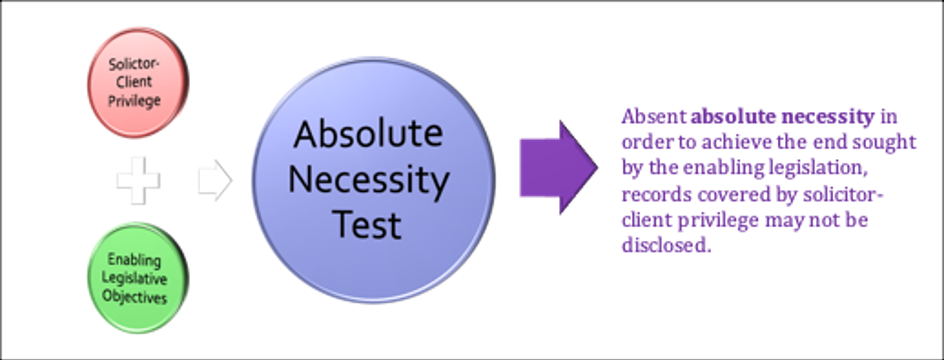

#  Module 8:  Ethics, Advocacy & Criminal Law

<!-- 
**Commentary**
 -->

<!--  -->

In this Module we return to the topic of advocacy but in a somewhat different context.  

Advocacy is of course central to a lawyer’s professional role.  As we have reviewed there are several **general ethical and professional obligations** that attach to an advocate for a client.  These obligations apply broadly for lawyers.  

In the **criminal law context**, however, advocacy takes on even more duties and obligations due to the greater stakes involved for a lawyer’s client:  generally the client’s personal freedom is at stake.  The entire legal power of the state may be deployed against a lawyer’s client.  Therefore, there are **special ethical duties and professional obligations** relating to advocacy for both criminal **defence lawyers and crown prosecutors**.

!!! note "Readings"

    - **Articles:**
        - Babcock, “Defending the Guilty” 
        - Scott, “An Inconvenient Bargain:  The Ethical Implications of Plea Bargaining in Canada”
    - **Code:** 5.1-1, commentaries 9 and 10; 5.1-2, 5.1-3, 5.1-7, 5.1-8
    - **Cases:**
        - ***R v Boucher***, [1955] S.C.R. 16
        - ***R v Johnson***, 2014 ONSC 2093
        - ***R v Legebokoff***, 2016 BCCA 386
        - ***R v Jenkins***, (2001), 152 CCC (3d) 426 (Ont Sup Ct)
        - ***R v Mills***, [1993] 3 S.C.R. 668
        - ***R v Delisle***, (1999), 133 CCC (3d) 541 (Que CA)
        - ***Krieger v Law Society of Alberta***, 2002 SCC 65
        - ***R v Anderson***, 2014 SCC 41
        - ***R v K(M)***, [1992] M.J. No. 334, 74 C.C.C. (3d) (Man. C.A.)
        - ***R v Nixon***, 2011 SCC 34
        - ***R v Hillis***, 2016 ONSC 451
        - ***R v Levert***, [2001] O.J. No. 3907, 159 C.C.C. (3d) 71 (Ont. C.A.)

## 8.1: Historical Context & Cases

Before we examine the modern era of ethics and criminal law, it is helpful to have some historical context.  Two cases can help illustrate the evolution of criminal law ethics: ***Queen Caroline's Case*** & ***R v Boucher***.

***Queen Caroline’s case***

The first is an English case involving legal proceedings brought in 1820 by King George IV against his estranged wife, Queen Caroline.  

A bill called the “Pains and Penalties Bill” was introduced in Parliament by the King to dissolve his marriage to Caroline and remove her royal title and privileges.  The 1820 trial of Queen Caroline involved evidence of semi-public nudity in a hotel suite by a member of the royal family traveling abroad.  It was the subject of intense discussion in both parliament and broader British society. For the first time the British media extensively covered legal proceedings containing salacious details involving the behaviour of the British monarchy.  Witnesses supporting the King’s motion presented evidence that the Queen had been seen in the arms of her Italian lover in various states of undress during her travels and that they bathed together. One of the Queen Caroline’s Italian servants testified before the House of Lords that the Queen employed a male exotic dancer and demonstrated aspects of the dance before the assembled peers.

Queen Caroline’s lawyer, Lord Henry Brougham, responded to accusations against the Queen by threatening to reveal secrets about George IV’s personal life that would damage the monarchy.  The accusations leveled against the King and Queen during the proceedings had the potential of undermining the reputation of the British monarchy.  If Brougham were to introduce the evidence in defence of his client, the Queen, it would have had the potential to throw the British monarchy into chaos.  It was suggested to Brougham that his duty as a “good citizen” required him to promote the welfare of Britain and “pull his punches” by not asserting the right of recrimination against the King. Brougham responded with a now infamous speech which asserted that the **zealous defence of his client is, essentially, all that matters.**

This case established the **"Rule in Queen Caroline’s case."** 

This is a common-law principle in criminal law that requires a cross-examiner to confront a witness with the contents of a prior inconsistent statement before the introduction of extrinsic evidence. The witness must be confronted with the time, place, persons present and the substance of an impeaching statement before extrinsic evidence could be admitted as proof that the statement had been made.

The rule was laid down in the ***Queen Caroline's Case***, (citation: 2 Br. & B. 284, 129 Eng. Rep. 976 (1820)) which states:

> If it be intended to bring the credit of a witness into question by proof of anything he may have said or declared touching the cause, the **witness is first asked,** upon cross-examination, **whether or not he has said or declared that which is intended to be proved.**

!!! info "***Boucher v. The Queen***, [1954 CanLII 3 (SCC)](https://canlii.ca/t/1nlk7){:target="_blank"}"

    This case involves Boucher, who was charged with murder, but our concern here is with the closing address of crown prosecutor. 

    One of the most quoted statements from ***Boucher*** on the **proper role of Crown counsel in criminal proceedings** is from pp 23-24 of the decision:

    > It cannot be over-emphasized that the** purpose of a criminal prosecution is not to obtain a conviction**, it is to lay before a jury what the Crown considers to be credible evidence relevant to what is alleged to be a crime. Counsel have a duty to see that all available legal proof of the facts is presented: it should be done firmly and pressed to its legitimate strength but it must also be done fairly. **The role of prosecutor excludes any notion 'of winning or losing**; his function is a matter of public duty than which in civil life there can be none charged with greater personal responsibility. It is to be efficiently performed with an ingrained sense of the dignity, the seriousness and the justness of judicial proceedings.”

## 8.2: B.C. Code & Advocacy in Criminal Law

**Rule 5.1** in general relates to the lawyer as advocate in adversarial proceedings.  Many of the sub-sections of the rule pertain to criminal law and specifically the duty of criminal lawyers relating defence and prosecution.

*R v Johnson* 2014 ONSC 2093 (cited as ***R. v. Cameron***, [2014 ONSC 2093](https://canlii.ca/t/g6v8z){:target="_blank"}) involved an applicant trying to strike his guilty plea.  The accused’s lawyer entered a guilty plea of trafficking cocaine and assault.  Key points here are:

- After plea was entered, Crown prosecutor read in the facts of the case. Defense counsel confirmed the accuracy of facts.
- The accused person here, Johnson, said he never told his lawyer that he was guilty to the charges, and that he actually insisted to his lawyer that he was NOT guilty and wanted to go to trial. Apparently the lawyer thought that Johnson’s chances at trial were not good, and Johnson said that his lawyer advised him to just say “YES” to the guilty plea as read by the Judge. 
- Johnson then said he lied to court during pre-inquiry questioning because he was just following his lawyer’s instructions. He maintained his innocence and said he wanted to go to trial.

!!! info "***R. v. Cameron***, [2014 ONSC 2093](https://canlii.ca/t/g6v8z){:target="_blank"}"

    The **issue** here became whether Johnson’s **guilty plea was voluntarily given** to his lawyer and accurately reflected his understanding of the facts of the case. Another **issue** involved whether Johnson’s lawyer **properly advised** him about the **implications** and possible **consequences** of the guilty plea.

    Defense counsel stated that he never conducted a “plea comprehension inquiry” with Johnson prior to his guilty plea, the inquiry is supposed to clarify with the accused that they are pleading guilty and consequences resulting from that.

    The problem though is that the Judge directly asked defense counsel if he’d had an opportunity to discuss the guilty plea with Johnson and counsel clearly said that he did discuss it, also confirming that the facts were correct, the same facts that Johnson was now disputing too.

    **The court concluded that Johnson didn’t voluntarily enter his guilty plea,** and was satisfied on balance of probabilities that he didn’t believe that he was guilty at any time.
    
    Court went on to say there was a “fraud” perpetrated on the court, and defense counsel was most responsible for this. Although Johnson was the one who plead guilty and lied to the court, the court said that **defense counsel could not represent a client entering a guilty plea if that client doesn’t admit that they committed the offense.**  If that happens, the court said a fraud is done to the court, leading to a miscarriage of justice.  They cited the Ontario Court rules, similar to the BC rules, which we just reviewed.  Basically lawyers cannot assist in a client’s dishonesty.

    Court was harshly critical of defense counsel...they didn’t meet their professional obligations to court, breached duties to client and court in several ways...all flowing from the inappropriate guilty plea when the client was actually still maintaining his innocence. They were all serious breaches of counsel’s ethical obligations.

Interesting question to this case that I want you to consider: what if you believe that the evidence is so overwhelming that a client couldn’t credibly maintain their innocence?

MISLEADING THE COURT

!!! info "***R. v. Legebokoff***, [2016 BCCA 386](https://canlii.ca/t/gttjs){:target="_blank"}"

    Appeal from conviction on four counts of first degree murder.  After the trial concluded, the trial judge expressed criticisms concerning the manner in which defence counsel had conducted a pre-trial change-of-venue application. L. submitted that this amounted to a miscarriage of justice.  L.’s position was that the judge had a duty to immediately disclose his views and that the delay in doing so created an appearance of unfairness.  L. did not allege any errors with respect to the conduct of the trial and conceded the evidence against him was overwhelming. 
    
    In opposing the appeal, the Crown submitted that the judge’s criticisms were unfounded.  
    
    **Held:  Appeal dismissed.**  The judge was not under a duty to immediately disclose his views, which in this case were unfounded.  In the circumstances, a well-informed reasonable person’s confidence in the administration of justice would not be shaken by the delayed disclosure.

